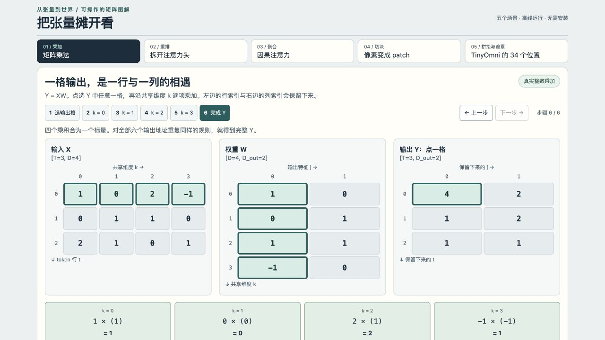

# 从张量到世界

中文技术书与 TinyOmni 实训工程，张量块图解修订版，2026-10-26。

## 先看张量怎样计算

本版按“一个输出格读取了哪些输入格”重写图解，保留完整理论和逐章实训：从矩阵乘加、reshape/transpose、多头、注意力，到MoE路由、MLA低秩计算、图像patch、音频分帧和多模态拼接。

[打开逐格交互演示源码](interactive/tensor-lab.html)：下载仓库后双击这个HTML文件，用浏览器离线运行，无需Python或网络。可以点选矩阵输出格、逐项乘加、追踪拆头索引、展开因果注意力，并切换TinyOmni缺失模态的mask。也可在项目根目录执行 `python -m http.server 8766 --bind 127.0.0.1`，浏览器访问 `http://127.0.0.1:8766/interactive/tensor-lab.html`。



本版PDF共168页，正文含50幅插图，其中31幅为新增张量格子图。交互演示包含5个场景、24个步骤。

## 先打开书

- [PDF 书稿](output/pdf/从张量到世界.pdf)：含可点击目录、张量块图解与资料链接。
- [离线阅读版 HTML](从张量到世界.html)：下载后用浏览器打开，插图已内嵌。
- [完整书稿与训练工程 ZIP](output/从张量到世界-书稿与实训.zip)：包含源码、插图、实验记录和已训练权重。
- [在线阅读 Markdown](book.md)：合并后的完整正文；分章原稿在`chapters/`，实训讲义在`labs/`。

内容覆盖张量、Transformer、GPT-2、预训练与推理、现代解码器、DeepSeek MoE/MLA/R1、VLM、全模态GPT-4o、VLA，以及从零训练的TinyOmni项目。

## RTX 3090 / 24 GB 的实践起点

建议用Python 3.12在这个目录中创建虚拟环境。按 [PyTorch官方安装选择器](https://pytorch.org/get-started/locally/) 安装适合操作系统与驱动的当前CUDA版PyTorch，然后：

```bash
python -m pip install -r tinyomni/requirements.txt
python -c "import torch,numpy as np; print(torch.from_numpy(np.zeros(1)).numpy()); print('CUDA:',torch.cuda.is_available())"
python -m tinyomni.tests
python -m tinyomni.train --tasks text,image,audio,video,mixed --steps 1000 --batch-size 32 --device cuda --out runs/my-first-omni
```

完整接口、恢复训练与部署见`tinyomni/README.md`及书中第17章。`--steps`是累计训练步数。模型很小，第一阶段不需要租卡。

上面的探针同时检查NumPy与PyTorch互转；若出现`_ARRAY_API`或`Numpy is not available`，先安装相互兼容的当前官方PyTorch与NumPy版本，再训练。依赖文件的宽版本范围不表示每种历史组合都经过测试。

每章实验的命令就在对应章节末尾。第01-11章也可统一运行：

```bash
python -m tinyomni.lab --chapter 3 --steps 300 --out runs/my-attention
python -m tinyomni.lab --chapter 3 --load runs/my-attention/model.pt --predict
```

## 已经跑过的内容

随书保留真实训练产物，不是虚构示例输出：

- `runs/ch01`至`runs/ch11`：11个机制实验，各训练300步，并通过参数更新与检查点重载检查。
- `runs/tinyomni-final/checkpoint.pt`：352,281参数的TinyOmni，从随机初始化训练1000步，batch32，seed42。
- `runs/tinyomni-final/metrics.json`：逐步loss、最终独立随机流验证，以及图像/音频消融；旧验证结果另存历史字段。
- `runs/tinyomni-final/demo-*`：加载实际检查点得到的图像、音频、文字与对照材料。
- `code/verification.json`：NumPy矩阵与KV缓存数值检查。

这些训练和测试实际在Apple平台CPU上执行。CUDA路径与3090配置已提供，但没有伪称已测GPU耗时或显存峰值。训练环境版本记录在`validation-report.json`。

## 直接试一下已训练的模型

```bash
python -m tinyomni.custom_infer --checkpoint runs/tinyomni-final/checkpoint.pt --text "blue square left" --device cpu --out runs/my-demo
python -m tinyomni.serve --checkpoint runs/tinyomni-final/checkpoint.pt --device cpu --port 8765
```

第一条命令写出真实预测的PNG、WAV与文字。第二条启动仅监听本机的接口；`GET /health`检查服务，`POST /infer`接受JSON `{"task":"image","seed":90001}`。HTTP入口按seed产生合成条件；显式图片或音频文件入口在`custom_infer`中，格式见附录A。

TinyOmni的世界只有3种颜色、3种形状、2种方向。图像16×16，音频256个合成采样，文字是受控属性token。它能学习跨模态条件与生成，**不具备自然语音对话、自由文字聊天或真实照片生成能力**。所有动作都是数组示例，不控制实体机器人。将项目扩展到真实图像和自然语音的路线在第17章单独讨论。

## 书稿构建

阅读与训练不需要构建工具。若要重新排版，需要Python的`reportlab`、`pypdf`和Pillow，以及Node的`marked`。`build_figures.py`、`build_pdf.py`默认使用macOS的Arial Unicode与Menlo字体；在Linux/Windows重新构建时应把字体路径改为可用的中文字体与等宽字体。训练代码没有这些字体依赖。

```bash
python -m pip install reportlab pypdf Pillow
npm install marked
python build_figures.py
node build_reader.mjs
python build_pdf.py
```

源图由程序绘制，数值图从实际训练记录读取。张量运算图分别位于 `tensor_figures_core.py`、`tensor_figures_language.py`、`tensor_figures_multimodal.py`。可执行 `python code/verify_tensor_walkthroughs.py` 和 `node code/verify_tensor_lab.mjs` 核对新增演示的数值与索引。若新增章节或改变训练结果，应重新构建并检查PDF版面。来源核验笔记在`research/`；读者需要的主要出处已嵌入正文与附录C。
