# 从张量到世界

## Transformer、语言模型与多模态智能

一本用矩阵、形状与数据流理解现代模型的技术书

**首版书稿 · 2026年10月23日**

## 写给读者

你已经知道神经网络由参数、激活函数和损失组成，也写过程序，可能还训练过一个分类器。接下来最容易遇到的障碍，往往不是更高深的微积分，而是论文把很多操作压进一个符号：一行 attention，到底在混合哪些东西？一个 token 究竟是什么？数千亿参数为什么不必对每个词全部计算？一张图片怎样和一段文字一起进入模型？机器人输出的“动作”，又如何变成真实世界的一次移动？

这本书选择沿着数据旅行。我们先跟踪一个整数如何成为向量，再跟踪一排向量如何交换信息。等这些操作能够逐项检查，就把它们堆成 GPT-2。然后改变位置编码、前馈层、缓存结构和训练目标，进入现代语言模型。最后，我们把同一套分析方法带到图像、声音、视频与动作。

你会经常看到这样的表达：`[B,T,D] → [B,H,T,d_h]`。它不是装饰，而是一本“货运单”：B 表示同批多少个样本，T 表示多少个位置，D 表示每个位置带多少个数。读懂一段网络，首先要知道货物有没有变、位置有没有交换、信息从哪里来。许多看起来神秘的结构，在这张单据写清楚以后就可以直接实现。

本书尽量不使用微分方程。训练只需要理解梯度作为“让损失局部下降的参数调整信号”；涉及连续动作生成时，也用有限步更新和几何图解说明。我们不会为了避免符号而回避技术：归一化的轴、损失的分母、注意力的掩码、缓存的字节数，都必须写清楚。

全书的蓝色表示表示向量或激活，青绿色表示变换与混合，橙色表示预测、路由或动作；灰色表示暂时不可访问的位置。所有示意图均为本书重绘。用于解释的矩阵是人为构造的教学数据，不是从真实模型导出的注意力或评测结果。实际架构事实在相邻段落或各章资料中给出来源。

## 这本书承诺什么

阅读完毕后，你应当能够拿起一份 Transformer 实现，逐层解释张量形状；算出一个小型 GPT 的主要参数和 KV 缓存预算；说明 MoE 和 MLA 分别解决了什么问题；读懂 VLM 中视觉 token 到语言空间的接口；指出一个全模态系统哪些能力来自模型，哪些来自产品编排；为一个 VLA 定义观测、动作、训练样本与评测方案。

我们不会把“能预测下一个 token”当作所有能力的完整解释。它是训练目标的描述，不等于对模型内部算法、推理可靠性或世界理解的证明。同样，一张热力图不是因果解释，一个排行榜数字也不是模型在你项目中的成功保证。本书会反复区分能计算的事实、实验支持的结论和仍然开放的问题。

GPT-2 是完整、紧凑而可核验的学习标本。DeepSeek 部分固定讨论 V2、V3 和 R1 的公开技术路线，不以“最新版本”包装历史模型。GPT-4o 用来说明全模态建模与公开证据的边界；未披露的层数、参数量和内部模块，不会被通用示意图替代成事实。资料核对日期是2026年10月23日，模型版本与论文年份分别标注。

## 阅读路径与全书地图

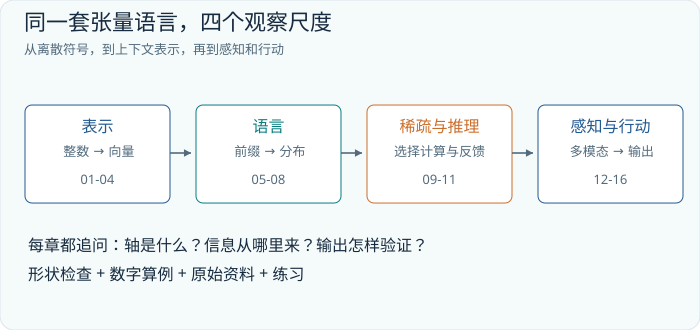

| 部分 | 章节 | 读完后应能回答的问题 |
| --- | --- | --- |
| 表示与计算 | 01-04 | 一个 Transformer 层究竟做了什么？ |
| 语言模型 | 05-08 | GPT-2 如何训练、生成并演化为现代解码器？ |
| 稀疏与推理 | 09-11 | DeepSeek 如何组织专家、压缩缓存和训练推理？ |
| 感知与行动 | 12-16 | 图像、音频和动作如何进入共同的建模框架？ |
| 从零训练项目 | 17与逐章实训 | 如何训练、保存、部署文字图像声音共享的小模型？ |
| 实验与查阅 | 附录A-C | 如何检查实现、定位错误与查找术语？ |

第一次阅读，建议按顺序读到第07章。随后可以沿第08-11章继续追踪语言模型，也可以从第12章开始进入多模态。每章末尾都有练习和答案要点。请先遮住答案，用纸写出形状，再做数字计算。读懂一个图的标准不是能复述图名，而是能够回答：删除这条箭头，哪些信息就不再可用？

## 统一符号

| 符号 | 含义 | 典型用法 |
| --- | --- | --- |
| B | 批量大小 | 一次并行处理的样本数 |
| T | 序列长度 | 文本位置数，含有效 token 与可能的填充 |
| D | 模型宽度 | 残差流中每个位置的通道数 |
| H、d_h | 查询头数、每头维度 | 普通多头注意力中常有 D=H×d_h |
| H_kv | 键值头数 | MHA中等于H，GQA中小于H |
| V | 词表大小 | 出现在形状[V,D]时表示整数 |
| V_mat | value矩阵 | 注意力公式中避免与词表大小混淆 |
| L、F | 层数、前馈中间宽度 | 参数与显存预算中的常用量 |
| N、K、A | 视觉token数、动作块长度、动作维数 | 语境变化时会重新定义 |

本书使用行向量约定：输入 `X[T,D]` 从右侧乘权重 `W[D,F]`，得到 `Y[T,F]`。一些框架把线性层权重保存为 `[F,D]`，前向时实际乘其转置；这只是存储约定不同。`@` 表示矩阵乘法，`*` 在代码中表示逐元素乘法，`⊙` 在说明中也表示逐元素乘法。形状中的逗号分隔轴，不是乘号。

本书已把“训练一个非常小的全模态模型”设为实践主线，默认面向RTX 3090的24 GB显存。前11章各有训练、保存和加载的小实验，第12至16章逐步引入TinyOmni的模态，第17章汇合成完整项目。NumPy算例检查数学，PyTorch实训真正更新参数。TinyOmni学习的是有限合成世界中的文字、彩色形状、合成音调和短视频，不具备自然语音对话或开放世界图像理解能力；后续扩展需要明确的新数据与编码方案。所有动作输出仅为数组示例，没有执行机器人动作。


---

# 第01章 把神经网络看成张量程序

## 01.1 从一个向量到一张带轴的表

设想你要向同伴描述三件物品，每件物品用四个数表示。把它们写成三行，便得到一个 `[3,4]` 矩阵。行回答“是哪件物品”，列回答“用哪个特征坐标描述它”。在神经网络中，这四个坐标通常不是人为命名的颜色、重量、温度和价格，而是训练形成的一组表示方向。我们仍然可以明确区分物品轴与特征轴。

现在一次处理两组这样的物品，就得到 `[2,3,4]`。增加的第一根轴不是更高深的几何空间，而是“第几组”的索引。本书把它写为 `[B,T,D]`：两组样本，每组三个位置，每个位置四个通道。张量是带若干根索引轴的数组；读张量时先给每根轴命名，再问数值表示什么。

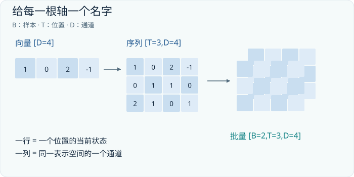

同样的 `[2,3,4]` 也可以表示两张三乘四的灰度图，所以形状本身不够。必须同时知道轴的语义。计算机不会阻止你把时间轴误当颜色轴；很多模型错误能够合法运行，正是因为数组长度恰好兼容。形状检查只是第一道门，语义检查是第二道门。

以一句话为例，T 个位置分别表示 T 个 token。D 个通道共同描述一个位置的当前状态。最初它们来自词嵌入，经过多层网络后，同一位置的向量会携带上下文。这里的“当前位置”是稳定的地址，“表示内容”则持续变化。后面看到残差流时，请保持这个区分：一行向量不是一张永远不变的词卡。

## 01.2 线性层到底混合什么

考虑一个位置的四维行向量与一个四行两列的权重矩阵：

```text
x = [1, 0, 2, -1]       shape [4]

W = [[ 1, 0],
     [ 0, 1],
     [ 1, 1],
     [-1, 0]]          shape [4,2]

x @ W = [1+2+1, 0+2] = [4,2]
```

输出的第一个通道从输入的第1、3、4个通道收集信息，第二个通道从第2、3个通道收集信息。权重描述收集比例。这种变换混合的是通道，不是不同 token。若 X 有三个位置，`X @ W` 会对三行分别使用同一个 W；输出仍有三行。三行之间没有在这个操作里交换信息。

再加上偏置 `b[2]`，同一个 b 被加到每一行。这叫广播。广播不意味着模型悄悄为每个位置学习了独立偏置，它只是把同一组数重复用于多个位置。位置之间共享参数是模型能处理不同内容与长度的重要原因之一。

| 操作 | 输入与输出 | 被混合的轴 |
| --- | --- | --- |
| X @ W | [B,T,D] → [B,T,F] | 通道D |
| A @ X | [B,T,T] 与 [B,T,D] → [B,T,D] | 位置T |
| X + b | [B,T,D] 与 [D] → [B,T,D] | 不混合，逐元素相加 |
| mean(X,最后一轴,keepdims=True) | [B,T,D] → [B,T,1] | 对通道汇总 |

第二行已经提前揭示注意力的骨架。A 的每一行规定一个输出位置应如何汇总输入位置。把通道混合和位置混合分开，整部书就有了两个基本动作。注意力主要负责让位置之间交换信息，前馈网络主要负责对各位置的通道进行非线性加工；两者交替出现，使已经交换来的信息能够被重新计算。

## 01.3 reshape不会自动完成transpose

一个数组可以换一种“装箱方式”，但改变箱子的标签与真正调换内容并不相同。假设长度为8的一行，被分成两个头，每头4个数。`reshape` 可以把 `[8]` 解释为 `[2,4]`，通常不改变元素的线性顺序。`transpose` 或 `permute` 则交换轴，让原本连续或相隔的位置按照另一组索引访问。

在多头注意力中，常见流程是：

```text
Q: [B,T,D]
reshape: [B,T,H,d_h]    D = H*d_h
transpose axes 1,2:
Q_heads: [B,H,T,d_h]
```

为什么不直接 reshape 为 `[B,H,T,d_h]`？因为原数组按每个 token 存放所有通道。直接改形状，会把“下一个 token 的通道”误分配成“同一个头的下一个位置”，具体错误取决于尺寸和内存顺序。我们想要的是先将每个 token 的 D 个通道分头，再把头轴移到时间轴之前。

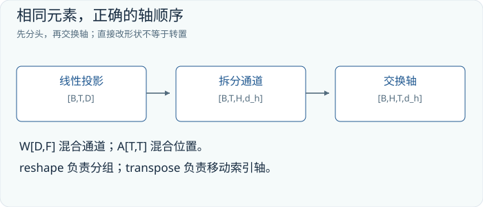

这也解释了一个工程细节：转置后的张量可能只是另一种内存视图，不一定连续。一些框架的 `view` 要求连续布局，`reshape` 则可能在必要时复制。算法层面的形状与硬件层面的存储布局相关，但并不等价。理解模型时先把索引关系写对，优化时再考虑数据是否需要搬运。

## 01.4 softmax是一行内部的重新分配

softmax 把一组分数转成非负、总和为1的权重。设分数为 `[2,1,0]`，先减去最大值2，再取指数并归一化：

```text
scores - max = [0, -1, -2]
exp          = [1, 0.3679, 0.1353]
sum          = 1.5032
weights      = [0.6652, 0.2447, 0.0900]
```

减最大值不会改变结果，因为所有项同时乘了相同的缩放因子，却能避免大正数的指数溢出。它不是额外的机器学习技巧，而是同一个数学表达的稳定算法。

最关键的问题是“沿哪根轴归一化”。语言模型输出 `[B,T,V]` 时，softmax 通常沿词表 V 归一化，表示每个位置对候选 token 的分布。注意力分数 `[B,H,T_q,T_k]` 则沿键位置 T_k 归一化，表示每个查询该从哪些位置读取。两处都叫 softmax，却回答不同问题。将 softmax 加在错误的轴上，数值看起来依然漂亮，每行也可能出现概率，但信息流已经变了。

softmax 不是事实验证器。0.9表示模型在当前候选集合和参数下给某个选项较大的相对权重；它不自动等于“这个答案在现实世界中90%正确”。概率的校准需要额外评测。注意力权重中的0.9更不是答案正确率，它只是一次内部汇总的比例。

## 01.5 参数、激活与缓存是三笔不同的账

权重 W 在不同输入之间复用，属于参数；X 随输入改变，属于激活；生成过程中为了不重复计算而保留的历史键和值，属于缓存。三者都占内存，但生命周期与规模增长方式不同。

一个 `[4096,4096]` 权重矩阵有16,777,216个参数。若每个数用2字节保存，权重本身占32 MiB。这里 MiB 使用1024的二次幂，与十进制 MB 不同。输入长度从1024翻倍到2048，不会让这个矩阵的参数数目翻倍；但对应激活会增长，普通注意力分数矩阵甚至随长度平方增长。

训练时还要保存反向传播所需的信息、梯度和优化器状态，可能存在高精度主权重；因此不能把“参数量×2字节”当成训练显存。推理时也有临时工作区、缓存、量化元数据和调度开销。后面会给出更具体预算，此刻先建立分类习惯：每看到一个大数，都问它数的是参数、一次计算还是存活中的数据。

计算量与参数量也不同。一个矩阵可以只存一份，却被大量 token 反复乘。反过来，MoE 可以保存许多专家参数，而一次只访问其中一部分。不了解这一区别，就很容易把“大模型能在某机器上运行”误解成“所有请求都很快”。

## 01.6 把“懂了”变成可检查的预测

读网络图时，建议做三件事。第一，在每条箭头旁写形状。第二，写出每个变换混合的是哪根轴。第三，设一个极端输入检验直觉：如果所有 token 向量相同，去掉位置编码的模型能否知道谁在第一位？如果注意力一整行被屏蔽，softmax会发生什么？如果增加批量大小，哪些权重会变化？

这些问题不需要求导，却能暴露许多根本误解。形状相同并不代表功能相同，参数多也不代表每一步都计算得多。我们真正要训练的是阅读张量程序的能力：在数值尚未得到时，先预测这个程序能够依赖哪些信息、不能依赖哪些信息。

## 01.7 练习与答案要点

**练习1。** X为`[4,10,32]`，W为`[32,48]`，b为`[48]`。输出形状、参数数目分别是多少？如果T从10变为20，哪项改变？

**答案。** 输出`[4,10,48]`；参数为32×48+48=1584。T改变时输出位置数和计算量改变，参数数目不变。

**练习2。** Q为`[2,3,5,8]`，最后两轴分别是查询位置和头内通道；K为同形状。Q乘K最后两轴的转置，结果是什么形状？softmax应沿哪一轴？

**答案。** 得到`[2,3,5,5]`，最后一轴是键位置，应沿最后一轴归一化。不能把头轴与键轴混为一谈。

**练习3。** 一个输出分布的logits全部加100，概率会改变吗？所有logits乘2呢？

**答案。** 全部加相同常数不变；乘2通常使分布更尖锐，相当于降低温度，除非所有分数相同等特殊情形。

**延伸资料。** 框架对批量矩阵乘法的广播与转置规则可查[PyTorch矩阵乘法文档](https://docs.pytorch.org/docs/stable/generated/torch.matmul.html)。本章数值算例由本书构造，附录A提供可重复计算。


## 本章实验：让二维投影矩阵真正学会一项变换

第一个实验不从大模型开始，而是训练一张小矩阵和一个偏置。数据生成器提供二维输入 x，以及由固定仿射变换产生的目标 y；训练程序只能看到成对样本，不能直接把目标矩阵复制为参数。模型计算 `y_hat=xW+b`，以预测与目标的逐元素均方误差为损失，反向传播更新 W 与 b。每次训练都要经历取样、前向、计算损失、清空旧梯度、反向和优化器更新，因而这是实质学习，不是观察一张随机矩阵的输出。

在项目根目录、已安装依赖的环境中运行：

```bash
python -m tinyomni.lab --chapter 01 --steps 100 --out runs/ch01
python -m tinyomni.lab --chapter 01 --load runs/ch01/model.pt --predict
```

第一条命令训练并保存参数，第二条在新的推理过程加载 `model.pt`，对实验生成的输入进行预测。命令是读者可以执行的操作说明，是否达到验收要求应以本次输出为准。保存的不是预测答案表，而是学到的参数及恢复实验所需的配置；因此换一组输入，加载后的模型仍应能计算输出。

训练时沿着 shape 检查：输入的最后一维是 2，投影前后保留批次轴，损失则把有效样本和输出分量归约为标量。不要把批次轴放进可学习矩阵，也不要把 `detach` 后的预测拿来计算训练损失，否则看似相同的数字运算将无法把梯度传回 W。

成功标准有三层：损失相对初始化明显下降；未用于更新的输入也获得较小误差；保存后重新加载，对同一输入的预测在浮点容差内一致。只达到第一层，可能只是记住了有限训练点；只比较文件是否存在，也不能证明加载成功。记录初始误差、结束误差和独立输入误差，才能把“程序运行完了”与“学到了变换”区分开。

若损失不降，先检查 x、y 是否配对、目标是否与模型形式相容、W 是否加入优化器；若训练误差低而新输入误差大，检查训练输入是否覆盖两个方向。所有输入都落在同一直线上时，数据无法确定整个二维变换，继续增加相同方向的样本也解决不了这个可辨识性问题。


---

# 第02章 文字怎样成为可以计算的序列

## 02.1 预测的对象不是“一个汉字”

当我们说语言模型预测下一个词时，这是一种便于交流的说法。模型实际处理的是token：由分词器定义的离散单位。一个token可以对应常见词、词的一部分、标点、空格模式，也可能对应字节片段。相同的字符串交给不同分词器，可能得到不同长度的整数序列。文本长度、字符数和token数因此不能互换。

为什么不直接用所有词作为词表？因为语言不断产生新词、人名、代码标识符和拼写变体。若每一个完整词都要独立编号，词表会膨胀，而且总会遇到词表外的输入。为什么不直接用每个字节？这能表示广泛的字符串，但常见词会被拆得很长，模型需要更多位置才能处理同样的内容。子词方法在两者之间做折中：常见片段用较短序列表示，罕见片段退回更细单位。

这里必须分清两个训练过程。训练分词器，是从语料统计或优化出如何切分以及有哪些离散符号；训练语言模型，是在已经固定的离散符号上学习预测分布。分词器通常不会在每次聊天时随着模型权重一起改变。即使模型能通过上下文理解一个新词，它也可能仍用多个既有token表示这个词。

## 02.2 一个手工可算的BPE练习

假设教学语料只有三种字符串：`low`出现3次，`lower`出现2次，`new`出现1次。先按字符拆开，并把词边界当作不可跨越边界。`l o`和`o w`各出现5次，`w e`和`e r`各出现2次。选择最高频的一对合并，遇到并列时按预先固定的规则选择。假设先合并`l o`，就得到新符号`lo`。

```text
初始： l o w      ×3
       l o w e r  ×2
       n e w      ×1

第一次合并 l+o：
       lo w      ×3
       lo w e r  ×2
       n e w     ×1

第二次合并 lo+w：
       low       ×3
       low e r   ×2
       n e w     ×1
```

BPE的核心是反复用新符号替代高频相邻符号对。实际系统还要定义预切分、边界规则、初始符号集合以及合并优先级。GPT-2使用字节层面的BPE实现，这不等于“每个token恰好一个字节”；它可以将多个字节合并成一个token。我们的字符示例只用来展示合并机制，不是GPT-2真实词表或精确切分结果。子词BPE的原始研究见[Sennrich等人的论文](https://aclanthology.org/P16-1162/)，GPT-2具体实现见[官方encoder.py](https://github.com/openai/gpt-2/blob/master/src/encoder.py)。

分词器的一个工程后果是：人类看来相似的文本，可能有不同计算成本。中文、英文、数学符号、代码、异常空格和罕见Unicode字符，压缩成token的效率不一定相同。评估模型的上下文容量时，要使用目标模型的实际分词器。仅凭“多少汉字”估算，很容易在长文档任务中失准。

## 02.3 token编号没有语义距离

假设教学词表把“猫”编号为7，把“狗”编号为8，把“跑”编号为400。7和8相邻并不意味着猫狗语义近，400也不代表“跑”比“猫”大57倍。编号只是地址。模型先查嵌入表E，把每个整数映射成D个可学习的数。

```text
token_ids: [B,T]       整数
E:         [V,D]       可学习参数
X = E[token_ids]
X:         [B,T,D]     浮点表示
```

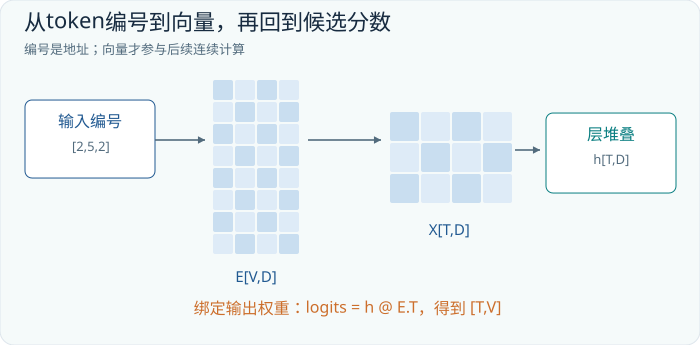

如果V=8、D=4，那么嵌入表只是8行4列的小矩阵。输入编号`[2,5,2]`，就取索引2、5、2的行（索引从0开始）。因此第一个位置和第三个位置在加入位置与上下文之前得到相同向量。查表等价于让one-hot向量乘E，但实现时不必真的构造含有大量零的one-hot矩阵。

这个等价关系很有价值：嵌入并非无法解释的特殊算子，它是一个利用稀疏输入实现的线性选择。训练会改变E中的数，使它们有利于后面的预测任务。单个坐标一般没有稳定的人工语义，整体方向、组合关系与下游使用方式比“第17维是否代表动物”更重要。

## 02.4 相同词形，为什么能有不同含义

“苹果放在桌上”和“苹果发布了新产品”中，“苹果”可能得到相同的初始嵌入；经过上下文计算后，它所在位置的隐藏状态可以不同。初始嵌入描述的是离散符号的共享起点，隐藏状态则描述这个位置在当前上下文中的角色。

可以把嵌入看成一张基础材料清单，而不是已经完成的语义答案。后续层通过读取“桌上”“发布”等上下文，把材料加工成与当前句子相关的表示。对于因果语言模型，只能利用该位置之前和当前位置的信息；若消歧线索在未来，则当前隐藏状态不能偷看它。这也是双向编码器与自回归解码器的关键差异之一。

这一区别还能解释为什么词向量可视化经常令人过度兴奋。二维投影可以展示某些聚类，但D维空间压到二维会丢信息；一个静态嵌入也无法代表全部语境行为。真正要判断一个位置表示了什么，必须考虑它属于哪一层、可访问什么上下文以及被哪一个任务使用。

## 02.5 顺序必须进入计算

如果只把词嵌入交给一个完全不含位置信号、且全可见的自注意力网络，调换输入顺序将对应调换输出行；网络缺少可靠区分“猫追狗”和“狗追猫”的顺序坐标。这叫置换等变性。它不是说两句话输出向量完全相同，而是说行的重排会导致对应的行重排，结构本身没有给位置赋予独立意义。

一种直接方法是给每个位置准备一个D维位置向量P，并逐元素相加：

```text
X[b,t,:] = E[token_ids[b,t],:] + P[t,:]
```

相加要求二者维度相同。它不把宽度从D变成2D，也不新建一个token。模型必须从混合后的表示中使用内容与位置线索。GPT-2采用可学习的绝对位置嵌入；其他结构会使用固定正弦位置编码或把旋转加入查询和键。第08章会详细讨论RoPE。不同方法不能简单当成同一个“位置矩阵”的不同配色。

因果掩码也会打破某些对称性，因为不同位置能看到的前缀长度不同，但它不是完整位置表示的简单替代。它告诉模型哪些位置可以读取，并不直接提供任意两点间的精细相对距离。顺序信息的来源必须按实际架构检查。

## 02.6 从隐藏状态回到词表

经过网络后，每个位置有一个D维向量h。模型用输出投影把它变为V个分数：

```text
h:       [D]
W_out:   [D,V]
logits = h @ W_out      [V]
probs  = softmax(logits)
```

每个logit对应一个候选token的分数。若输入嵌入E与输出权重共享，就令`W_out=E.T`。这叫权重绑定。此时某个候选token的分数是h与它的嵌入向量的点积。它节省一整张词表投影矩阵，但不意味着输入与输出的功能完全相同：输入阶段取一行，输出阶段与所有行比较。

举一个只有四个候选token的例子。logits为`[2,1,0,-1]`，softmax约为`[0.644,0.237,0.087,0.032]`。模型可以选择最大值，也可以按这个分布采样。做出选择以后，新的token编号加入序列，再开始下一步。语言模型因此既是一个条件概率估计器，也可以被一个外部采样过程反复调用成为生成器。

这里没有一个矩阵一次性直接输出“完整思想”。当然，模型内部可以在向量中编码复杂中间信息，但可观察的文字生成接口通常仍是一系列条件选择。要研究模型的推理，既要观察生成轨迹，也要明确这种轨迹不是所有内部计算的逐字转录。

## 02.7 条件概率怎样组织一段文字

把序列写为a、b、c，则它的概率可以分解为：

```text
P(a,b,c) = P(a) * P(b | a) * P(c | a,b)
```

这个分解来自概率链式法则，并不依赖Transformer。Transformer的作用是用可训练的张量程序估计这些条件分布。它可以用在翻译、代码或问答中，因为任务说明和示例也可以写入条件前缀。但“都能写成条件预测”不代表各任务难度相同、数据需求相同或可靠性相同。

例如提示“将hello译成中文：”可以使下一token分布偏向中文翻译。模型是否真的学会翻译，取决于训练数据与能力，而不是冒号具有魔法。提示只是通过输入改变激活与后续分布，通常不会更新模型权重。这是上下文学习与参数学习之间最基本的边界。

## 02.8 练习与答案要点

**练习1。** V=10000、D=256的嵌入表有多少参数？输入从20个token变为40个token，表会变大吗？

**答案。** 2,560,000个参数；表不变，取出的激活行数翻倍。

**练习2。** 同一token在位置3和位置10是否必须有相同的第一层输入？最后一层状态是否必须相同？

**答案。** 若使用绝对位置相加，第一层输入一般不同；最后层还依赖可见上下文，更不必相同。即使初始输入相同，不同上下文也可产生不同隐藏状态。

**练习3。** 有人认为token编号较近，模型会天然认为语义较近。如何构造反例？

**答案。** 同时重排词表编号、嵌入行和输出列，保持编码解码映射一致，模型表达的分布可以完全不变。编号之间的数值距离不是语义来源。


## 本章实验：从零训练字符 bigram 语言模型

本实验训练一个只看前一个字符的语言模型。数据由八个符号组成周期，词表给每个符号分配 ID，输入是当前字符，target 是紧随其后的字符。一个可学习的 `[8,8]` 表把输入 ID 映射为下一字符 logits，交叉熵提高真实后继的概率。它没有长上下文、注意力和语义知识，正因为限制明确，读者能直接看懂“统计规律进入参数”这件事。

```bash
python -m tinyomni.lab --chapter 02 --steps 100 --out runs/ch02
python -m tinyomni.lab --chapter 02 --load runs/ch02/model.pt --predict
```

第一条命令在实验自带的小型字符数据上更新参数并保存 `model.pt`，第二条加载后生成或预测实验样例。整个词表及其顺序属于模型协议：即使两个词表包含相同字符，只要 ID 排列不同，权重表的行列含义就不同。部署应恢复保存的实验配置，不能临时按另一种顺序重新建立词表。

把训练样本看成许多小分类题：看到 a 后预测 b，看到 b 后预测下一个符号。前面的 a 是输入条件，后面的 b 才是评分目标；若输入与标签没有错开，模型会学成复制当前字符。生成时则取本次选出的字符作为下次输入，所以相同表可以形成任意长度的输出链，但每一步仍然只利用一个前驱字符。

验收先比较训练前后的独立样本负对数概率，再观察常见字符转移是否被学到。生成结果应符合局部规律，不能因为几个字符串得顺就宣称获得了句法理解。若同一个前驱在语料里有两个常见后继，模型应当保留概率分布；强求每次生成唯一答案，反而会误解语言建模任务。

若损失下降而生成看起来杂乱，检查语料是否本来就需要更长上下文。例如同一个字符在不同位置应接不同后继，bigram 无法辨别这些位置。若加载后出现陌生字符或整体错位，优先检查词表、特殊起止符和编码过程；不要先调温度来掩盖协议错误。最后用一个新起始字符反复预测，确认部署使用的是加载的参数，而非又创建了一张随机表。


---

# 第03章 注意力：一次可计算的内容检索

## 03.1 为什么每个位置需要读其他位置

上一章的嵌入和线性层都可以独立作用于每个位置。若模型永远只这样计算，“它”就无法根据前面出现的是猫还是机器人改变含义；一个函数调用也无法根据之前定义的变量得到解释。我们需要某种位置之间的信息交换，而且交换比例最好随输入内容变化。

最简单的方案是把所有位置取平均。这样每个输出都能知道整段文本的大致内容，却无法有选择地读取：当前处理一个代词与当前处理一个括号，可能需要不同的上下文。注意力用当前表示构造查询，再对其他位置的键打分，以分数决定从相应值向量中取多少信息。

“查询、键、值”的检索类比很有用，但不要把它理解成硬盘上固定的字典键。三个矩阵通常都由当前隐藏状态通过可学习投影获得。同一个位置既可以提出查询，也可以提供键和值；每一层都能重新计算这三种角色。

## 03.2 三个投影，以及一张关系矩阵

为看清计算，暂时忽略批量与多头，令X为`[T,D]`。定义：

```text
Q = X @ W_Q        [T,d_k]
K = X @ W_K        [T,d_k]
V_mat = X @ W_V    [T,d_v]

S = Q @ K.T / sqrt(d_k)    [T,T]
A = softmax(S, axis=keys)  [T,T]
O = A @ V_mat              [T,d_v]
```

Q、K的最后维度必须一致，才能点积；值向量宽度d_v则可以不同。S的第i行第j列，表示第i个查询对第j个键的匹配分数。A的第i行是在所有允许读取的位置上分配的权重。最后，第i行输出用这些权重对值向量做加权求和。

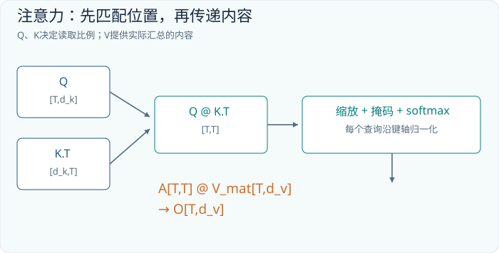

为什么需要分别学习Q与K，而不是直接用X与X的转置？因为“我想寻找什么”和“我能被如何找到”是两个角色。Q与K使用不同变换后，匹配可以不对称：位置i读取j较多，不要求j也同样读取i。一个动词需要找主语，与一个主语需要找修饰词，不必共享同一方向的匹配标准。

为什么还有V？匹配特征与传递内容也未必相同。你可以根据文件名找文档，却读取正文。网络中的键和值仍是连续向量，并不是人工规定的字段；这个分离只是给模型提供了灵活的计算结构。标准缩放点积与多头注意力的定义见[Transformer原论文](https://arxiv.org/abs/1706.03762)。下面的数字是本书独立构造的算例。

## 03.3 完整手算一个三位置注意力

设查询和键如下，数值仅用于演示：

```text
Q = K = [[1,0],
         [0,1],
         [1,1]]

V_mat = [[1,0],
         [0,2],
         [3,1]]
```

先计算未缩放的点积：

```text
Q @ K.T = [[1,0,1],
           [0,1,1],
           [1,1,2]]
```

第3行的第3项为2，是`[1,1]·[1,1]`的结果。每个查询与每个键都比较一次，因此产生3×3矩阵；不是把三个token两两拼接成六维向量，也不是在词表里查相似词。

每项除以sqrt(2)。随后加入因果掩码，使第i个位置只能看自己及之前的位置：

```text
S_masked = [[0.7071,   -inf,   -inf],
            [0,        0.7071, -inf],
            [0.7071,   0.7071, 1.4142]]

A ≈ [[1,      0,      0     ],
     [0.3302, 0.6698, 0     ],
     [0.2483, 0.2483, 0.5035]]
```

第一行只有一个可见位置，所以无论该分数是多少，softmax后都为1。第二行在两个位置之间分配。第三行更偏向自己的值，但仍会读取前两个位置。以第三行输出为例：

```text
O[2] = 0.248255...*[1,0] + 0.248255...*[0,2]
       + 0.503489...*[3,1]
     ≈ [1.7587,1.0000]
```

输出按未截断的softmax权重计算；显示的四位权重存在舍入误差。这一步应当认真读一遍。注意力权重没有直接变成输出文字，也没有选择一个“胜利token”。它先混合连续值向量，得到新的连续表示。此后还要经过输出投影、残差连接、前馈网络和其他层，最后才进入词表预测。

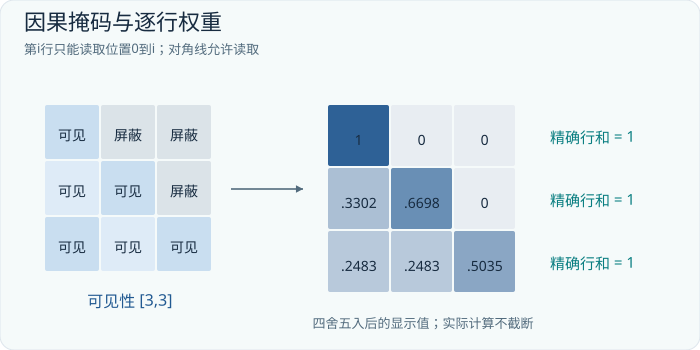

## 03.4 掩码为何必须在softmax之前

屏蔽未来位置意味着那些位置的权重应为0，并且允许位置之间的权重总和仍为1。把未来分数设为负无穷，再做softmax，能够同时满足这两点。如果先对所有位置做softmax，再直接把未来权重乘0，剩余权重通常不再归一化；除非额外重归一化，否则是另一种计算。

因果掩码允许对角线，这是因为位置i的输入token用于预测位置i+1。当前位置的token并不是预测目标的未来信息。训练时输入序列和目标序列的移位关系将在第06章展开。若你把标签移位和对角线含义弄反，就可能得到“模型准确率极高”但实际偷看答案的实现。

填充掩码处理另一件事：不同样本长度不一时，补齐位置不应成为有意义的键。某些任务还需要块状掩码，隔离打包到同一数组中的不同文档。注意力掩码决定能读谁，损失掩码决定哪些预测算分；它们有联系，却不是同一张东西。

一整行都是负无穷时，稳定softmax会遇到`-inf - (-inf)`，可能产生NaN。应确保每个有效查询至少有一个允许位置，或对无效查询进行专门处理，而不是靠“足够小的负数”掩盖数据管线问题。具体库对布尔掩码的真假含义可能不同，调用前必须查当前接口。

## 03.5 为什么除以sqrt(d_k)

点积是许多乘积项相加。若各维近似独立、均值为0、尺度相近，维度越多，点积波动通常越大。直接把越来越大的分数送入softmax，容易让它过早接近只选一个位置，训练信号也会变得难用。

除以sqrt(d_k)是在一组近似统计假设下稳定尺度的办法，而不是把向量严格归一化成单位长度。它不等于余弦相似度，后者还要除以两个向量各自的范数。实际网络里的分布未必满足独立假设，因此缩放是一项结构设计，不是保证数值始终完美的定理。

注意力也不必天然服从人类语义相似性。查询和键可以学到语法位置、格式约束、重复片段或其他有助于任务的匹配。说“注意力在找最相关词”可以启发直觉，但当你调试系统时，更准确的描述始终是：它用投影后的点积生成位置权重。

## 03.6 多头让同一位置保留多个读取通道

如果一行权重混合了多个位置，细节可能互相覆盖。多个头允许不同子空间用不同权重读取，再把结果合并。以D=8、H=2、d_h=4为例，每个头对同一段序列产生自己的`[T,T]`权重矩阵，输出各自的`[T,4]`，拼接后回到`[T,8]`。

```text
X               [B,T,8]
Q,K,V projected [B,T,8]
split heads     [B,2,T,4]
attention       [B,2,T,T]
head outputs    [B,2,T,4]
merge           [B,T,8]
output project  [B,T,8]
```

多头不是把文本按头切成前半句和后半句；每个头通常都能看到掩码允许的全部位置。切分的是投影后的通道。我们也没有事先指定头1负责语法、头2负责情绪；训练可能形成某些模式，但不能把这种解释当成架构保证。

输出投影W_O进一步混合各头的信息。因此某个头即使权重图很醒目，它对最终答案的影响还取决于值向量、输出投影以及后续层。只凭注意力热力图宣称“模型就是因为这句话而回答”，证据不够。相关权重是计算中的一个切面，因果归因需要干预或其他分析。

## 03.7 自注意力与交叉注意力

自注意力的Q、K、V通常都来自同一序列。交叉注意力则让查询来自一个序列，键和值来自另一个序列。假设文本有5个查询位置，图像有196个视觉位置，关系矩阵就是`[5,196]`。这五个文本位置可以分别从同一幅图中读取信息。

可见，“self”说的是来源关系，不是只看自己那一行。自注意力完全可以大量读取其他位置。交叉注意力也不要求两边token数相同，只要求查询与键投影后的比较维度兼容。这个接口在翻译、多模态与机器人策略中都会出现。

## 03.8 练习与答案要点

**练习1。** 将上述算例第二个值向量从`[0,2]`改成`[0,20]`，Q和K不变。A会改变吗？第三行输出第二维是多少？

**答案。** A不变；第二维约为0.2482550783×20+0.5034898435×1≈5.4686。读取比例与被读取内容是两件事。

**练习2。** 查询为`[B,8,10,64]`，键为`[B,8,25,64]`，值为`[B,8,25,32]`。权重和输出分别是什么形状？

**答案。** 权重`[B,8,10,25]`，输出`[B,8,10,32]`。

**练习3。** 序列长度翻倍，普通完整注意力的分数元素数如何变化？参数数目呢？

**答案。** 每头从T²变为4T²，权重参数不因T翻倍而改变。高效实现可以避免完整存储分数，但不能因此直接宣称所有计算变成线性。


## 本章实验：训练单头注意力完成内容查找

本实验提供四个 one-hot 键，每个键携带一个随机二值 value，再给出查询键，要求输出被查中的 value。训练 target 来自确定的查找规则；模型不能读取额外的答案列。查询经 Q 投影，候选经 K、V 投影，注意力汇总后进入分类输出头，以二值目标的分类损失更新投影和输出参数。这使“关注某个位置”不再只是一张手画权重图，而是为任务服务的可学习过程。

```bash
python -m tinyomni.lab --chapter 03 --steps 100 --out runs/ch03
python -m tinyomni.lab --chapter 03 --load runs/ch03/model.pt --predict
```

第一条命令训练并保存，第二条从检查点恢复实验，预测新生成的查找样例。推理只需要条件序列与查询，target 仅用于离线核对，不能拼入模型可访问的输入。若答案也作为候选的一部分出现，必须确认它是合法的键值内容，而不是额外泄漏出来的“正确答案标签”。

在计算图上标出查询长度与候选长度。一个查询对 T 个候选会产生长度为 T 的注意力分布，输出仍只有一个查询位置；不是把 T 个位置简单平均成一个词。softmax 沿候选轴归一化，分类 softmax 则沿输出词表轴归一化，它们服务于不同的概率问题。

成功标准是独立样本查找准确率明显超过随机猜测，同时将候选顺序打乱后仍能找到同一内容。观察注意力可以帮助排查，但高权重恰好落在目标位置也不是唯一验收条件；最终输出才决定任务是否完成。保存后重新加载，应保持同一固定样例的预测一致。

若只在原顺序中成功，模型可能记住位置捷径；若训练准确率高而新符号组合失败，检查训练是否覆盖查询和候选的组合；若权重接近均匀且损失不降，检查 QK 缩放、softmax 轴和输出损失是否连通。不要通过给正确位置手动加大分数来“修好”实验，那会把需要学习的任务换成预先写好的答案。


---

# 第04章 把注意力装成一个Transformer

## 04.1 一层网络必须既交流，也加工

注意力解决了位置之间的交流，却还不是完整的Transformer。一次加权平均可以把线索搬过来，但搬来的线索需要通过非线性计算组合。例如“不是”“没有”“问题”三个片段之间的关系，不能仅靠把三个静态向量求平均就可靠处理。完整的层通常把注意力与逐位置前馈网络结合，再加上残差连接和归一化。

本章先使用现代解码器常见的Pre-LN形式：归一化位于子模块之前。我们将在本章末尾与2017年的原始Post-LN形式比较，不把不同年代的模型混成一张图。忽略dropout时，一层可以写成：

```text
U = X + Attention(LayerNorm_1(X))
Y = U + MLP(LayerNorm_2(U))

X,U,Y 都是 [B,T,D]
```

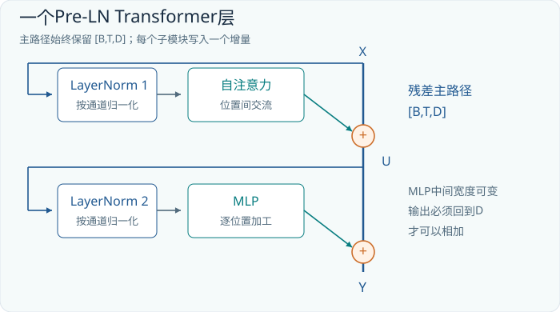

仔细看加号。注意力并不是把旧表示彻底替换掉，而是产生一个同形状增量加回主路径。随后前馈网络再写入另一个增量。D维残差流因此像一个共享工作区：各层可以读取、加工、写入，当前位置始终保留一个D维状态。这个比喻有助于追踪信息，但不能据此断言某个通道有固定的人类概念。

## 04.2 残差连接为什么要求形状一致

假设X某一行是`[1,2,3,4]`，子模块输出`[0.1,-0.2,0,0.3]`，相加后得到`[1.1,1.8,3,4.3]`。原始表示仍可沿直接路径保留，子模块可以学习较小修改。若子模块暂时输出全零，这一部分就近似恒等映射；堆很多层时，这种结构有利于维持信息与训练信号传播。

这不是保证网络不会退化的魔法。残差流的尺度可能变化，初始化、学习率和归一化设计仍然重要。它的明确作用是提供一条加法旁路，让一个复杂变换不必单独负责同时复制旧信息和生成新信息。

如果注意力内部某个头输出d_h维，多个头合并后还要通过输出投影回到D，才能与X相加。如果MLP中间扩大到F，也必须缩回D。这解释了为什么架构图中有些矩阵先变宽再变窄：中间计算可以灵活，但接口需要保持一致。

## 04.3 LayerNorm：对每个位置单独校准通道

LayerNorm通常沿每个token的通道轴计算均值和方差。对`[B,T,D]`的输入，标准Transformer用法并不会把不同样本或不同时间位置混在一起求统计量。计算可写为：

```text
mean = sum(x_j) / D
var  = sum((x_j-mean)^2) / D
x_norm_j = (x_j-mean) / sqrt(var+eps)
y_j = gamma_j*x_norm_j + beta_j
```

其中gamma和beta各有D个可学习参数。eps是防止分母过小的正数。假设x为`[1,3]`，均值为2，方差为1；忽略eps并令gamma为1、beta为0，结果就是`[-1,1]`。若把x整体平移为`[101,103]`，标准化后仍相同。这表明LayerNorm强调相对通道结构，而弱化某些整体偏移和尺度变化。

但“归一化后均值为0、方差为1”只对应用gamma、beta之前且忽略eps的理想情况成立。学习后的缩放与偏置会再次改变统计量。LayerNorm也不把每个向量变成概率分布，不要求所有元素非负，更不意味着所有token都变成相同向量。

LayerNorm的原始定义见[Ba等人的论文](https://arxiv.org/abs/1607.06450)。后面的RMSNorm会省去中心化步骤并采用均方根尺度，它与LayerNorm相关，但不应在公式中随意替换。第08章会比较两者。

## 04.4 前馈网络的宽度与非线性

一个经典前馈子层可以写成：

```text
MLP(X) = activation(X @ W_1 + b_1) @ W_2 + b_2

X:   [B,T,D]
W_1: [D,F]     W_2: [F,D]
b_1: [F]       b_2: [D]
```

第一层把通道从D扩展到F，非线性允许网络根据不同输入组合表现出不同响应，第二层把F维结果压回D。若去掉中间非线性，两次线性变换可以合并成一次，扩宽再缩窄就失去大量表达价值。

这个MLP对每个位置独立使用同一组参数。它看起来不能交流，却可以处理已经由注意力收集到的上下文。层与层交替后，当前位置先读到其他位置的信息，再做非线性加工，下一层又可以将加工结果传给其他位置。因此“前馈网络不跨token”不等于“它不处理上下文”。

用D=4、F=16的教学配置计算：W_1有64个参数，W_2有64个参数，偏置共有20个，共148个。忽略偏置的主项是2DF。若F=4D，便是8D²。标准注意力的Q、K、V与输出投影在等宽设定下合计约4D²。因此常见解码器层的大部分参数可能在前馈部分，而不是在那张最吸引眼球的注意力热力图中。

现代模型常用门控前馈网络：一条分支决定内容，一条分支调节内容通过的程度，之后再投影回去。它改变了矩阵数量和合适的F值。第08章的SwiGLU和第09章的专家网络都可以在本节基础上理解。

## 04.5 三种Transformer，差别首先在信息可见性

“Transformer”不是“只能逐字聊天的网络”的同义词。编码器通常让输入位置双向可见，用来得到整段输入的表示；仅解码器模型通常采用因果掩码，用前缀预测后续；编码器-解码器模型先处理源序列，再让目标序列通过交叉注意力读取源表示。

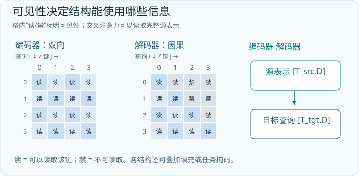

| 结构 | 查询可读的信息 | 典型输出解释 |
| --- | --- | --- |
| 编码器 | 输入中允许的前后位置 | 上下文表示、分类或掩码预测 |
| 仅解码器 | 当前与之前的前缀 | 下一token分布 |
| 编码器-解码器 | 目标前缀和完整源表示 | 条件生成，如翻译 |

以翻译为例，源语言句子可以先完整输入编码器。生成第3个目标词时，解码器不能看未来目标词，却可以看完整源句，因为源句本来就是条件。掩码应反映任务的信息边界，而不是机械地把所有矩阵都画成下三角。

类似地，图像作为已经给定的观测可以被双向视觉编码器处理，再提供给因果文字生成器。第13章中“视觉编码器+语言解码器”的结构，正是这一思想在不同模态之间的延伸。

## 04.6 并行训练与串行生成并不矛盾

训练时，我们已经知道完整样本，可以一次性把多个前缀的预测组织进同一个矩阵。因果掩码保证位置i的结果不读取未来。所有位置在一层中可并行完成矩阵乘法，因为本层读取的是上一层各位置已经得到的表示，而不是必须等待本层前一个位置先计算完。

生成时，未来token尚未产生。要得到第t+1个token，通常需要先确定第t个token，把它作为条件。因此标准自回归采样在时间上存在依赖。某些加速策略可以提出多个候选再验证，或改变生成机制，但不能把训练并行性直接当作免费并行生成所有未知token的证据。

这也是Transformer相对循环网络的一项重要计算组织差异：在已有完整输入的条件下，它可以更充分利用矩阵硬件。代价之一是普通全注意力需要处理许多位置对。后面的FlashAttention通过改变存储与计算顺序改善硬件效率，并不会凭空消除所有位置关系。

## 04.7 原始Transformer与GPT式模块的区别

2017年的原始Transformer面向序列转换，包含编码器和解码器，经典示意采用Post-LN，即`LayerNorm(X+Sublayer(X))`。本章为了衔接GPT-2，先使用Pre-LN：`X+Sublayer(LayerNorm(X))`。两种表达只调换几个符号，却改变了残差路径经过归一化的方式，对深层训练行为有影响。

除了归一化位置，不同模型还会在激活函数、位置编码、偏置、注意力头共享、前馈结构和词表上作选择。把论文中的一个框叫作“Transformer块”，只能说明家族关系，不能代替精确配置。实现一个模型时，至少应确定这几项：可见性、归一化、注意力投影、位置机制、前馈形式、残差连接与输出头。

有了这一张检查单，接下来阅读GPT-2就不会变成记忆陌生名词。它只是把这些选择固定为一套具体方案，再训练所有参数，使最终词表预测更符合数据。模型的规模可以增大，基本计算仍然由可追踪的张量操作组成。

## 04.8 练习与答案要点

**练习1。** 某MLP把`[2,128,768]`投影为`[2,128,3072]`，为什么不能直接与残差流相加？

**答案。** 最后一轴不匹配，必须投影回768或另外定义兼容的残差投影。标准块选择前者。

**练习2。** 对每个位置独立的MLP是否能够处理“前面提到的城市”？

**答案。** 可以处理已被注意力编码进当前位置的城市信息；单独的MLP无法直接访问其他位置，但整个层堆叠可以。

**练习3。** 目标序列长度为20、源序列长度为35的编码器-解码器，某一头交叉注意力的权重矩阵多大？需要对源序列加目标的因果三角掩码吗？

**答案。** 每样本为`[20,35]`。通常不需要按目标顺序遮住源句未来位置；仍可能需要源端填充掩码。目标端自注意力使用自己的因果掩码。

**资料。** 架构沿革以[Attention Is All You Need](https://arxiv.org/abs/1706.03762)及[GPT-2官方实现](https://github.com/openai/gpt-2/blob/master/src/model.py)为锚点。图04-1是教学用Pre-LN块，不是对原论文图的直接复制。


## 本章实验：训练两层 Transformer 判断序列关系

本实验训练一个很小的两层 Transformer 分类器。输入是六个离散 token，target 表示首尾 token 是否相同。中间位置提供干扰，模型必须把两端的信息放在一起比较。它先查嵌入，再经过两层注意力、前馈与残差模块，最后由分类头输出类别，用交叉熵更新参数。标签由规则产生，不表示比较规则已被硬编码进前向计算。

```bash
python -m tinyomni.lab --chapter 04 --steps 100 --out runs/ch04
python -m tinyomni.lab --chapter 04 --load runs/ch04/model.pt --predict
```

本章要核对的是模块如何共同学习。每一层主干保持 `[B,T,D]`，注意力沿位置轴交换信息，前馈网络在每个位置混合通道；只有最后的聚合与分类头把它变成 `[B,C]`。不要直接把 `[B,T,D]` 展平成一个巨大固定长度向量，再把结果称为同一种结构，这会改变参数、长度限制和信息处理方式。

数据应同时提供各类别的样例，并划出未参加更新的序列。训练中保存的参数包含嵌入、两层模块和分类头，部署时三者缺一不可。加载命令会按检查点对应的实验配置恢复模型，不需要重新训练；它输出的是该小规则世界的分类结果，不是通用文本理解能力。

成功标准首先是验证准确率超过类别多数基线，再检查交换关键位置或修改关键符号时，预测是否按规则改变。仅看训练损失很低不够，因为小模型也能记住有限序列。若类比例失衡，一个永远选择多数类的程序可能拿到较高准确率，必须先算出这个无需学习的基线。

失败时区分两种情况：对顺序无感，可能是位置表示缺失或聚合方式不当；对训练序列准确而对新序列失败，可能是样本覆盖不足或记忆捷径。还要检查是否把因果掩码错误加在需要全序列证据的分类位置上。任务需要哪些位置可见，应由任务定义决定，而不是看到 Transformer 就一律使用同一种掩码。


---

# 第05章 GPT-2：把语言模型完整拆开

## 05.1 为什么值得逐颗螺丝认识 GPT-2

理解了一次注意力计算，并不等于理解了一个语言模型。实际模型还必须回答许多具体问题：文字怎样变成整数？整数怎样变成向量？位置从哪里进入？十二个模块怎样连接？最后为什么能得到五万多个候选 token 的分数？所谓一亿多参数，到底是哪几张表加出来的？本章把这些问题放进同一张计算图。

我们选用公开发布的 GPT-2 small 配置作为标本。它规模足够小，可以完整核算；结构又足够典型，能帮助我们理解后续大模型。这里讨论的 GPT-2 是 2019 年模型，不是聊天产品，也不是一个天然懂得遵守系统消息的助手。它的核心任务是根据前缀预测下一 token。[GPT-2 原论文](https://cdn.openai.com/better-language-models/language-models.pdf)

| 符号 | GPT-2 small 数值 | 含义 |
|---|---:|---|
| V | 50,257 | 词表大小 |
| D | 768 | 每个 token 的表示宽度 |
| L | 12 | Transformer 层数 |
| H | 12 | 每层注意力头数 |
| d_h | 64 | 每个头的宽度，D/H |
| T_max | 1,024 | 学习位置表的长度 |

输入批量大小 B、实际序列长度 T 可以变化，但 T 必须在实现所支持的上下文范围内。若 B=2、T=6，模型处理的是两条各六个 token 的序列，而不是十二个头各负责一个 token。头数分割的是特征维 D，序列轴 T 仍被每个头完整看见；因果 mask 再限制其中允许读取的位置。

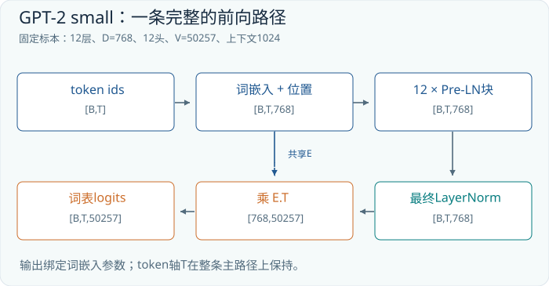

图中的粗横线可以理解为一条持续存在的“工作向量流”。每层注意力从中读取信息，写回一次修正；前馈网络再读取并写回一次修正。计算不断丰富每一行的上下文信息，但主干形状始终保持 `[B,T,D]`。形状不变是残差相加能够成立的基本条件。

## 05.2 byte-level BPE：模型首先看见的是编号

GPT-2 并不直接处理“一个汉字”“一个英语单词”这样的语言学单位。它使用字节级 BPE。编码过程先按照规则把文本切成初步片段，再把片段转换为 UTF-8 字节，把字节映射到可逆的符号表示，最后依照已经学好的合并优先级反复合并相邻符号。结果再查词表，成为整数 token ID。原始实现中的正则切分与字节映射都可以直接检查。[官方 tokenizer 代码](https://github.com/openai/gpt-2/blob/master/src/encoder.py)

为什么从字节开始？UTF-8 文本最终可以分解为 256 种字节值。即便出现训练时很少见的人名、符号或文字，也能退回较短的字节片段来表示。BPE 合并让常见片段用较少 token 表示，兼顾可表示性与序列长度。但“能够表示”并不意味着“表示得高效”：同一句话在不同语言中可能需要非常不同的 token 数；一个不常见的汉字也可能被拆成多个 token。

下面只演示合并机制，**不是 GPT-2 真实词表的切分结果**。假设某个片段最初是 `[a,b,a,b,c]`，合并表规定 `(a,b)` 优先于 `(ab,c)`，则可得到：

```text
初始符号： a | b | a | b | c
第一轮：   ab    | ab    | c
第二轮：   ab    | abc
查词表：   17    | 42
```

合并的依据是训练 tokenizer 时确定的优先级，不是当前句子的语义重要性。词表本身不会在每次生成时临时长出一个新条目。空格也可能成为 token 片段的一部分，因此“词首形式”和“带前导空格的形式”可能有不同 ID。不要手工按空格切分后再假设它等价于模型的编码器。

GPT-2 的 50,257 个条目对应字节基础符号、合并产生的符号，以及特殊结束标记。特殊标记是一种有专门 ID 的协议符号，不是普通字符串在任何位置都必然具有特殊语义。做数据处理时，应明确什么时候把字面文本当作文本，什么时候真正插入特殊 ID。解码则把 token ID 恢复为字节片段，再组合成文本；单个 token 的字节片段不一定独自构成完整 Unicode 字符。

## 05.3 两张表如何组成第一层输入

GPT-2 首先有一张 token embedding 表 E，形状 `[V,D]`，以及一张可学习位置表 P，形状 `[T_max,D]`。输入 ID 张量的形状是 `[B,T]`。查 E 后得到 `[B,T,D]`，取位置表对应的 T 行后广播到每条序列，再逐元素相加：

```text
X[b,t,:] = E[token_id[b,t],:] + P[position_id[b,t],:]
```

这里没有矩阵乘法的必要；整数索引可以直接取出一整行。只有在教学推导中，我们才把查表写成 one-hot 矩阵乘 E。两种表达数学等价，但实际构造巨大 one-hot 张量通常浪费内存。

设一个教学词表有 V=5、D=4，ID 为 2 的行是 `[0.4,-0.1,0.8,0.2]`，位置 0 的行是 `[0.1,0.2,0.0,-0.1]`。相加得到 `[0.5,0.1,0.8,0.1]`。如果同一 token 出现在位置 1，仍查 E 的同一行，却加入 P 的另一行。因此它的初始输入向量发生变化。**这些数值是本书构造的算例，不来自真实 GPT-2 权重。**

学习位置表把位置变成参数，但也把“有哪些位置可查”写进表的尺寸。把输入长度改成 2,048，并不会自动给这张只有 1,024 行的表补出训练好的后半部分。增加表长、插值、重训都属于模型改造，不能只修改一个配置数字就宣称拥有可靠的长上下文能力。

位置编码与注意力 mask 解决不同问题。位置编码告诉模型 token 的顺序或相对位置线索；mask 决定哪些信息可以访问。没有 mask，模型可能在训练时读取答案；没有位置机制，注意力对顺序的表达又会受到限制。两者不能互相替代。

## 05.4 一个 GPT-2 模块的两次读取与写回

GPT-2 使用常称为 Pre-LN 的布局，即先归一化，再进入注意力或前馈子层：

```text
U = LayerNorm_1(X)
A = CausalSelfAttention(U)
Y = X + A
Z = Y + MLP(LayerNorm_2(Y))
```

注意第一条残差路径直接保留 X，而不是把归一化后的 U 当作主干。归一化后的值用于计算修正，修正再加回原来的表示。这使得层的工作更像“在已有表示上添加需要的变化”，也为多层网络保留了比较直接的信息与训练信号通道。最后一层之后还有独立的最终 LayerNorm。该顺序可在官方 `block` 与 `model` 函数中核对。[GPT-2 模型实现](https://github.com/openai/gpt-2/blob/master/src/model.py)

注意力内部一次大投影便能产生 Q、K、V。虽然代码可能把这个操作命名为 `conv1d`，这里的核宽为 1，本质上是对每个位置实施同一组线性投影；它不是利用邻域卷积来混合相邻 token。

| 张量或操作 | 形状 | 解释 |
|---|---|---|
| U | `[B,T,768]` | 归一化后的输入 |
| U W_qkv + b_qkv | `[B,T,2304]` | 三组 768 维特征 |
| Q、K、V 拆头 | 各 `[B,12,T,64]` | 交换轴后逐头计算 |
| Q K^T | `[B,12,T,T]` | 每个查询位置对各键位置的分数 |
| softmax(S) V | `[B,12,T,64]` | 每个头汇集内容 |
| 拼头并投影 | `[B,T,768]` | 返回可与主干相加的宽度 |

分数先除以 `sqrt(64)=8`，再加入因果 mask，然后沿最后一维做 softmax。第一行只允许读取第一个 token；第六行允许读取前六个 token。训练时六行可以一起计算，因为答案是否可见由 mask 控制，而不是依靠慢速逐行执行来保证。

MLP 对每一个位置使用相同参数，把宽度从 768 扩展至 3,072，经过 GELU，再压回 768。它不直接沿 T 轴混合 token。跨位置交流发生在注意力，MLP 则在每个位置重新组合已经汇集来的特征。这种分工不是对功能的绝对解释--信息会跨层相互影响--但作为检查张量代码的原则非常有效。

## 05.5 最后一行怎样变成下一个 token

十二层之后得到上下文化表示，最终 LayerNorm 输出记为 N，形状 `[B,T,D]`。GPT-2 复用输入词向量矩阵，计算：

```text
logits = N @ transpose(E)
[B,T,D] @ [D,V] -> [B,T,V]
```

这叫权重共享或 tied head。输出端没有再配置一张独立的 `[D,V]` 大矩阵。输入时，E 的一行提供一个 token 的起始表示；输出时，同一行与当前上下文向量做点积，成为该 token 的候选分数。不能把这理解为“模型只会找语义最接近的词”：最终向量经过多层训练塑形，它编码的是为了预测下一 token 而组织起来的信息。

再看一个与真实权重无关的小算例。若 N 的某一行为 `[1,0,2]`，三个候选 token 的 embedding 行分别是 `[1,0,0]`、`[0,1,1]`、`[-1,0,1]`，则 logits 是 `[1,2,1]`。softmax 后约为 `[0.212,0.576,0.212]`。分数 2 不是“概率 2”，也不是某条事实有两倍正确；它必须与全部候选分数共同归一化后才能成为概率。

训练需要很多位置的预测，所以一般保留 `[B,T,V]`。生成时只有最后一个有效位置的下一 token 分布用于采样，许多实现可以只对这一位置计算输出投影，以节省工作。若一批序列使用 padding，“最后一个有效位置”也未必就是张量物理上的最后一列；这必须与批处理策略一致。

## 05.6 一亿二千四百万参数到底在哪里

参数核算只数可学习的标量，不数激活、梯度、KV cache 或优化器状态。下面按 GPT-2 small 的公开结构独立核算。每个带偏置的线性层参数数为“输入宽度乘输出宽度，再加输出宽度”；每个 LayerNorm 有 D 个缩放系数和 D 个偏置。

| 单个模块部件 | 计算式 | 参数数 |
|---|---|---:|
| QKV 合并投影 | `768×2304 + 2304` | 1,771,776 |
| 注意力输出投影 | `768×768 + 768` | 590,592 |
| MLP 扩展投影 | `768×3072 + 3072` | 2,362,368 |
| MLP 压缩投影 | `3072×768 + 768` | 2,360,064 |
| 两个 LayerNorm | `2×2×768` | 3,072 |
| 单模块合计 | 上述五项相加 | 7,087,872 |

全模型还要加入两个输入表与最终归一化：

| 全模型部件 | 计算式 | 参数数 |
|---|---|---:|
| token embedding | `50,257×768` | 38,597,376 |
| 位置 embedding | `1,024×768` | 786,432 |
| 十二个模块 | `12×7,087,872` | 85,054,464 |
| 最终 LayerNorm | `2×768` | 1,536 |
| 总计 | 四项相加 | **124,439,808** |

共享输出头不再加一遍 E。若错误地把输出头视为独立权重，就会多算 38,597,376。也不应把十二个注意力头理解成十二套完整 768 维投影；它们共同使用总宽度 768 的投影结果，再拆成十二份 64 维表示。

早期 GPT-2 论文把 small 标为 117M，官方仓库后来明确说明早期参数统计有误。这里的 124M 来自已发布配置的实际结构核算，而不是“117M 只数一部分”这一未经证实的口头解释。[官方仓库的参数计数更正](https://github.com/openai/gpt-2)

观察账本还会发现一个重要比例：词向量表就占约 31% 的参数。增大词表可以缩短某些文本的 token 序列，却会增大 embedding 和输出计算；扩大 D 会令许多矩阵按平方增长。模型设计是几个轴共同作用，不能只盯着层数或词表大小。

## 05.7 阅读实现时最容易掉进的坑

第一，模块名不等于数学作用。叫 `Conv1D` 的模块可能只是线性投影；叫 decoder 的网络未必含有编码器-解码器交叉注意力。GPT-2 的主干是因果自注意力堆叠，不能把原始机器翻译 Transformer 的整个 decoder 原样套过来。

第二，reshape 不是投影。把 `[B,T,768]` 改排成 `[B,12,T,64]` 不增加参数，也不自动学出新特征；真正可学习的变换发生在矩阵乘法。transpose 调整轴的解释，必要时改变实际存储布局，但同样不是一次新的神经网络学习操作。

第三，架构公开不等于训练过程全部可重现。知道矩阵形状，足以构造同形网络；复现原模型质量还需要数据、清洗流程、训练日程、随机性以及算力条件。阅读推理代码时，也不要因为代码里没出现某个训练步骤，就反向推断原始训练一定没使用它。

## 05.8 动手检查

**练习一。** 在 B=3、T=20 的 GPT-2 small 中，Q 的拆头后形状与最终 logits 形状分别是什么？若只生成下一个 token，究竟从 logits 中取哪一部分？

**简答。** Q 为 `[3,12,20,64]`，logits 为 `[3,20,50257]`。对每条序列取最后有效位置对应的 50,257 个分数；无 padding 时就是 `logits[:,19,:]`。

**练习二。** 如果保留现有 E，再增加一个不共享的无偏置输出头，会多出多少参数？如果把十二层改成十三层，又会多出多少？

**简答。** 分别增加 38,597,376 与 7,087,872。这里第二问假设新增层结构相同，其他部分不变。

**练习三。** 同一个 token 在两个位置的初始 embedding 相同，是否意味着其第一层输入相同？最终输出相同吗？

**简答。** E 的查表结果相同，加入不同位置向量后第一层输入通常不同；因果可见前缀也不同，最终表示更不能认为相同。即使采用其他位置机制，位置与上下文仍会影响计算。

本章原始资料：[GPT-2 论文](https://cdn.openai.com/better-language-models/language-models.pdf)、[官方模型代码](https://github.com/openai/gpt-2/blob/master/src/model.py)、[官方 tokenizer 代码](https://github.com/openai/gpt-2/blob/master/src/encoder.py)、[官方参数计数更正](https://github.com/openai/gpt-2)。所有小维度数例均为教学构造，参数账本则按已发布结构精确计算。


## 本章实验：从随机权重训练微型因果 GPT

本实验建立一个远小于 GPT-2 的因果解码器，在八符号周期序列上学习下一 token。输入是序列去掉最后一项，target 是同一序列去掉第一项；各位置的隐藏状态通过实验配置的输出头得到词表 logits，使用交叉熵更新参数。周期结构提供可检查的规律，既不需要下载预训练权重，也不需要把小模型误称为真实 GPT-2 的能力复现。

```bash
python -m tinyomni.lab --chapter 05 --steps 100 --out runs/ch05
python -m tinyomni.lab --chapter 05 --load runs/ch05/model.pt --predict
```

训练过程要实际改变嵌入、注意力与前馈矩阵。推理命令重新加载 `model.pt`，从实验提供的前缀逐个生成后续符号；未知后继必须来自模型输出，不能把真实答案逐步塞回去再称为自由生成。训练中的 teacher forcing 与部署中的自回归生成在这里第一次产生可观察的差别。

本章可同时检查三件事：沿着主干核对 `[B,T,D]`；确认分数 `[B,H,T,T]` 的未来区域被屏蔽；核算小模型实际配置的参数量。第五章正文中的 124,439,808 是 GPT-2 small 的账本，本实验的层数、宽度和词表另由实验配置决定，不能把两组数字混用。保存模型时同时保存配置，否则仅凭权重文件名不能恢复结构。

成功标准是独立周期序列的损失下降，自由续写能够持续遵守所学周期，并且保存加载前后的固定前缀 logits 一致。只在训练时预测正确，仍可能在部署时因一处错误偏离后续轨迹。应把一段完整续写打印出来逐项比对，而不是只展示概率最高的第一个 token。

如果损失异常接近零，先检查标签有没有进入可见输入、因果掩码是否方向相反；如果训练正常而生成错一位，检查标签移位和首次输出的时机。若生成长度超过位置表，必须按模型配置限制请求，不能通过捕获异常后截掉前缀来暗中改变问题。这个微型训练练习的成果是学会一个有限规律及其部署过程，不是自然语言聊天能力。


---

# 第06章 从文本到能力：预训练、监督微调与偏好优化

## 06.1 一个网络为什么会从预测文字中学到东西

上一章给出了可以运算的网络，但随机初始化的矩阵只会产生杂乱分数。训练要做的事，是让大量真实文本中实际发生的下一 token 获得较高概率。它没有为“语法”“日期”“代码格式”“人物关系”分别设置输出头；这些规律只要有助于预测，就可能在共享表示中被利用。

这不意味着下一 token 目标会自动保证正确推理或可靠知识。网页可能包含错误，常见表达可能只是流行而非真实，训练分布也可能遗漏某些任务。目标函数奖励的是对训练样本的预测，而我们最终关心的是复杂场景下的行为。预训练、指令微调和偏好训练之所以成为不同环节，正因为“能延续文本”与“能按要求完成任务”之间存在距离。[GPT-2 论文](https://cdn.openai.com/better-language-models/language-models.pdf)、[InstructGPT 论文](https://arxiv.org/abs/2203.02155)

本章把训练理解为一条可核对的数据管线：原始文档变成样本，样本变成输入和标签，网络生成分数，损失函数把分数压成一个数字，自动微分生成与每个参数同形的修正信号，优化器再更新参数。只有这条管线各处都正确，较低的损失才有可信含义。

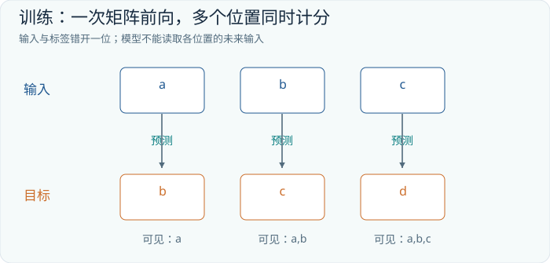

## 06.2 标签只移动一格，任务却完全不同

假设经过 tokenizer 后得到五个 ID `[11,23,7,48,9]`。这些编号是教学示例，与 GPT-2 真实词表无关。截取一段长度 T+1=5 的 token 流，可以构造长度 T=4 的训练对：

```text
完整片段： 11  23   7  48   9
输入 x：   11  23   7  48
目标 y：   23   7  48   9
```

第一个位置根据 11 预测 23，第二个位置根据 11、23 预测 7，依此类推。注意力允许一个位置看到自己，是因为位置 t 的输入是当前 token，而目标是 t+1 的 token。若把输入和标签完全对齐，又没有在模型内部移位，网络可能学成复制当前 token；若数据端移位一次、框架内部又移位一次，则任务变成错误地跨两格预测。

“自回归”描述概率的分解和生成依赖，并不要求训练时慢慢生成整段话。训练文本中每个正确前缀已经存在，模型可以一次计算所有位置，这常被称为 teacher forcing。其代价是训练时看到正确前缀，而生成时前缀可能包含自身先前的错误；一个早期错误会改变后续条件分布。

| 对象 | 形状 | 内容 |
|---|---|---|
| input_ids | `[B,T]` | 输入 token 的整数 ID |
| targets | `[B,T]` | 各位置要预测的下一 token |
| logits | `[B,T,V]` | 每个位置的全词表分数 |
| token_loss | `[B,T]` | 各有效标签的负对数概率 |

许多实现把前两轴临时展平，得到 `[B×T,V]` 和 `[B×T]`，再调用分类交叉熵。这只是把很多分类问题放进同一批，不是抹掉了上下文。上下文早已在 Transformer 中参与计算。

## 06.3 交叉熵的数字含义

对一个位置，假设真实下一 token 是词表第 j 项。我们取模型给它的概率 p_j，并记分 `-ln(p_j)`。概率越接近 1，损失越接近 0；概率越小，惩罚越大。只看这一项，是因为标签可以看成一个仅第 j 项为 1 的 one-hot 分布。其他候选仍通过 softmax 的分母参与竞争，并没有从训练中消失。

考虑三个有效位置，模型给正确标签的概率分别为 0.8、0.5、0.25。这是本书人为指定的概率，不是一次训练结果：

| 位置 | 正确标签概率 | 负对数概率 |
|---|---:|---:|
| 1 | 0.80 | 0.2231 |
| 2 | 0.50 | 0.6931 |
| 3 | 0.25 | 1.3863 |
| 平均 | - | **0.7675** |

第三个位置给总损失的贡献最大。它不是简单判断“预测对了还是错了”，而是区分模型把正确答案放在 0.49、0.01 或百万分之一的不同情况。即便 argmax 都错误，概率质量朝正确标签移动仍能被奖励。

困惑度 perplexity 是 `exp(平均损失)`，这里约为 2.1544。一个直观参照是：若每个位置都在 K 个候选之间均匀分配概率，困惑度就是 K。不过在真实分布中，它是概率意义上的有效分支量，不能字面解读为“每一步正好犹豫 2.15 个词”。

困惑度比较必须固定 tokenizer、测试文本及计分方法。一个模型把“机器学习”表示成两 token，另一个表示成四 token，它们的每 token 损失已经不在同一尺度。不同截断方式、是否计算文档起始、是否把 padding 算进分母，也能显著改变结果。训练日志中的下降值得关注，但脱离计分协议的跨模型数字可能误导。

实现中通常直接用稳定的 log-softmax 或融合交叉熵，不先把低精度 softmax 概率算出来再取对数。原因很朴素：极小概率可能被舍入成零，随后 `log(0)` 无法给出有限数值。减去每行最大 logit 的稳定变换，不会改变 softmax 分布，却能避免无谓的数值溢出。

## 06.4 三种 mask 不要混成一个

因果 mask、padding mask 和 loss mask 各有职责。因果 mask 回答“当前位置能读哪些位置”；padding mask 排除为了凑齐形状而填充的虚假 token；loss mask 决定哪些目标参与训练评分。它们可能同时存在，却不能互相代替。

假设一批中有两条样本，真实长度分别为四和二，补到 T=4。第二条的末尾两个位置只是占位符。我们既不希望其他位置把占位内容当作证据，也不希望模型因没猜中占位 ID 而受惩罚。可用以下示意：

```text
样本 A 的有效位置：1 1 1 1
样本 B 的有效位置：1 1 0 0
损失 = 有效位置损失之和 / 有效位置数量
```

有些框架用标签值 `-100` 表示忽略。它是损失函数约定的哨兵值，不是词表中第 -100 个 token，更不是向 logits 添加的负无穷。把它直接拿去查 embedding 是错误的。类似地，若某行注意力分数被全部屏蔽，softmax 可能产生无效数值；因此 padding 行如何处理必须和具体实现配套。

为减少 padding 浪费，可以把多个短文档打包进同一个长度窗口。此时存在两种明确但不同的训练定义：允许模型跨文档边界读取前文，并插入结束标记；或者用分块因果 mask 把文档隔离。后一种情况下每个文档形成独立的下三角区域。两者都能被实现，关键是不要以为“放了结束标记”就等价于“注意力绝不跨边界”。结束标记提供可学习线索，mask 才施加硬访问约束。

## 06.5 数据质量首先是评估可信度问题

在训练前先把文本随机切成短块，再随机分训练集和验证集，可能把同一篇文章的相邻段落分到两边。重复网页、转载、模板页和代码镜像又可能让验证内容以另一种形式留在训练集。这样的验证损失会显得漂亮，但不能真实衡量模型遇到新材料时的能力。

较可靠的思路是在文档、来源、时间或近重复簇层面划分，再把每一部分切成训练窗口。完全重复可以用规范化文本的哈希检查，近重复需要更细的片段或相似度方法。去重不是“把所有相似句子都删掉”：自然语言会重复常用表达，过度清洗也可能扭曲分布。应保留数据来源、清洗版本和划分依据，便于解释后来出现的指标变化。[训练数据去重研究](https://arxiv.org/abs/2107.06499)

数据配比同样决定模型究竟在学习什么。若某类模板重复了一万遍，它在损失中就拥有一万遍的发言权。增加总 token 数而不检查重复率，可能只是反复训练相同模式。对代码、数学、多语种与普通网页设置不同采样比例，本质上是在改变目标分布；这属于建模选择，不能把“更多”当作自动更好的同义词。

训练集用于更新参数，验证集用于调参和选择检查点，测试集用于最后估计泛化。若研究者根据测试分数反复修改训练方案，测试集实际上开始承担验证集角色。保留一个长期不触碰的评估集，以及独立的任务评估，比只追踪一个语言模型损失更能发现能力退化。

## 06.6 优化器如何改动一张张矩阵

不展开微分推导，也能理解反向传播的工程含义：每个参数张量 W 都得到一个同形张量 G，其中的值表示当前批次损失对该参数变化的局部敏感方向。若 W 是 `[768,3072]`，G 也必须是 `[768,3072]`；优化器不会凭空生成不同形状的更新。

最简单的更新是 `W_new = W - 学习率×G`。Adam 一类方法还维护梯度方向和梯度平方的滑动平均，让历史方向与各坐标的尺度影响更新。AdamW 将权重衰减与自适应梯度更新分开，可以把它直观理解为“按训练信号移动，再对选中的参数施加适度收缩”。这不等价于在所有优化器中简单把平方惩罚加到损失上。[AdamW 原论文](https://arxiv.org/abs/1711.05101)

学习率太大时，一步可能破坏此前形成的表示；太小时，有限训练时间内变化不足。warmup 让训练初期逐渐进入目标步长，后续衰减让末期调整更细。梯度裁剪限制进入优化器的梯度范数；实际参数更新还取决于优化器状态与学习率。它们都是控制训练过程的手段，不会补救错位标签、泄漏验证集或错误 mask。

显存限制下可以使用梯度累积。例如每次只能放入 B_micro=4 条长度 1,024 的序列，累积八次再更新一次，相当于一次更新汇集 32 条、最多 32,768 个 token 的信号。若各微批有效 token 数不同，正确平均必须依据有效 token 数加权；简单平均每个微批的平均损失会让短样本微批获得过大的权重。

训练显存也远大于“参数数乘每参数字节数”。除权重外，还要保存梯度、优化器状态、某些高精度副本，以及反向传播需要的激活。激活重计算可以少存中间结果，在反向时重新计算，用计算量换显存。此处的取舍与下一章推理用的 KV cache 不同，不能把两种缓存混为一谈。

## 06.7 SFT：告诉模型怎样回答

监督微调 SFT 仍然通常使用下一 token 交叉熵，但数据变成示范任务，例如“问题-合适回答”或多轮对话。输入中包含角色与边界协议，模型学习在相应上下文中输出应有格式。常见做法只在助手回答 token 上计算损失，用户问题仍参与注意力，却不作为需要模仿输出的目标。

```text
上下文： [用户] 请把三点建议写成列表 [助手] 1. ... 2. ... 3. ...
loss：   0 0 0 0 0 0 0 0              1 1 1 1 1 1 1 1
```

这只是协议示意，不规定任何真实模型的聊天模板。使用预训练权重时，训练和推理应遵循该模型所定义的特殊 token 与模板。手工写几个看似相同的角色字符串，未必等同于模型熟悉的对话格式。

SFT 通过正面示范提高符合要求的输出概率，但它并没有直接看到“两个答案中为什么这个更好”。如果示范数据存在错误、样式单一或覆盖不足，微调同样会学到这些偏差。更低的 SFT 损失意味着更贴近示范，不等于在所有任务上更聪明。[InstructGPT 的示范学习与偏好训练流程](https://arxiv.org/abs/2203.02155)

## 06.8 DPO：把一对答案的相对偏好变成训练目标

DPO 使用同一提示 x 下的较优回答 y_w 和较差回答 y_l，还保留一个固定参考模型。先计算每个回答在当前模型与参考模型下的整段条件对数概率，再比较两种“相对于参考的变化”：

```text
r_w = log p_current(y_w|x) - log p_ref(y_w|x)
r_l = log p_current(y_l|x) - log p_ref(y_l|x)
margin = beta × (r_w - r_l)
DPO_loss = -log sigmoid(margin)
```

整段对数概率来自回答 token 的对数概率之和，提示部分不计入回答概率。这里的 beta 是调节训练目标的系数，不是采样温度。参考模型用于衡量变化基准；它不是一个专门判断答案好坏的奖励模型。标准 DPO 可以直接用偏好对训练，而不必先单独拟合奖励模型再运行在线强化学习循环。[DPO 原论文](https://arxiv.org/abs/2305.18290)

看一个教学构造的完整序列概率例子。参考模型给两个候选分别分配 0.08、0.08，当前模型给它们分配 0.12、0.04。候选之外还有大量回答，所以这两个概率不需要加起来等于 1。相对比值分别为 1.5 与 0.5，它们的对数差为 `ln(3)=1.0986`。若 beta=0.1，margin 为 0.1099，损失约为 0.6397；若当前模型与参考模型相同，margin 为 0，损失为 `ln(2)=0.6931`。

这个目标关心相对变化，不能推出“每一步都会同时提高优选回答的绝对概率、降低劣选回答的绝对概率”。更不能把偏好标签当作真理标签：标注者可能喜欢自信、冗长或迎合的回答。答案长度也影响对数概率累加，因此数据配对和实际训练目标要一起检查，不能随意把标准求和换成长度平均而仍声称目标完全相同。

预训练、SFT、DPO 还与“更新哪些参数”这一问题正交。全参数微调或 LoRA 描述参数更新方式；SFT、DPO 描述样本与目标。一个 LoRA 训练既可以使用 SFT 目标，也可以使用偏好目标。后续章节再讨论依赖验证奖励和采样组的推理训练方法。

## 06.9 动手检查与常见误区

**练习一。** 文本 ID 为 `[4,8,15,16]`，希望一次训练三个下一 token 位置，input 和 target 分别是什么？

**简答。** input=`[4,8,15]`，target=`[8,15,16]`。若模型封装已内部移位，数据接口可能要求传同一完整序列，必须检查接口，不能再额外移位。

**练习二。** 两个微批分别有 2 个和 6 个有效 token，平均损失为 1.0 和 2.0。合并后的 token 平均损失是多少？

**简答。** `(2×1+6×2)/8=1.75`，不是两个平均值的简单平均 1.5。

**练习三。** 某训练把用户问题标签全部忽略，却保留问题的注意力访问。这是否意味着模型无法利用问题？

**简答。** 不意味着。loss mask 控制评分，attention mask 控制读取。助手位置仍可根据问题计算预测；训练信号也会通过相关计算路径影响共享参数。

最后记住两个边界：自回归训练可以并行处理已知文本中的许多位置，生成时却要等待未知 token 被选出来；验证损失是特定数据分布上的统计量，不能单独证明事实准确、工具可靠或任务完成。理解这些边界，才能读懂下一章的推理系统设计。

本章原始资料：[GPT-2](https://cdn.openai.com/better-language-models/language-models.pdf)、[数据去重](https://arxiv.org/abs/2107.06499)、[AdamW](https://arxiv.org/abs/1711.05101)、[InstructGPT](https://arxiv.org/abs/2203.02155)、[DPO](https://arxiv.org/abs/2305.18290)。所有概率与批量数字均为教学构造，不是训练实验报告。


## 本章实验：给微型 GPT 建立可信训练与验证管线

本实验继续训练周期序列语言模型，但重点从“能下降”转为“下降是否可信”。生成器用训练与验证各自的种子采样完整序列，再构造输入和下一 token 标签。训练使用因果可见范围；当前实现固定长度、所有标签有效，因此交叉熵没有需要忽略的 padding。验证只前向计分，不更新参数。它实际训练的是一个小语言模型，不是只对预设概率手算损失。

```bash
python -m tinyomni.lab --chapter 06 --steps 100 --out runs/ch06
python -m tinyomni.lab --chapter 06 --load runs/ch06/model.pt --predict
```

本实验实际检查因果 mask，正文中的 padding 与 loss mask 则是扩展到变长任务时需要补上的接口。忽略标签不应阻止模型读取合法上下文；反之，禁止访问未来也不会自动把 padding 从损失分母删除。若读者把实验改为变长序列，应使用有效 token 总数归约损失，不能把长短不同序列的平均值未经说明地再平均。

保存后的部署模型不需要携带训练集或优化器才能完成预测，但必须恢复模型结构、词表和相关预处理约定。加载命令使用同一实验的生成规则提供新前缀；查看其输出能验证训练数据接口与部署数据接口是否一致。若检查点中还包含优化器状态，那是供继续训练使用，不能与推理必须的参数混为一谈。

成功标准是训练与验证损失都相对初始值改善，二者差距能够被解释，固定样例在保存加载前后保持一致。本实验按独立序列种子验证，但八符号循环仅有八种语义相位，不能把新种子称为未见内容泛化。它首先检查训练和验证管线是否一致；若要研究新规则，必须另行设计并隔离周期结构。

失败诊断从数据检查开始：验证远好于训练，可能是掩码或计分方式不同；训练很好、验证不动，可能是记忆、覆盖不足或切分偏差；损失随 batch 长度明显变动，检查分母和 padding。正文介绍的 SFT、DPO 是更一般的训练目标，本实验没有执行完整偏好优化流程，不能把周期语言模型的下降作为 DPO 的实验验证。


---

# 第07章 模型怎样说下去：采样、缓存与推理系统

## 07.1 下一 token 分布还不是一段回答

语言模型的一次前向计算产生分数，而生成程序决定怎样使用这些分数。它把已有前缀送入模型，取最后有效位置的 logits，选择一个 token，把该 token 接回前缀，再重复。直到遇到约定的结束标记、停止条件或长度上限，这个循环才结束。

每一步都是一个条件概率问题。假设前缀是“电路中的电流单位是”，模型在词表上产生分布；选择结果成为下一轮输入的一部分。模型并没有在第一步就明确生成并存储了完整未来句子。某些搜索、推测解码或特殊模型可以改变执行方式，但普通自回归生成的依赖关系仍是后一步取决于已经确定的前缀。

因此，相同权重可以产生不同风格的文本。差异可能来自 prompt、聊天模板、采样随机数、停止规则以及推理参数。评价一个模型时，只记录模型名字而不记录这些条件，往往不足以解释输出为何不同。

## 07.2 温度到底改变了什么

设当前四个候选 token 的 logits 是 `[2,1,0,-1]`。这是教学构造，不是真实模型输出。温度 tau 大于零时，采样分布为 `softmax(logits/tau)`。它没有重训权重，只重新缩放当前分数差：

| 候选 | tau=0.5 | tau=1 | tau=2 |
|---|---:|---:|---:|
| A，logit=2 | 0.8650 | 0.6439 | 0.4551 |
| B，logit=1 | 0.1171 | 0.2369 | 0.2760 |
| C，logit=0 | 0.0158 | 0.0871 | 0.1674 |
| D，logit=-1 | 0.0021 | 0.0321 | 0.1015 |

温度降低，分布更集中；温度提高，尾部候选获得更多概率。候选的分数排序没有因正温度缩放而改变。tau 趋近零时，分布趋向最大分数项；但程序中的“temperature=0”通常是切换为贪心选择的约定，不应真的计算除以零。

低温度不等于事实正确。假如错误 token 的 logit 最高，降低温度会让错误更稳定。高温度也不等于创造力，它可能增加有效的表达变化，也可能增加无意义跳转。温度调节的是局部选择的随机程度，而任务质量仍取决于模型、上下文与解码策略的共同作用。

贪心解码每次选概率最大项，容易理解且可重复，但逐步最优不一定得到整段最优。束搜索保存多个候选路径，可以提高某些结构化任务的搜索能力；对于开放式长文本，盲目追求高序列概率也可能产生重复或平淡的表达。采样方法正是为了避免把最大似然训练误解为每一步都必须做贪心选择。[神经文本退化与 nucleus sampling 原论文](https://arxiv.org/abs/1904.09751)

## 07.3 top-k 与 top-p：筛掉哪些候选

top-k 只保留概率最大的 k 项，再在这些项中归一化采样。它规定固定候选数量，却不关心这些候选覆盖了多少概率。top-p 则先按概率降序排序，取累计概率达到阈值 p 的最小前缀，至少保留一个候选，再重新归一化。

沿用 tau=1 的四项分布 `[0.6439,0.2369,0.0871,0.0321]`。若 p=0.8，第一项累计概率只有 0.6439；加入第二项后达到 0.8808，所以保留 A 与 B。重新归一化得到约 `[0.7311,0.2689]`。这次操作不会让 A 的真实正确性提高，只是把 C、D 的采样概率设为零。

若同一组 logits 先采用 tau=0.5，再进行 top-p=0.8，A 一项已占 0.8650，于是只保留 A，采样实际退化为确定选择。由此可见，温度与 top-p 不是两个彼此独立的“创造力旋钮”；前者改变概率形状，后者依据形状截断候选。实现中处理顺序也应明确。

停止规则同样值得认真对待。最大输出长度限制的是 token 数，而非字数；结束 token 可以由模型主动产生；文本停止串可能跨 token 边界。批量生成中，每条序列到达停止条件的时间不同，系统应停止该序列的有效生成，而不是把后续占位 token 当作真实回答。

## 07.4 prefill 与 decode：同一个模型的两种工作负载

prompt 已知时，系统一次处理其中的许多 token，构建上下文，这个阶段通常叫 prefill。随后每轮只输入一个新确定的 token，产生下一步分布，称为 decode。两阶段使用相同权重，矩阵形状却很不同。

| 阶段 | 新输入形状 | 单头注意力分数形状 |
|---|---|---|
| prefill | `[B,T_prompt,D]` | `[B,T_prompt,T_prompt]` |
| decode | `[B,1,D]` | `[B,1,T_history+1]` |

prefill 的最后位置 logits 已可用于选择第一个输出 token。这个选出的 token 在下一轮才进入模型，生成自己的 K、V，并用于预测第二个输出 token。不要在流程图中让“第一个输出 token”既尚未选出又已经作为 prefill 输入。

对于长 prompt，prefill 常含有适合 GPU 的大矩阵运算；单请求 decode 每轮只有一行新特征，却仍需访问大量模型权重和历史缓存，往往受到内存带宽与调度影响。因此“每秒生成多少 token”与“首 token 延迟”是不同指标。把很多请求组成批量可以提高吞吐，但排队和更大的批量也可能改变单用户延迟；系统不能只优化一个数字。

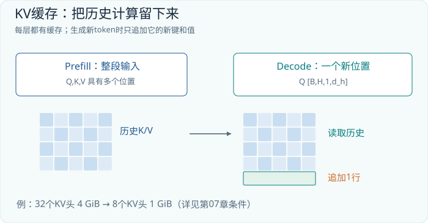

## 07.5 为什么只缓存 K 和 V

在因果自注意力中，历史位置不能读取未来。因此新增 token 到来时，历史位置在每一层的表示不会因为这个未来 token 而改变。在权重和既有前缀不变、推理计算设置一致的前提下，历史 K、V 可以重复使用。新位置只需生成自己的 Q、K、V：Q 去检索旧 K 加新 K，再用权重汇总旧 V 加新 V。

为什么一般不保存历史 Q？下一轮只需要新位置的输出，旧位置的查询已经完成使命。把历史 Q 再算一次不会为新查询增加信息。为什么每一层都有自己的 cache？因为不同层的 K、V 来自不同表示和不同投影，最后一层缓存不能代替前面各层。

若每个查询头各有一个 KV 头，缓存每层的两个张量形状可写成：

```text
K_cache: [B,H,T,d_h]
V_cache: [B,H,T,d_h]
```

缓存并没有取消注意力计算。新 Q 仍需与 T 个历史 K 做点积，并读取相应 V。随着上下文变长，单步注意力工作和缓存读取量仍增长。缓存省掉的是对旧 token 的重复投影和重复前向，不是把任意长历史压成零成本。

修改早期 prompt 后继续沿用旧 cache 通常不正确：被修改位置之后的表示都可能变化。多用户共享前缀缓存也必须建立在相同 token 序列、相同模型参数、位置处理等条件一致的基础上。它是精确复用计算结果，不是把语义相似的两段文字随便视为同一段。

## 07.6 GQA 与一笔可以算清楚的显存账

标准多头注意力 MHA 中，查询头数与 KV 头数相等。多查询注意力 MQA 让所有查询头共享一组 K/V。分组查询注意力 GQA 位于两者之间：若查询头有 H=32，KV 头数 H_kv=8，则每四个查询头共享一个 KV 头。它们依然各自拥有 Q、各自计算注意力分布，并不是四个头的输出被强制变成相同结果。[GQA 原论文](https://arxiv.org/abs/2305.13245)

在 GQA 中，Q 形状为 `[B,H,T,d_h]`，K、V 为 `[B,H_kv,T,d_h]`。计算时按分组建立对应关系，逻辑上可广播，实际高效内核通常避免把共享缓存真正复制成 H 份。缓存所需字节数可以估算为：

```text
KV_bytes = 2 × L × B × T × H_kv × d_h × bytes_per_element
```

系数 2 代表 K 和 V。设 L=32、B=1、T=8,192、H=32、d_h=128，缓存采用每元素 2 字节的 FP16 或 BF16。这是本书设定的假想配置，不对应本章对某个型号的性能实测。

| 方案 | KV 头数 | 缓存字节数 | 二进制单位 |
|---|---:|---:|---:|
| MHA | 32 | 4,294,967,296 | 4 GiB |
| GQA | 8 | 1,073,741,824 | 1 GiB |
| MQA | 1 | 134,217,728 | 128 MiB |

这里 `1 GiB=2^30 bytes`。如果 B 从 1 增至 4，上述缓存也增至四倍。实际显存还包括权重、临时缓冲、缓存分配粒度、量化元数据和系统开销；不同长度请求、前缀共享或缓存分页也会影响占用。因此公式是逻辑缓存容量估算，不是显卡利用率的完整预测。

GQA 改变投影结构和头之间的信息共享方式，不能把一个已训练好的 MHA 模型直接删掉四分之三的 K/V 就保证质量不变。它通常是训练时的架构选择，或者需要相应转换与继续训练。缓存缩小四倍也不代表整机推理速度必然提高四倍，因为权重读取、MLP、调度和其他运算没有同样缩小。

## 07.7 量化：减少比特，同时接受近似

若一个模型有 N 个参数，仅权重的理论存储约为 `N×每参数字节数`。例如 70 亿参数用 16 位存储约需 14 GB；理想的 4 位存储约需 3.5 GB。这里 GB 是十进制单位，尚未计入缩放因子、零点、对齐及未量化部分。权重量化也不会自动把 KV cache 变成 4 位，两者是独立选择。

量化可以用一个小向量理解。给定权重 `[-0.9,-0.1,0.4,1.0]`，用对称整数范围 -7 到 7，缩放 s=1/7，先算 `q=round(w/s)`，得到 `[-6,-1,3,7]`；恢复近似值 `s×q`，得到约 `[-0.8571,-0.1429,0.4286,1.0]`。这种教学表示使用 4 位有符号编码的部分范围，不是在规定所有 INT4 格式都使用同一约定。

误差来自把连续值吸附到有限格点。若某一组权重里有极端大值，它可能拉大 s，使多数小值只能落在少数格点上。按通道或分组设置不同尺度，以及基于校准数据评估输出误差，都是改善精度的方法。GPTQ 是训练后权重量化的一项代表工作，但各种量化格式和内核并不能被简单当成等价标签。[GPTQ 原论文](https://arxiv.org/abs/2210.17323)

量化后是否更快，取决于硬件是否擅长这种计算、是否需要反量化、批量大小和内存瓶颈。压缩比是存储性质，速度是整个执行路径的性质。某种格式文件更小，并不能单独证明响应更快或回答质量完全不变。

## 07.8 RAG 与微调：改上下文还是改参数

当模型不知道公司本周更新的产品资料时，常见方案是先检索资料，把相关段落放进 prompt，再生成答案。这种检索增强生成通常称为 RAG。其关键变化是模型每次作答能接触到外部证据；模型权重可以保持不变。原始 RAG 论文研究了检索器与生成模型结合的具体训练方法，而今天工程中的“先检索、再放入上下文”是更广义的使用方式。[RAG 原论文](https://arxiv.org/abs/2005.11401)

检索本身可以是一条独立管线：把文档切块，计算表示，依据查询寻找候选，再重排、过滤并给出带来源的上下文。这里的检索向量模型未必与生成模型相同。检索到了正确段落，也不保证生成模型正确引用；没有检索到，则更不应指望生成模型凭空补全可信证据。

微调则更新参数，让模型更适应特定任务、格式或领域分布。LoRA 用低秩增量表示部分矩阵更新。采用本书的行向量约定，若 W 形状为 `[D_in,D_out]`，可写 `DeltaW=A_low@C_low`，其中 A_low 为 `[D_in,r]`，C_low 为 `[r,D_out]`。于是新增可训练参数为 `r×(D_in+D_out)`，通常小于 `D_in×D_out`。[LoRA 原论文](https://arxiv.org/abs/2106.09685)

LoRA通常冻结原权重W，只训练低秩因子；常见实现另有alpha/r缩放，本节将它吸收到增量定义中。

例如 D_in=D_out=4,096、r=8，原矩阵有 16,777,216 个参数，两个低秩矩阵合计 65,536 个。它限制的是更新矩阵的秩，不是说原始权重矩阵也只有秩 8。推理时若条件允许，增量可以合并回原矩阵；若要动态切换多个适配器，则可能选择保留分离计算。

| 需求 | 常用手段 | 要检查的失败点 |
|---|---|---|
| 引入频繁变化的资料 | 检索并提供上下文 | 检索遗漏、证据过期 |
| 统一回答格式或任务习惯 | SFT，可配合 LoRA | 数据覆盖、格式退化 |
| 提供可追溯依据 | RAG 加引用校验 | 引用是否真的支持结论 |
| 改善领域任务表现 | 数据、微调与检索组合 | 独立测试是否提升 |

RAG 与微调可以同时使用：微调让模型更会利用证据与按格式回答，检索给它最新、具体、可追溯的内容。它们不是互相排斥的选项，也都不是事实正确性的自动保证。

## 07.9 动手检查

**练习一。** 概率为 `[0.50,0.30,0.15,0.05]`，top-p=0.75 保留哪些项？重新归一化后是什么？

**简答。** 保留前两项，累计概率 0.80；归一化为 `[0.625,0.375]`。

**练习二。** 采用本章 GQA 配置，但 B=2、T=4,096，缓存大小是多少？

**简答。** 仍为 1 GiB，因为 B×T 与 B=1、T=8,192 相同。假定其他参数和存储精度不变，也不计实际分配开销。

**练习三。** 把模型权重从 16 位压缩到 4 位，是否能推断所有显存和延迟都变成四分之一？

**简答。** 不能。权重理论存储约缩小四倍，KV、激活、元数据和运行开销不一定缩小；速度还取决于内核、硬件和工作负载。

本章原始资料：[nucleus sampling](https://arxiv.org/abs/1904.09751)、[GPT-2 的 past/cache 实现](https://github.com/openai/gpt-2/blob/master/src/model.py)、[GQA](https://arxiv.org/abs/2305.13245)、[GPTQ](https://arxiv.org/abs/2210.17323)、[RAG](https://arxiv.org/abs/2005.11401)、[LoRA](https://arxiv.org/abs/2106.09685)。本章数字用于解释机制与容量，未宣称任何硬件上的实测速度。


## 本章实验：训练同一模型，再比较部署时的采样行为

本实验先从随机参数训练一个周期序列微型 GPT，再在保存的模型上生成续写。因此观察到的分布来自实际学习，而不是人为指定四个 logits。训练输入与 target 仍是错开一格的 token 序列，损失为有效位置交叉熵；温度、top-p 等采样选择不参与这一基础训练目标，它们发生在模型输出 logits 之后。

```bash
python -m tinyomni.lab --chapter 07 --steps 100 --out runs/ch07
python -m tinyomni.lab --chapter 07 --load runs/ch07/model.pt --predict
```

预测入口按本实验实现的设置展示续写，采样配置为温度 0.8、top-p 0.9。本书不添加未经实现的采样 CLI 开关；需要更换这些值时，应先找到实验中相应的解码配置，再记录修改。比较时固定权重和前缀，改变的只有采样规则，才能把差异归因到解码而不是重新训练。

把每条续写分成两个指标：局部周期正确率，以及整条序列是否完整遵守规则。较低温度可能让正确规律更稳定，也可能稳定地产生同一个错误。采样多样性只说明选词变化，不等于模型学到了更多规律。若实验任务几乎确定，过高温度增加错误是正常现象，不能把这种错误解释成创造力。

保存加载是部署的一部分。应先对固定前缀检查加载前后的 logits，再进行随机采样；两次文本不同可能只是随机数不同，而不是权重损坏。反过来，两次文本相同也不能单独证明模型加载正确，未训练的贪心模型也可能总输出同一条链。比较确定性中间结果比只看最终字符串更容易定位问题。

成功标准是模型先学会任务，再能用正确的推理循环产生后续 token，并明确记录停止条件。若第一项输出重复前缀末尾，检查生成时取的是预测下一个 token 的 logits 还是已知 token 本身；若 cache 与完整前向不一致，检查历史长度、位置偏移与 mask。RAG、量化和 LoRA 在正文中属于扩展工具，本实验没有以采样训练替代这些组件的专项实现。


---

# 第08章 现代解码器的积木：RoPE、RMSNorm、SwiGLU 与高效注意力

## 08.1 主干没有消失，积木已经改变

从 GPT-2 走到许多现代开放权重语言模型，最外层流程仍然熟悉：token 查表，经过多层因果 Transformer，再映射为下一 token 分数。变化往往发生在内部积木与执行方式：位置不再一定通过加一张学习表表达；归一化可以省去均值中心化；前馈网络多了一条门控支路；注意力可以采用共享 KV 头；GPU 也不必显式保存完整分数矩阵。

这些改动不能简单归结为一个“现代 Transformer 公式”。不同模型有自己的组合和例外。本章以常见解码器设计为教学对象，分别说明每个组件解决什么问题。LLaMA 论文是这一组合的一份代表性历史资料；我们也参考官方后续 Llama 实现核对组件，但仓库版本与初代论文的配置并非逐项相同。所有模型都应按自己的配置阅读。[LLaMA 论文](https://arxiv.org/abs/2302.13971)、[官方模型实现](https://github.com/meta-llama/llama/blob/main/llama/model.py)

最重要的阅读习惯是先看接口：某个模块是否改变 `[B,T,D]` 主干形状？新增了哪些参数？改变了哪些跨 token 连接？哪些变化只影响执行效率？把这几类问题分开，论文中的新名词便不容易混成一团。

## 08.2 RoPE：让二维向量按位置旋转

旋转位置编码 RoPE 将每个注意力头的特征分成二维小组。假设一组坐标为 `(a,b)`，位置为 m，这组对应的角频率为 theta，则旋转后是：

```text
a' = a × cos(m×theta) - b × sin(m×theta)
b' = a × sin(m×theta) + b × cos(m×theta)
```

这个变换通常作用在 Q 和 K 上，而不是把一张位置向量表加到主干 X 上。二维旋转不改变向量长度，却改变方向。注意力使用 Q 与 K 的点积比较方向，位置因此进入分数。多个坐标对使用不同频率，使位置以不同尺度影响比较。[RoFormer / RoPE 原论文](https://arxiv.org/abs/2104.09864)

先只看二维教学例子。设未旋转的 q=k=(1,0)，每移动一个位置旋转 60°。q 在位置 1，k 在位置 3，则：

```text
q_1 = (cos60°, sin60°)   = (0.5, 0.8660)
k_3 = (cos180°, sin180°) = (-1.0, 0.0)
q_1 · k_3 = -0.5
```

再把二者位置都加 1，q 到位置 2，k 到位置 4：

```text
q_2 = (-0.5, 0.8660)
k_4 = (-0.5,-0.8660)
q_2 · k_4 = 0.25 - 0.75 = -0.5
```

共同平移改变两个绝对旋转角，但没有改变相对角差，因此点积保持不变。一般形式是 `dot(R(m)q,R(n)k)=q^T R(n-m)k`。这说明位置差可以自然进入注意力比较。它不意味着整个语言模型对任意平移都完全不变，因为真实内容、边界、mask 和上下文构成还会影响计算。

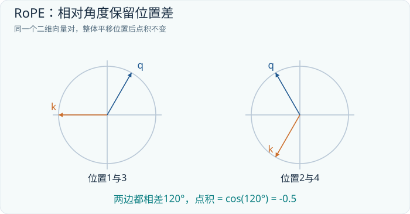

实际模型通常使用弧度和一系列频率。经典形式可以写成 `theta_i=base^(-2i/d_h)`，i 遍历二维组，base 是位置配置参数；后续模型可能调整频率或缩放规则。上面的每步 60° 便于画图，不是某个真实模型所有维度采用的角度。

假设 d_h=8，就有四个二维组。Q 的整体形状仍为 `[B,H,T,8]`，只是每组坐标内部发生旋转，不新增注意力头，也不增加 token。实现可能配对相邻维，或采用另一种等价排列；权重与旋转布局必须对应，不能只因为两段代码都叫 RoPE 就直接混用。

## 08.3 RoPE 为什么不等于无限上下文

学习位置表超出表长会遇到直接的索引问题；RoPE 的三角函数可以计算任意位置，看起来似乎没有边界。但“函数能算”与“模型在这个范围内训练得好”是两回事。训练时只见过某些位置差与相位组合，推理时突然扩展很多倍，仍可能改变注意力统计并导致质量下降。

位置插值提供了一种思路：假设希望把原来支持的长度扩大 s 倍，把新位置 m 映射成 m/s 再进行原有旋转，使角度范围更接近训练区间。代价是相邻位置在这个坐标系中更接近，原有细粒度位置区分也随之改变，通常需要继续训练和评估。它不是免费复制四倍长度的通用按钮。[位置插值原论文](https://arxiv.org/abs/2306.15595)

长上下文至少包含三个不同问题：系统是否装得下，位置机制是否适应，模型能否准确使用远处信息。前者由缓存、激活、分布式与内核效率影响；第二项涉及位置处理和训练；第三项涉及数据和任务能力。一个模型接受了十万 token 输入，只能证明接口和执行流程允许这次输入，不能证明它把每个段落都同样可靠地理解了。

长文评估应改变关键信息的位置、加入相似干扰项，并测试多个证据之间的组合。只在长文本中寻找一个独特字符串，是有价值但狭窄的检查。早期研究已经展示了相关信息处在中间位置时可能更难被利用；这类现象提醒我们按任务测试，而不是把窗口上限当作能力分数。[Lost in the Middle](https://arxiv.org/abs/2307.03172)

## 08.4 RMSNorm：控制尺度，不强制均值归零

LayerNorm 对每个 token 的 D 维向量计算均值和方差，先中心化再缩放。RMSNorm 则用均方根控制尺度，省去减均值：

```text
rms(x) = sqrt(mean(x_i × x_i) + epsilon)
RMSNorm(x)_i = g_i × x_i / rms(x)
```

g 是长度 D 的可学习缩放向量。常见实现没有额外偏置，但具体模型仍应以代码为准。epsilon 防止分母接近零；内部以较高精度计算平方和，也能减少低精度累积误差。[RMSNorm 原论文](https://arxiv.org/abs/1910.07467)

用 x=`[1,2,3,4]` 做教学比较，忽略极小 epsilon 并令缩放为 1。均方根为 `sqrt(7.5)=2.7386`，RMSNorm 输出约 `[0.3651,0.7303,1.0954,1.4606]`。它们仍全为正，均值也不为零。LayerNorm 则先减去均值 2.5，再除以标准差 `sqrt(1.25)=1.1180`，得到约 `[-1.3416,-0.4472,0.4472,1.3416]`。

两者都在调整特征尺度，但保留与删除的信息不同。RMSNorm 没有主动移除整行的均值分量，因此不能把它理解为“完全一样，只少一次减法”。它的研究动机是检验重新缩放是否足以获得所需训练性质，并减少部分计算。实际总模型加速取决于归一化在工作负载中的占比，不能把一个算子的理论简化直接当作整模型的同倍率加速。

RMSNorm 一般仍逐 token 工作：输入 `[B,T,D]`，统计量形状可保留为 `[B,T,1]`，再沿 D 广播。它不会把整个 batch 混在一起计算均值，也不会把 T 个位置压成一个向量。这使训练与不同长度的推理更容易保持一致的归一化接口。

## 08.5 SwiGLU：两条投影支路相乘

GPT-2 的 MLP 可以写成 `GELU(XW_up+b_up)W_down+b_down`。一种常见门控前馈网络 SwiGLU 则先构造两条支路，再逐元素相乘：

```text
G = SiLU(X @ W_gate)
U = X @ W_up
F = (G * U) @ W_down
SiLU(z) = z × sigmoid(z)
```

星号表示逐元素乘法，不是矩阵乘法。设中间宽度为 M，W_gate 与 W_up 都是 `[D,M]`，W_down 是 `[M,D]`。两个中间张量都是 `[B,T,M]`，乘完仍是同形张量，最终返回 `[B,T,D]`。这里省略偏置以对应一种常见现代配置。[GLU 变体原论文](https://arxiv.org/abs/2002.05202)

门控带来的变化是输入可以决定某些中间特征如何被放大、削弱或改变符号。它不是 softmax：各维没有总和为 1 的约束，也不在不同 token 之间选择。SiLU 的输出也不局限在 0 到 1，所以“开关”只能作为比喻，不能把它当作二值开门或关门。

看一个 D=2、M=3 的构造算例。令 x=`[1,2]`，并选择：

```text
W_gate = [[ 1,0,-1],    W_up = [[1,1,0],
          [ 0,1, 1]]            [1,0,1]]

W_down = [[1, 0],
          [0, 1],
          [1,-1]]
```

于是 `xW_gate=[1,2,1]`，经过 SiLU 得到约 `[0.7311,1.7616,0.7311]`；另一条支路 `xW_up=[3,1,2]`。逐元素乘后为 `[2.1932,1.7616,1.4621]`，再乘 W_down，最终约为 `[3.6553,0.2995]`。这组数字的意义不在于输出是否“有语义”，而在于看清每个矩阵承担的角色：两条投影构造可相互调制的特征，第三条投影把它们混合回主干空间。

## 08.6 为什么中间宽度常常不是 4D

一个不带偏置、扩展为 4D 的普通 MLP 有两张大矩阵，参数量约为 `D×4D+4D×D=8D²`。如果 SwiGLU 仍把 M 设置为 4D，就会拥有三张矩阵，总量变成 `12D²`，多出约一半。要在相似参数预算下比较，可以令：

```text
3 × D × M = 8 × D × D
M = 8D / 3
```

例如 D=768，取 M=2,048。两矩阵普通 MLP 的权重数是 4,718,592；三矩阵 SwiGLU 的权重数也是 4,718,592。这里仅比较权重，排除了偏置和归一化参数。实际系统往往再把 M 舍入到适合硬件的整数倍，所以配置文件中出现某些不直观的宽度，并不一定是笔误。

| 前馈结构 | 中间宽度 | 权重参数量 |
|---|---:|---:|
| 普通双矩阵 MLP | 4D | `8D²` |
| SwiGLU，保持 4D | 4D | `12D²` |
| SwiGLU，近似等预算 | 8D/3 | `8D²` |

这说明比较架构时必须同时检查宽度和参数预算。若一个门控模型使用更多参数、更多训练数据与更多计算，不能把全部性能差异都归功于“乘了一条门”。反过来，参数数相近也不意味着算子效率完全一样；中间张量、激活函数和硬件融合程度都会影响运行成本。

## 08.7 FlashAttention：不把整张分数表搬来搬去

标准注意力的概念表达是先算 `[T,T]` 分数矩阵，再 softmax，再乘 V。对于长序列，显式写出和读取这张大表很昂贵。GPU 的高带宽显存 HBM 容量大，片上 SRAM 更小却更接近计算单元；频繁把大中间结果写回 HBM，可能比我们从算术次数上预期的更慢。

FlashAttention 通过分块计算与在线 softmax，在片上处理一小块 Q、K、V，并维护每行必要的统计量与输出累积，避免在 HBM 中物化完整注意力矩阵。它计算的是精确注意力算法，考虑浮点舍入时可能与另一执行顺序有微小差异；“精确”是相对于改变注意力数学定义的近似方法而言。[FlashAttention 原论文](https://arxiv.org/abs/2205.14135)

难点在于 softmax 分母涉及所有键位置，不能把每个块各自归一化后直接平均。一个行级算法只需要持续保存最大分数 m、归一化分母 l 和未归一化加权和 u。看到新块 s、v 时，先令新最大值为 m_new，再把旧统计量换到新参考尺度：

```text
m_new = max(m, max(s))
l_new = exp(m-m_new) × l + sum(exp(s-m_new))
u_new = exp(m-m_new) × u + sum(exp(s-m_new) × v)
最终输出 = u / l
```

这里对 v 的乘法按向量分量累积；真实注意力每行输出是 d_h 维向量。为方便手算，先让 v 是标量。给定分数 `[1,2,3,4]`、内容 `[10,20,30,40]`，分两块处理：第一块后 `m=2`，`l=1.3679`，`u=23.6788`；第二块后最大值更新为 4，旧量乘以 `exp(-2)`，加入新块，得到 `l=1.5530`、`u=54.2410`。相除约为 34.9265，与一次性对四个分数做 softmax 后加权一致。

这个例子揭示核心：可以不保存整行的全部概率，只保留足够的信息，最后得到同一个输出。真正 GPU 内核还需处理分块大小、线程组织、因果边界和反向传播重计算，复杂性远超这段行级伪代码，但数学机制已经清楚。

## 08.8 复杂度的三本账

理解高效注意力，至少要分清算术量、临时存储和数据搬运。全注意力仍需考虑大量查询-键配对，因此密集注意力的算术复杂度仍随 T² 增长。FlashAttention 避免完整分数矩阵的持久存储，并减少 HBM 访问，不等于把密集注意力自动变成线性时间。

| 问题 | 常见改善手段 | 不应推出的结论 |
|---|---|---|
| 历史 token 重复前向 | KV cache | 长历史读取免费 |
| KV cache 太大 | GQA、缓存量化 | 所有计算同比缩小 |
| 分数矩阵搬运昂贵 | FlashAttention | 密集注意力变成 O(T) |
| 访问位置太多 | 滑窗或稀疏注意力 | 与全注意力完全相同 |

滑动窗口限制每个位置只读取附近的 W 个位置，在 W 固定时可把相应注意力工作缩减到近似 O(TW)。但这改变了可访问的信息范围。远处信息可能通过多层传播，仍不能把直接全连接访问与局部传播视为相同。FlashAttention 则主要改变执行方式，二者处于不同层次，也可以组合。

同样，减少训练时的注意力激活，不会自动消除推理阶段的 KV cache。前者是如何计算和保存一次注意力中间结果，后者是如何保存多步生成所需的历史投影。看见“内存线性”这样的描述时，应追问它指哪一种张量、哪一个阶段、固定了哪些维度。

## 08.9 动手检查

**练习一。** 本章 RoPE 二维例子中，若 q 与 k 同时增加五个位置，点积是否改变？如果只把 k 增加一个位置呢？

**简答。** 同时增加五个位置保持角差，点积仍为 -0.5。只把 k 增加一个位置，角差从 120° 变为 180°，点积变为 -1。这里假设未旋转向量保持为 `(1,0)`，每步仍为教学设定的 60°。

**练习二。** D=384，普通 MLP 中间宽度为 1,536。若使用无偏置 SwiGLU 并保持权重参数量相同，M 应取多少？

**简答。** `M=8×384/3=1024`。两者权重数都为 `8×384²=1,179,648`。

**练习三。** FlashAttention 没有在显存中保留完整 `[T,T]` 概率表，是否说明某些 token 对从未计算？

**简答。** 对密集版本不是。相关块仍参与计算，只是结果以在线统计量与加权和形式累积。若使用因果或稀疏 mask，不允许访问的配对则按其规则排除，需区分数学可见范围与存储策略。

本章原始资料：[RoPE](https://arxiv.org/abs/2104.09864)、[RMSNorm](https://arxiv.org/abs/1910.07467)、[GLU 变体](https://arxiv.org/abs/2002.05202)、[LLaMA](https://arxiv.org/abs/2302.13971)、[官方实现](https://github.com/meta-llama/llama/blob/main/llama/model.py)、[位置插值](https://arxiv.org/abs/2306.15595)、[长上下文评估](https://arxiv.org/abs/2307.03172)、[FlashAttention](https://arxiv.org/abs/2205.14135)。旋转、门控和在线 softmax 数例均为教学构造，并经过独立数值核对。


## 本章实验：训练并比较 GELU 与 SwiGLU 小网络

本实验选择本章一个可以低成本训练的组件：前馈网络。两个小模型接收四维输入，以 `sin(x0)+x1*x2-0.3*x3` 为 target，分别使用 GELU 双投影和 SwiGLU 三投影，用均方误差学习非线性关系。实验不包含完整现代语言模型，也没有把一个普通矩阵运算程序称为 GPU FlashAttention 实现。

```bash
python -m tinyomni.lab --chapter 08 --steps 100 --out runs/ch08
python -m tinyomni.lab --chapter 08 --load runs/ch08/model.pt --predict
```

两种结构都保留输入与最终输出接口，但中间计算不同。GELU 支路先扩展再压缩；SwiGLU 形成两条同形支路，其中一条经过 SiLU，再逐元素相乘。训练时必须让两条投影都参与梯度更新。若把一条支路预先固定为常数，便不再是在比较同样的可学习门控机制。

公平比较要同时记录实际参数量、隐藏宽度、优化器和训练步数。等中间宽度时，三投影网络通常拥有更多权重；接近等参数预算时，又需要调整中间宽度。因此某个小任务上的较低误差，只能说明这组配置的结果，不能直接推出某种激活在全部语言模型上必然更优。

检查点保存本实验所需的模型状态，加载后在同一输入上得到对应预测。训练结果的验收以独立样本误差为主，辅以保存加载的一致性；不是要求两个结构必须分出固定胜负。若它们在简单目标上都拟合得很好，也是一种正常结果，说明这个任务尚不足以暴露结构差异。

如果门控网络不收敛，先检查乘法是逐元素还是矩阵乘法、两条支路宽度是否相同、初始化与学习率是否合理；如果一方明显领先，检查是否只是参数更多或数据顺序不同。正文中的 RoPE 与在线 softmax 手算用于理解机制，不能把本实验的前馈训练结果扩写为已验证长上下文能力、RoPE 外推性能或 FlashAttention 的硬件加速。


---

# 第09章　让参数各司其职：从稠密网络到混合专家

一个模型能不能拥有很多知识，却不在每次处理一个词时调用全部参数？前面介绍的稠密 Transformer 很像一本每页都要经过同一套加工流程的书：无论当前 token 是代码中的括号，还是中文诗歌中的意象，某一层的前馈网络总使用同一组权重。混合专家模型，即 Mixture of Experts，改变的是这条计算路径。它保留许多可以选择的前馈网络，让一个很小的路由器决定本次使用其中哪些网络。

“专家”在这里是一个参数模块的名称，不代表一个可以独立交谈的语言模型，也不保证它对应人类命名的学科。我们先搭建一个能手算的 MoE，再去阅读 DeepSeek-V3 的配置。这样，671B 和 37B 就不再是两个孤立的大数，而是能够追溯到计算图的数量。

## 09.1　先把稠密 FFN 拆开来看

设注意力之后的输入是 X，形状为 [B,T,d]。为了集中讨论逐 token 计算，把前两个轴展平，记 N=B×T，得到 [N,d]。每一行是一枚 token 在这一层的向量；行与行之间的信息交换已由注意力完成，FFN 对每行分别应用同一个函数。

现代模型经常使用门控前馈网络。以一种忽略偏置的写法为例，所有向量均按行存放：

```text
X       : [N,d]
W_gate  : [d,m]
W_up    : [d,m]
W_down  : [m,d]

G = SiLU(X @ W_gate)             # [N,m]
U = X @ W_up                    # [N,m]
F = (G * U) @ W_down            # [N,d]，* 是逐元素乘
Y = X + F                      # 示意残差；归一化位置另行处理
```

这里的三个矩阵约有 3dm 个参数。m 越大，模型在中间空间中可以使用的特征组合越丰富，每一个 token 的乘加工作也越多。现在把一组矩阵改成 E 组，得到 E 个专家，每个专家仍然接受 [d]、输出 [d]。如果让所有专家都处理所有 token，再把结果相加，这只是扩大计算量。MoE 的关键在于稀疏选择：每行仅送入 k 个专家，通常 k 远小于 E。

| 对象 | 形状 | 作用 |
|---|---|---|
| token 矩阵 X | [N,d] | 本层所有输入 |
| 路由权重 W_router | [d,E] | 产生专家分数 |
| 稀疏路由矩阵 A | [N,E] | 每行至多 k 项非零 |
| 第 e 个专家输出 | [n_e,d] | 只计算分配给它的 n_e 行 |

不要把路由矩阵 A 与注意力矩阵混淆。注意力矩阵的两个主要轴是“查询 token”和“被读取的 token”；这里的两个轴是“token”和“专家”。前者决定向谁读取上下文，后者决定把当前表示交给哪组参数加工。

## 09.2　四枚 token 怎样通过三个专家

下面的数值是为手算构造的教学例子，不是从真实模型中抽取的激活。假设三名路由专家、每行选择两名。把 X 与非负亲和分数 S 直接作为分发算子的已知输入；本例不求解从 X 产生 S 的路由器权重。每行保留最大的两个数，再除以这两个数的和。第三行有并列，明确约定优先选择编号较小的专家。

```text
X = [[ 1, 2],       S = [[0.6, 0.3, 0.1],
     [ 2, 0],            [0.1, 0.7, 0.2],
     [-1, 1],            [0.2, 0.2, 0.6],
     [ 0, 2]]            [0.5, 0.1, 0.4]]

top-2 并重新归一化：
A = [[2/3, 1/3,   0],
     [  0, 7/9, 2/9],
     [1/4,   0, 3/4],
     [5/9,   0, 4/9]]
```

虽然这个 S 的各行恰好加起来为 1，计算过程并不要求它事先如此。比如经过逐元素 sigmoid 得到的亲和分数，通常不满足行和为 1。需要检查的是选中之后如何归一化，以及实现是否另有输出缩放。

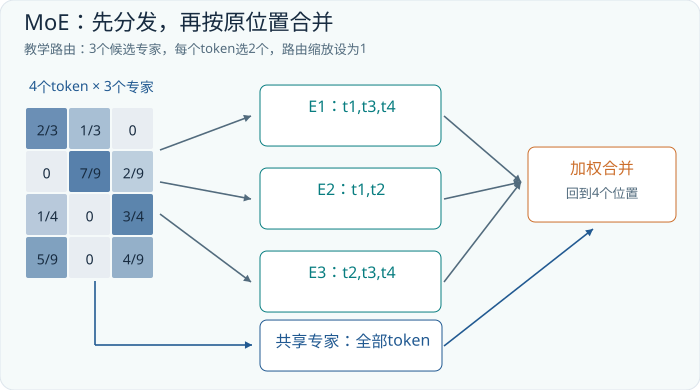

为了把路由行为与复杂的 FFN 分开，暂时令 E1(x)=x、E2(x)=2x、E3(x)=-x。另有一个每枚 token 都会调用的共享专家，设 Shared(x)=0.5x。这些线性函数仅用于演示，真实专家内部具有前述门控非线性。

第一枚 token 经过 E1 和 E2，路由输出为：

```text
x1 = [1,2]
routed1 = (2/3)*[1,2] + (1/3)*[2,4] = [4/3,8/3]
shared1 = [1/2,1]
F1 = routed1 + shared1 = [11/6,11/3]
Y1 = x1 + F1 = [17/6,17/3]       # 如果此处再计入残差
```

第三枚 token 提供了一个更有意思的情况：E1 与 E3 的结果方向相反。路由输出等于 -0.5x3，而共享输出等于 0.5x3，所以 F3 恰好为零。专家输出可以抵消，权重的非负性并不使最终向量的每个坐标非负。完整的 FFN 增量如下；它尚未加残差。

```text
F = [[11/6,11/3],
     [11/3,   0],
     [   0,   0],
     [   0,11/9]]
```

从矩阵 A 的列还能读出计算批次：E1 接收第 1、3、4 行，E2 接收第 1、2 行，E3 接收第 2、3、4 行。不是把完整 X 给每个专家，然后将无用结果乘零；那会失去稀疏计算的收益。实现通常先收集索引，分别组成 [3,d]、[2,d]、[3,d] 的小矩阵，完成乘法后再散射回原 token 位置。

## 09.3　参数容量、激活参数与显存是三本账

考虑一个玩具层：d=1024，每名专家的中间宽度 m=2048，共有 16 名路由专家，每枚 token 选 2 名，另有 1 名共享专家。仍然忽略偏置和路由器的小额开销：

```text
每名专家参数 = 3 × 1024 × 2048 = 6,291,456
全部专家参数 = 17 × 6,291,456 = 106,954,752
每 token 使用 = (2+1) × 6,291,456 = 18,874,368
```

这说明一个层可以拥有约 1.07 亿专家参数，而一次 token 计算只调用其中约 1887 万。模型把可存储的参数容量与单次执行的参数数量部分解耦了。但这里的“使用”是计算路径上的统计口径，不能直接当作真实 FLOPs，更不能当作显存需求。

如果全部权重以每参数 2 字节常驻设备，专家权重仍约占 204 MiB，而不是只占约 36 MiB。下一枚 token 可能选择另外两名专家；下一批请求还可能覆盖所有专家。可以把专家分布到多个设备，或在内存与显存之间调入调出，但搬运时间和额外缓冲区会进入系统账单。训练还要为参数梯度、优化器状态和中间激活准备空间。

DeepSeek-V3 的公开配置提供了一个真实落点：总参数约 671B，每 token 激活约 37B；61 层中前三层采用稠密 FFN，其余层各有 1 名共享专家和 256 名路由专家，每 token 选中 8 名路由专家。专家中间宽度为 2048，隐藏宽度为 7168。这里的 37B 覆盖模型整体的相关计算路径，不能用 671B×8/256 来复算，因为注意力、共享专家和稠密层等部分也在其中。[DeepSeek-V3 技术报告，第4.2节](https://arxiv.org/html/2412.19437v2#S4.SS2)

仅作存储量级估计，如果把 6710 亿参数都按 2 字节存放，权重本身约为 1.342 TB，即约 1.22 TiB。量化可以改变这个数字，但“37B 激活”并不表示把整个原始模型装入一张只够存放 37B 权重的显卡就能无代价运行。批大小、缓存长度、量化格式和并行切分方式必须另行说明。

还可以在大致相同的专家参数预算下改变粒度。设方案甲有 8 名宽度 4096 的专家，每次选 1 名；方案乙有 16 名宽度 2048 的专家，每次选 2 名。两者全部专家中间宽度的总和均为 32768，每 token 调用的中间宽度总和均为 4096。因此按前述 3dm 估算，专家总参数和单 token 激活参数相同。但甲有 8 种单专家选择，乙有 120 种双专家集合，可以更灵活地组合参数模块。

组合数量更大不等于能力必然更强。路由器必须学会利用这种自由度，更小的专家批次还可能降低硬件效率。而且把一个非线性 FFN 切成两块，再施加不同路由权重，不保证与原 FFN 完全等价。细粒度专家提供的是一种结构与训练选择，不能只凭组合计数推断最终质量。

## 09.4　路由不仅要选得准，还要避免排长队

若训练初期某个专家偶然表现较好，路由器可能不断把更多 token 送给它。该专家因获得更多训练机会而继续变强，其他专家逐渐闲置。容量没有真正用起来，最忙的设备还会拖慢整步计算。这种问题不能通过“平均每名专家收到 N×k/E 行”来消除，因为平均数不描述分布。

例如 N=1024、E=16、k=2，平均负载为 128 次 token 分配。若某个专家实际收到 700 行，它承担的计算远大于平均值。传统方案可加入鼓励负载均衡的辅助损失，也可设置每个专家的容量上限。容量上限需要配套定义：溢出的 token 是丢弃该支路、改派，还是等待？不同选择会影响数值行为与吞吐，不能只报一个 top-k 数值。

再看一个更小的偏置例子。某 token 对三名专家的亲和分数是 [0.60,0.55,0.50]，若 top-1，只会选 E1。假设观察到 E1 过载，给选择分数加上偏置 [-0.15,0,0.02]，选择时得到 [0.45,0.55,0.52]，于是改选 E2。这相当于在“内容适配程度”之外加入“当前资源拥挤程度”的调节。

DeepSeek-V3 使用的负载调节偏置影响专家选择，但最终加权仍来自原来的亲和分数；偏置不是混入输出的内容信号。其报告称为 auxiliary-loss-free 的主要平衡策略，也保留了一个很小的序列级平衡辅助项。因此不能把名称理解为“训练目标中绝对没有任何平衡辅助损失”。[DeepSeek-V3 技术报告，第2.1.2节](https://arxiv.org/html/2412.19437v2#S2.SS1.SSS2)

在真实实现中，归一化后的路由权重还可能整体乘一个系数。V3 公开配置中的 routed_scaling_factor 是 2.5。这意味着“选中专家权重和为 1”描述的是归一化步骤，而非缩放后的最终支路系数。本章手算例子把这个系数设为 1，以隔离路由机制。[DeepSeek-V3 官方配置](https://huggingface.co/deepseek-ai/DeepSeek-V3/blob/main/config.json)

## 09.5　通信是稀疏网络的一部分

假设 E1、E2 在设备 A，E3 在设备 B。图09-1的第 2、3、4 枚 token 都需要访问 E3。它们的向量必须从所在设备发到 B，专家计算结束后再把结果送回。专家并行的核心不只是“把参数分开存”，还包括分发、计算、回传和重新排列四个环节。

举一个只统计有效向量载荷的例子：一批有 4096 枚 token，d=4096，top-2，输入和输出均为 BF16。若全部两路分配都跨设备，发送输入的载荷约为 4096×2×4096×2 字节，即 64 MiB；回传同形状结果又约 64 MiB。这尚未包含索引、对齐填充、同步与路由缓冲。若一部分专家就在本地，或同节点可复用一次传输，真实网络流量会不同。

因此，增加专家数量但保持 k 不变，虽然不必线性增加每 token 的专家乘法量，仍可能增加跨节点通信、负载管理和权重分布的难度。一个只统计矩阵乘 FLOPs 的比较，会漏掉部署时真正等待的部分。

共享专家的意义也可以从这张图重新理解：每枚 token 都经过它，模型有一条公共的变换路径；路由专家再提供可选择的补充。究竟哪些规律进入共享模块，哪些形成专家专长，由训练共同决定。观察到某专家偏爱某种 token，不等于证明它学到了一个封闭、稳定、可以人类命名的技能。

## 09.6　读“开源模型”时，分开检查三种材料

下载得到权重，意味着可以在许可范围内运行或修改已训练模型；得到推理代码，意味着能够检查前向计算的实现；得到完整训练数据及构建流程，才进一步接近重建训练过程。这三者没有逻辑上的自动蕴含关系。还应区分公开论文中的方法描述与完整可复现的训练系统。

本书讨论的是明确命名的 V2、原始 V3 与原始 R1，不把后续型号的许可和实现倒推给它们。V3 官方仓库将代码许可与模型许可分开列出，代码为 MIT，模型使用另列的 Model License；R1 仓库对主体代码与权重采用 MIT，并提示蒸馏模型还涉及相应基础模型的许可。做版本核对时应查看具体模型卡及随权重提供的许可证文件。[V3 许可说明](https://github.com/deepseek-ai/DeepSeek-V3#7-license)、[R1 许可说明](https://github.com/deepseek-ai/DeepSeek-R1#7-license)

这些发布材料不等于公开了完整预训练语料。因此，书中称“开放权重”时，只陈述实际可取得的工件；称“可复现”时，则必须进一步交代数据、软件、训练设置和算力条件。对学习者而言，能读懂并运行前向图已非常有价值，但它与从头重建同等能力的模型是不同的工程任务。

## 09.7　练习与答案

**练习1：** 图09-1的 A 有多少个非零元素？每名路由专家收到多少行？共享专家收到多少行？为什么不能由总分配数直接推断最慢专家的耗时？

**答案：** A 有 8 个非零元素，三名路由专家分别收到 3、2、3 行，共享专家收到 4 行。总数只给出总体工作量；各专家的批次大小、所在设备速度、通信等待和乘法效率共同决定完成时间。

**练习2：** 保持第09.3节的 d、m、k 和共享专家不变，把路由专家从 16 增加到 32。全部专家参数与每 token 专家激活参数各是多少？

**答案：** 全部专家参数变为 33×6,291,456=207,618,048；每 token 仍调用 3 名专家，为 18,874,368。路由器参数量与全体权重存储增大，所以“专家乘法工作近似不变”不代表系统成本全部不变。

**练习3：** 选择时使用 s+b，合并时使用 s。某 token 原分数为 [0.4,0.3,0.2]，偏置为 [-0.2,0,0.2]，top-2，输出缩放系数为 1。选中哪些专家，合并权重是多少？

**答案：** 选择分数是 [0.2,0.3,0.4]，选 E3 与 E2；原分数归一化给出 E2 权重 0.6、E3 权重 0.4。不能拿选择分数归一化得到 3/7 和 4/7，那会把资源调节偏置误当成内容混合权重。


## 本章实验：训练四专家、top-2 路由的分段回归器

本实验让一个小 MoE 学习分段非线性映射。每个输入由数据生成器产生一个连续 target；路由器给四个专家打分，选择其中两个，归一化所选权重后混合专家预测。训练使用均方误差加上系数为 0.01 的负载平衡辅助项，使专家与路由逐步适应该任务。这里训练的是一个可检查的小回归网络，不是缩小参数量后便能获得同等能力的 DeepSeek 模型。

```bash
python -m tinyomni.lab --chapter 09 --steps 100 --out runs/ch09
python -m tinyomni.lab --chapter 09 --load runs/ch09/model.pt --predict
```

为了让示例清晰，代码可以计算全部四个专家，再用 top-2 掩码选取参与输出的结果。这在输出数学上展示了稀疏选择，但执行层面仍做了所有专家计算。因此参数被选择的比例不能直接写成节省了一半 FLOPs，更不能宣称已经实现专家并行或稀疏加速内核。

除训练和独立输入误差外，还要查看专家负载，即各专家被选中的频率。代码的 `expert_load` 用全部选择次数归一化，因此四项总和为 1；若改成每样本选择频率，总和会是 2。记录指标时必须写清分母，避免把正常的总和误判成实现错误。专家被选中不代表它获得相同的混合权重，也不代表它处理的样本同样困难。

检查点需要同时保存路由器与全部专家。部署不能只加载最常用的两个专家，因为不同输入可能选择不同组合。验收要求独立输入误差改善、保存加载一致，并且能报告路由分布；不要求负载必然完全均匀，也不把均匀负载本身当作任务成功。分段任务的各区域若频率不同，合理负载本来就可能不相同。

若误差只在某一区域很大，检查该区域样本量和实际路由；若所有输入几乎只用同一组合，检查路由分数、专家初始化与是否出现塌缩。增强平衡项可能改善负载，却未必改善拟合。先把任务误差和路由统计同时画出来，再决定是否调整辅助项权重，不能用一个好看的平均值代替诊断。


---

# 第10章　把历史记忆压进潜变量：MLA 的矩阵推演

MoE 节省的是每枚 token 经过前馈网络时的部分计算。另一个不断增大的负担藏在注意力里：模型每生成一枚 token，都需要读取历史 token 的键和值。模型权重在一次对话中通常固定，KV 缓存却随上下文增长。长文档、多轮对话与大批量服务，会把“保存历史”变成独立于参数规模的资源问题。

本章从缓存的字节数开始，推导 DeepSeek-V2、V3 使用的 Multi-head Latent Attention，即 MLA。这里的 latent 指较低维的联合表示。它不只是把 KV 换成更低精度的数字，也不等于让多个查询头共享同一组键和值；它改变了可以被缓存和直接参与注意力计算的表示。

## 10.1　先算清楚要存什么

标准多头注意力有 h 个头，每头键维度 dk、值维度 dv。忽略缓存管理元数据，对 B 个请求、每个长度 T、共 L 层，缓存元素数是：

```text
KV 元素数 = B × T × L × h × (dk + dv)
KV 字节数 = KV 元素数 × 每元素字节数
```

设 B=1、T=8192、L=32、h=32、dk=dv=128，缓存以 BF16 存储，每元素 2 字节。总量恰好是 4 GiB。把批大小增为 8，就成为 32 GiB。这里没有计入模型权重，更没有计入训练时保存的反向传播中间量。

为什么通常不缓存全部历史查询 Q？在标准自回归解码中，第 t 步只需要当前查询去读取过去各位置的 K、V；旧查询已经完成过自己的读取任务。未来新增 token 不需要重新计算旧位置的输出。因此压缩 Q 可能减少训练或投影计算的成本，却不会像压缩历史 K、V 那样直接减少解码缓存。

还要分清 prefill 与 decode。prefill 一次处理用户输入的整段文本，许多查询可以并行；decode 通常每次为每个请求产生一枚新 token，读很长的历史缓存。对前者有利的矩阵形状和内核，不一定适合后者。一个注意力结构可以在 decode 省缓存，同时在 prefill 采用另一条展开计算路径。

## 10.2　MHA、GQA 与 MLA 改动的是不同约束

在 MHA 中，每个查询头有对应的键和值投影。GQA，即分组查询注意力，仍保留较多查询头，但令一组查询头共享一组 K、V。若查询头为 32、KV 头为 8，则每 4 个查询头读取同一组 KV；上例缓存从 4 GiB 降到 1 GiB。GQA 的核心限制是“哪些查询头共享相同的键和值”。这是一种结构选择，不是无需训练就能任意套在既有权重上的无损变换。[GQA 原始论文](https://arxiv.org/abs/2305.13245)

MLA 采取另一种办法：对每个历史 token 保存一个共同潜变量 C，再通过不同的上投影矩阵恢复各头的键和值。不同头可以得到不同的 K、V，但它们共同受这个低维表示约束。注意“不同”与“独立”的区别：各头并非完全共享同一个 K、V，也不是各自拥有毫无限制的完整表示。

| 机制 | 历史缓存的核心对象 | 每层每 token 元素数 |
|---|---|---|
| MHA | 每头独立 K、V | h×(dk+dv) |
| GQA | g 组 K、V | g×(dk+dv) |
| MLA | 联合潜变量和位置键 | r+p |

表中 r 是联合 KV 潜变量维度，p 是之后解释的位置键维度。它比较的是存储形状，不是证明三种结构具有相同精度。不能仅由元素数宣布哪一种在所有任务上更好。MLA 的低维子空间、查询头数和训练过程共同决定表达能力。

## 10.3　低秩联合表示怎样生成键和值

仍采用行向量约定。令输入 X 的形状为 [B,T,d]，先沿最后一维降到 r。为突出矩阵关系，下面把归一化后的潜变量统一记为 C：

```text
C   = Norm(X @ W_D)               # [B,T,r]
K_C = C @ W_UK                   # [B,T,h*dk]
V   = C @ W_UV                   # [B,T,h*dv]

W_D  : [d,r]
W_UK : [r,h*dk]
W_UV : [r,h*dv]
```

K_C 和 V 再分别 reshape 为 [B,T,h,dk] 与 [B,T,h,dv]。下标 C 表示内容支路；稍后还会增加一个位置支路。真实实现可以把两次上投影合成一次矩阵乘，再沿最后一维切开。合并矩阵是工程组织方式，不会改变这里的依赖关系。

如果 r=512，而 h×dk=16384，那么一行 512 维潜变量足以通过已学到的矩阵产生 16384 维内容键，另产生 16384 维值。生成出的 32768 个数当然不是任意自由变化的：它们都由同一行 512 个数决定。这正是低秩约束带来的压缩来源。

查询也可以走“降维、归一化、升维”的路线，但应单独画出来。以 V3 为例，当前隐藏向量先从 7168 维映射到 1536 维，再产生 128 个头各自的内容查询与位置查询，合计 128×(128+64)=24576 个坐标。查询潜变量与 KV 潜变量不是同一个张量，维度也不同；它们共享输入来源，却承担不同工作。

配置中的字段 q_lora_rank、kv_lora_rank 容易使人联想到 LoRA 微调。名称里出现低秩，并不意味着这里只是给冻结基础模型挂上一个可拆卸的微调适配器。在 MLA 中，这些瓶颈属于注意力主体的参数化结构。判断一个低秩矩阵做什么，要沿着它在计算图中的输入、输出和缓存去看，不能仅靠字段名称。

这里没有“先得到完整 KV，再找一种无损文件压缩”的过程。模型训练时就采用这条受限的参数化路径，学习让 C 保留对后续读取最有用的信息。任意稠密模型的已有 KV 通常不能直接无损装进同样大小的 C；“MLA 两种计算实现等价”与“任意 MHA 都能无损变成 MLA”是两件不同的事。[DeepSeek-V2 技术报告，第2.1节](https://arxiv.org/html/2405.04434v5#S2.SS1)

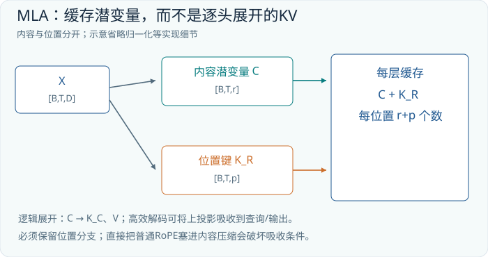

## 10.4　不把 K、V 展开，也能算出相同结果

若每步仍把全部历史 C 展开成巨大 K、V，虽可减少长期存储，却会增加重复计算。MLA 更关键的一步是重新排列矩阵乘法。只看一个头，省略 batch：

```text
当前内容查询 q : [1,dk]
历史潜变量 C  : [T,r]
该头 U_K      : [r,dk]
该头 U_V      : [r,dv]

展开的内容分数 = q @ (C @ U_K)^T
               = (q @ U_K^T) @ C^T

q_latent = q @ U_K^T             # [1,r]
内容分数 = q_latent @ C^T         # [1,T]
```

这只是矩阵乘法结合律和转置规则。没有交换矩阵的次序，也没有近似截断。当前查询先被映射到 r 维，再直接与历史潜变量比较，不必为所有历史位置生成展开的键。

用两个历史位置、二维潜变量亲手验证：

```text
C   = [[1,0],      U_K = [[1,0],      q = [[1,2]]
       [0,2]]             [1,1]]

K   = C @ U_K = [[1,0],
                  [2,2]]
q @ K^T = [[1,6]]

q_latent = q @ U_K^T = [[1,3]]
q_latent @ C^T = [[1,6]]
```

在这个暂不包含位置支路的例子中，除以 sqrt(2) 并做 softmax，注意力权重约为 [0.028318,0.971682]。现在令 U_V=[[2,0],[0,1]]，展开值是 V=[[2,0],[0,2]]。先读取展开值，得到输出约 [0.056636,1.943364]。

如果先读取潜变量，则计算为：

```text
a = [[0.028318,0.971682]]
a @ C = [[0.028318,1.943364]]      # [1,r]
(a @ C) @ U_V
      = [[0.056636,1.943364]]      # [1,dv]

a @ (C @ U_V) = (a @ C) @ U_V
```

注意力权重 a 已经包含 softmax，不能随意把 softmax 移到别处；可移动的是 softmax 前后各自的线性乘法。每个头仍有自己的 a，所以不能先把所有头的注意力权重简单平均，再只读一次 C。共享缓存不意味着所有头得到相同的读取结果。

随后，值上投影还可与输出投影按头分块组合。在数学上，它们都是线性变换；在工程上，预先物化完整组合矩阵可能增加权重大小或改变最合适的乘法形状，因此“可以吸收”不等于“任何实现都应该预先乘成一个巨矩阵”。V3 官方推理代码同时提供展开路径与 absorb 路径，后者直接缓存归一化后的潜变量和位置键。[V3 官方推理实现中的 MLA](https://github.com/deepseek-ai/DeepSeek-V3/blob/main/inference/model.py)

## 10.5　RoPE 为什么要单独走一条支路

上面的内容分数还不知道位置。普通 RoPE 会依 token 位置旋转查询和键。问题在于：把一个位置相关的旋转插入低秩上投影之后，通常就不能再使用一个对所有历史位置都相同的吸收矩阵。

用行向量记号，若 R_t、R_j 分别是查询位置 t 和历史位置 j 的旋转矩阵：

```text
旋转后分数 = (q @ R_t) @ (c_j @ U_K @ R_j)^T
           = q @ R_t @ R_j^T @ U_K^T @ c_j^T
```

中间的 R_t @ R_j^T 随 j 改变。一般矩阵乘法不满足交换律，不能把它随意穿过 U_K。于是“先把当前 q 变成一个固定 q_latent，再与所有 C 做一次乘法”的便利被打断了。低秩表示与位置编码并非逻辑上不能共存，难的是保留这种高效的吸收路径。

一个二维例子足以看出为什么不能交换顺序。令 U 把第二个坐标放大两倍，R 做一个直角旋转：

```text
U = [[1,0],       R = [[0,-1],
     [0,2]]            [1, 0]]

R @ U = [[0,-2],       U @ R = [[0,-1],
         [1, 0]]                [2, 0]]
```

两者不同，因为先放大再旋转，会把放大后的方向转走；先旋转再放大，则放大另一个原始方向。真实 RoPE 在成对坐标上做位置相关旋转，低秩投影又会混合坐标，不能假设这种不交换性会自动消失。特殊权重可能具有额外结构，但通用学习矩阵没有这样的保证。

V2、V3 使用解耦 RoPE：内容键走前面的低秩路径，额外的位置键携带旋转信息。对每个头，查询分成 q_C 与 q_R；历史键分成 k_C 与 k_R，其中 k_R 在各头之间共享。打分可以拆成两项：

```text
q_C : [1,dk]      k_C : [T,dk]
q_R : [1,p]       K_R : [T,p]

scores = (q_C @ k_C^T + q_R @ K_R^T) / sqrt(dk+p)
       = (q_latent @ C^T + q_R @ K_R^T) / sqrt(dk+p)
```

旋转已经应用于 q_R、K_R；内容项没有位置旋转妨碍吸收。缓存因而只须保存 C 的 r 个数，加上 K_R 的 p 个数。这一结构同时保留了位置敏感的打分与压缩内容缓存的路径。[DeepSeek-V2 解耦 RoPE 推导](https://arxiv.org/html/2405.04434v5#S2.SS1.SSS3)

## 10.6　把抽象字母换成 V3 的实际尺寸

V3 的公开配置使用 d=7168、h=128、内容键维度 dk=128、值维度 dv=128、KV 潜变量 r=512、位置维度 p=64，查询低秩维度为 1536。这里列的是原始 V3 配置；不要把“模型版本名称”与始终变化的在线服务配置混为一谈。[DeepSeek-V3 官方配置](https://huggingface.co/deepseek-ai/DeepSeek-V3/blob/main/config.json)

| 对象 | 单 token 形状 | 是否保存到历史缓存 |
|---|---|---|
| KV 潜变量 C | [512] | 是 |
| 共享位置键 K_R | [64] | 是 |
| 展开内容键与值 | 各 [128,128] | 吸收路径不必长期保存 |
| 查询内容与位置 | [128,128]、[128,64] | 当前步使用 |

以 B=1、T=32768、L=61、缓存 BF16 为明确假设，潜变量缓存需要：

```text
32768 × 61 × (512+64) × 2
= 2,302,672,896 字节
= 2.14453125 GiB
```

若把内容 K、V 全部展开，同时仍只存一份共享位置键，同口径将需要约 122.24 GiB。如果还把位置键重复物化到每个头，则约为 152.5 GiB。后两个数是对同类尺寸进行的缓存布局比较，不是宣称一个实际部署必须占用这些显存，更不是与另一款同精度模型的实验对比。

压缩也有边界。decode 的每个头可能要在 512 维潜空间中完成读取，而原来的值维度仅为 128；省去缓存带宽，不意味着所有计算量同时变小。实际速度取决于内核、并行方式、批大小与缓存长度。低精度运算还会使两条理论等价路径出现舍入误差；量化矩阵后再组合，与先组合再量化，误差也未必相同。

实现时还应沿一次 decode 核对轴。当前内容查询从 [B,1,128,128] 变到按头排列的 [B,128,1,512]；历史内容缓存是 [B,T,512]，在头维上共享读取，产生的分数为 [B,128,1,T]。softmax 沿最后的历史位置轴进行。读取潜变量后，各头得到 [B,128,1,512]，经值上投影回到每头 128 维，再拼接并投影回隐藏宽度 7168。共享缓存时并未删除头轴；头轴仍在查询、注意力权重与读取结果中。许多看似“数值没报错”的实现错误，实际是沿错了轴做 softmax 或把头轴错误合并。

最后，Norm 是非线性的，不能把 X @ W_D、Norm 与上投影不加区分地合并成一个线性矩阵。本章的等价推演从已经确定的 C 出发。缓存格式、位置缩放、掩码和数值精度保持一致，才有资格检查实现的输出是否在允许误差内一致。

## 10.7　练习与答案

**练习1：** 第10.1节的模型改为 8 个 KV 头，并将批大小改为 4，其他不变。GQA 缓存占用多少？

**答案：** 4×8192×32×8×(128+128)×2 字节，即 4 GiB。单个请求的缓存降为原 MHA 的四分之一，但四个请求又将总量乘四。

**练习2：** 令 C 的形状为 [100,16]，某头 U_K 为 [16,8]，当前 q 为 [1,8]。请写出两条打分路径的中间形状；哪一条避免生成 [100,8]？

**答案：** 展开路径先得到 K=[100,8]，随后 q @ K^T 得 [1,100]。吸收路径先得 q @ U_K^T=[1,16]，再乘 C^T=[16,100] 得 [1,100]，避免生成展开的历史键。

**练习3：** 把 MLA 的 r 从 512 增为 1024，保持 p=64。缓存是否恰好翻倍？只增加查询潜变量维度会不会增加历史 KV 缓存？

**答案：** 缓存比例为 (1024+64)/(512+64)=17/9，约 1.889 倍，位置支路没有翻倍。只增加查询潜变量维度不会直接增加这里定义的历史 KV 缓存，但会影响查询投影的权重、计算和训练激活。


## 本章实验：训练共享低秩潜变量，再验证 KV 吸收

本实验把同一输入产生的 8 维 K 和 6 维 V 作为重构目标，训练秩为 3 的共享潜变量及两个展开映射。预测的 K、V 与目标比较均方误差，梯度更新压缩和展开参数。模型必须从数据中学习低维表示；不能把原矩阵分解后直接赋值，再把没有优化步骤的代数操作称为训练。

```bash
python -m tinyomni.lab --chapter 10 --steps 100 --out runs/ch10
python -m tinyomni.lab --chapter 10 --load runs/ch10/model.pt --predict
```

实际训练按独立向量批次组织，潜变量 c 为 `[B,3]`，展开后的 K 为 `[B,8]`，V 为 `[B,6]`；验证吸收时把一组行作为可检索的位置库。原目标共有 14 个通道，共享潜变量只有 3 个通道。本实验教师也使用秩为 3 的共同来源，因此任务具有可拟合结构；若改成互相独立的高秩目标，继续训练也不能消除容量限制。

部署后比较两条数学等价路径。一条先把 c 展开成 K、V，再计算注意力和输出；另一条把线性展开映射按结合律移到查询侧或注意力加权和之后，避免重复物化可吸收的中间表示。等价比较必须使用同一组已经训练好的权重、输入与 mask，检查最大绝对差，而不是比较两次独立训练的网络。

本实验只有纯内容线性关系，没有加入 RoPE、解耦位置分支和完整语言模型，也没有测量 GPU 缓存吞吐。因此它验证的是低秩重构能否学习，以及适用条件下的线性吸收恒等式；它不是完整 MLA，更不是 DeepSeek-V3 的复现。重构有近似误差与两条计算路径数值等价可以同时成立，二者比较的参照物不同。

验收时分别记录相对原目标的重构误差，以及展开和吸收两条路径之间的浮点差。前者反映压缩容量，后者检查实现正确性。若前者大而后者小，代数实现可能正确但低秩容量不足；若后者也大，优先检查转置、缩放、输出投影和归一化的位置，不要立刻扩大潜变量来掩盖错误。


---

# 第11章　从会续写到会检查：推理后训练与 R1

前两章改变了模型的计算结构：MoE 决定调用哪些参数，MLA 决定怎样保存和读取上下文。本章改变的是模型的行为。即使网络结构完全不动，也可以通过训练，让它更常生成有助于解决问题的中间步骤、尝试其他路径、检查答案，或者在简单任务上直接回答。

“推理模型”因此不是一个与 Transformer 对立的神秘模块。它仍然逐 token 产生概率分布。值得研究的问题是：什么样的训练信号，让这些局部概率更经常组成有效的长程求解过程？以下以原始 DeepSeek-R1-Zero 和 DeepSeek-R1 为案例，区分预训练、监督学习、强化学习、蒸馏与推理时计算预算。

## 11.1　R1-Zero 的 Zero 不等于没有基础

一个经过大规模预训练的模型，已经学习过语言、程序、数学表达和大量解题文本。对它开展强化学习，与从随机权重开始训练是截然不同的起点。R1-Zero 以 DeepSeek-V3-Base 为基础，直接开展推理强化学习，没有在此前增加推理监督微调阶段；Zero 描述的是这条后训练路线，不能解释成“没有预训练数据、没有先验知识”。R1 与 R1-Zero 的基础架构都继承自 V3-Base。[DeepSeek-R1 官方模型说明](https://github.com/deepseek-ai/DeepSeek-R1#3-model-downloads)

R1-Zero 的实验观察包括较长的求解文本、自我检查与重新尝试，也暴露出可读性差、语言混杂等问题。R1 加入了冷启动监督数据，随后进行推理强化学习，再以筛选后的推理及通用任务样本开展监督训练，最后进行面向多类场景的强化学习。报告里的这条路线包含两段 SFT 与两段 RL；它不是简单在 R1-Zero 上加一个更长的提示词。[原始 R1 报告，第2节](https://arxiv.org/html/2501.12948v1#S2)

可以把这条训练流水线理解为几个作用不同的操作。SFT 展示较好的输出样本，告诉模型“这些 token 序列值得模仿”；RL 让模型亲自生成多种序列，再根据结果调整生成倾向。筛选生成数据则把一次昂贵的探索转化为可重复使用的训练材料。它们都可能改变同一组权重，但数据从哪里来、如何提供监督，并不相同。

在阅读训练流程图时还要看清“从哪个检查点开始”。原始报告中的较大规模 SFT 使用整理出的数据重新微调 V3-Base，不能一概理解为所有阶段只沿着上一阶段权重连续往后加。模型版本的谱系是一张带分支的数据与检查点依赖图，未必是一条直线。[R1 的拒绝采样与 SFT 阶段](https://arxiv.org/html/2501.12948v1#S2.SS3.SSS3)

## 11.2　把一次强化学习批次摊成张量

设一批有 B 个问题，每个问题从旧策略采样 G 条回答，每条回答补齐到长度 U。为简化讲解，下面只列生成部分；实际模型输入还包含问题前缀。词表大小记为 V。

| 张量 | 形状 | 每个元素表示什么 |
|---|---|---|
| 回答 token 与有效位掩码 | [B,G,U] | 生成 token 编号、是否计入损失 |
| 所选 token 的对数概率 | [B,G,U] | 对已经采到的 token 重新评分 |
| 每条回答奖励 R | [B,G] | 验证器或奖励模型的评价 |
| 组内优势 A | [B,G] | 相对同题其他回答的好坏 |

完整 logits 概念上是 [B,G,U,V]，但实现不一定将这块巨大张量长期物化。训练主要需要取出已采样 token 对应的概率，以及计算所需的其他统计量。

为什么同一个问题要生成多条回答？一次失败只能说明这次路径失败，无法告诉模型同样条件下是否存在更好的路径。一个组提供了局部比较：问题难度、题目措辞和输入上下文相同，回答行为不同。若其中一些结果成功、另一些失败，就得到可用于调整概率的差异信号。

奖励不必能微分。代码能否通过单元测试、最终整数是否等于参考答案，都是离散判断。模型参数通过“所采 token 的概率”参与优化；外部验证器只需给出评价。不能把“验证器不可微”误认为“无法训练”，也不能把这理解为模型在推理时自动对自己的参数做梯度更新。

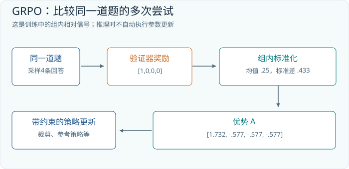

## 11.3　GRPO：相对于这一组，我的回答表现怎样

GRPO 的直观做法是，从同一问题的多个奖励估计比较基线，从而不必另训练一个专门的价值网络来估计这个基线。下面用结果奖励的版本说明：一整条回答得到一个奖励，再把对应优势用于这条回答中的有效 token。详细的 token 级目标与这种结果奖励处理，可以追溯到提出 GRPO 的 DeepSeekMath 报告。[DeepSeekMath，第4.1节](https://arxiv.org/html/2402.03300v3#S4.SS1)

设问题是某个可验证的算术题，一组四条回答中只有第一条正确。给正确答案 1 分，其余 0 分。为了让计算完全确定，本例使用总体标准差，即平方差平均时除以 G；其他实现若使用样本标准差，优势的整体尺度会不同。

```text
R = [1,0,0,0]
mean(R) = 1/4 = 0.25
variance(R) = (0.75^2 + 3*0.25^2)/4 = 0.1875
std(R) = sqrt(0.1875) ≈ 0.433013

A_i = (R_i - mean(R)) / std(R)
A ≈ [1.732051,-0.577350,-0.577350,-0.577350]
```

第一条回答获得正优势，其余获得负优势。它们不是四条回答的新概率，不能把 A 加到原概率上。优势用于加权学习信号：在其他因素相同的局部条件下，增加成功采样序列的生成倾向，降低较差序列的生成倾向。归一化后优势之和约为零，正负信号来自相对表现。

现在看一个 token 的概率比率。假设旧策略给已采 token 的概率为 0.20，更新中的策略给它 0.26，比率为 1.30。若该 token 属于第一条回答，其优势约为 1.732。取剪裁范围 [0.8,1.2]，只看待最大化的策略项：

```text
rho = p_new(token | prefix) / p_old(token | prefix)
surrogate = min(rho*A, clip(rho,0.8,1.2)*A)

A = 1.732051，rho = 1.30：
surrogate = min(2.251666,2.078461) = 2.078461
```

这样，已经明显增加成功 token 概率的更新，不会因为继续拉高同一个比率而在这个项上无限获益。对于负优势，方向相反。若 A=-0.577350，rho=0.70，两个候选值约为 -0.404145 与 -0.461880，取较小者 -0.461880；对这个较差样本，概率已经降低很多，再降低时同样遇到剪裁约束。

真实目标还会结合参考策略的 KL 约束，控制偏离程度。旧策略与参考策略承担不同工作：旧策略记录这批样本从哪里采来，参考策略提供训练中希望维持的概率行为基准。它们可以在某个时刻相同，也不能因此在概念上合并。对每条回答的长度归一化、padding 掩码与截断处理，也会改变训练信号；一个漂亮的四元素奖励例子并未规定完整训练器。

这里还有一个容易忽略的失败情形：如果四条回答全错，奖励都是 0，差异信号便消失。分母加入小常数可以避免除零，但不能凭空造出哪个答案更好的信息。若题目远超当前能力，单纯加大这类零差异批次未必有效；需要调整题目分布、探索方式或提供其他监督。

## 11.4　奖励是否可靠，比奖励公式是否漂亮更重要

设模型需要写一个排序函数，验证器只检查输入 [3,1,2] 是否输出 [1,2,3]。一个永远返回 [1,2,3] 的程序能拿到满分，却没有学会排序。把测试集增加到空数组、重复数、负数和随机数组，会排除一批投机程序；再检查复杂度、内存使用和异常输入，评价对象才逐渐接近“可靠的排序实现”。

这个例子展示了可验证奖励的优点，也展示它的范围：反馈明确、可重复、成本可控，但奖励只覆盖验证器实际检查的属性。得到正确终值，不保证中间论证每一步有效；通过有限测试，不保证软件在全部输入上正确。模型可能学到更好的求解策略，也可能学到特定评测器的捷径，两者需要额外实验区分。

R1-Zero 使用规则形式的正确性与格式奖励。格式奖励告诉模型怎样组织输出，正确性奖励评价结果；原始报告没有把它描述成一个能逐步读取模型内部真实思考的监督器。[R1-Zero 奖励设计](https://arxiv.org/html/2501.12948v1#S2.SS2.SSS2)

对开放式任务，验证更困难。例如“这封道歉信是否得体”没有唯一字符串答案，可能依赖偏好模型或人工比较。此时奖励包含评价者的偏好和盲点。把模型训练成善于获得高分，与使它在真实世界始终有用之间，仍有需要测量的距离。

长推理文本本身也不是可靠性证明。可见文字能够提供可检查的中间结果，但并不保证它忠实解释了网络内部全部因果过程。对一个程序，实际运行测试比评价解释听起来是否自信更直接；对算术题，重新验算比数一数写了多少次“反思”更有效。

## 11.5　蒸馏迁移的是行为，架构不会随名字自动迁移

假设教师为问题 q 生成一条质量较好的回答 y。筛选后，把 q 与 y 组成监督样本，学生按自己的 tokenizer 将文本变成 token，再学习在每个前缀下预测下一个目标 token。一个最简单的序列蒸馏过程可以写成：

```text
教师：问题 q -> 多条回答 -> 质量筛选 -> 文本 y
学生：encode_student(q,y) -> 学生自己的 token 序列

对每个目标 token：
    计算 -log p_student(target_token | preceding_tokens)
对有效目标位置求平均，更新学生参数
```

这条路径不要求学生模仿教师每一层的隐藏向量，也不要求教师与学生的词表大小相等。若采用逐 token 概率分布蒸馏，还需处理词表和分词边界对齐；这里讨论的是根据教师生成文本进行监督训练的路径，不能把两者混称为同一实现。

原始 R1 发布了基于 Qwen 与 Llama 的多个稠密蒸馏模型，参数规模包括 1.5B、7B、8B、14B、32B、70B。它们不是从 671B MoE 中挑出少数专家拼成的小网络，也不因名称含有 R1 就自动具有 MLA 或 V3 的路由结构。要判断具体模型的缓存和计算成本，应阅读其基础架构与配置。[R1-Distill 官方模型列表](https://github.com/deepseek-ai/DeepSeek-R1#deepseek-r1-distill-models)

教师筛选的文本把昂贵探索压缩为训练样本，却也可能把错误一起传递。最终答案正确而论证有漏洞的样本尤其隐蔽。学生能否学会教师展示的策略，还取决于自身容量、基础知识和训练分布；“使用教师数据”不是能力等同的保证。

## 11.6　把训练计算与推理预算分开报告

训练时，采样、评价和更新形成闭环，权重会改变。推理时，通常固定权重，只是在这组权重下分配更多生成时间。可以延长单条求解序列，也可以并行生成多条候选，用测试器、验证器或投票选择结果。两种增加预算的方式都可能有帮助，却不是同一种计算。

例如方案 A 生成一条 4000 token 的回答；方案 B 生成四条各 1000 token 的回答。两者生成 token 总数相同，但 B 可以并行，重复前缀的计算与缓存可能不同，还额外需要候选选择。A 有机会在同一上下文里连续修正，B 有机会覆盖不同路径。比较时至少要记录总生成量、延迟和选择方法，不能只写“给模型更多思考时间”。

一个简单的概率例子说明多次尝试的意义和限制。若每次独立成功概率 p=0.3，四次里至少一次成功的概率是：

```text
P(至少一次成功) = 1 - (1-p)^4
                = 1 - 0.7^4
                = 0.7599
```

这不是最终自动交付正确答案的概率，除非系统能识别那次成功。实际候选还可能高度相关，反复犯同一个错误，因此独立性是假设而非模型属性。用正确答案挑出最佳候选得到的 pass@k，也不能冒充部署中只输出一条答案的 pass@1。

最后，评测要防止把记忆混同于泛化。公开题目可能进入预训练语料、教师生成数据或后训练筛选过程；仅仅在某一阶段排除它，并不能证明所有上游都未见过。更可信的验证应说明题目时间范围、去重与污染检查、提示模板、采样参数、上下文和输出上限，以及是否使用工具或外部验证。对同题多次采样估计 pass@1，是估计单次平均成功率；从多次结果中选出最好的答案，则是另一项指标。

## 11.7　练习与答案

**练习1：** 同一题的奖励为 [1,1,0,0]，使用总体标准差。组内优势是什么？若奖励为 [1,1,1,1] 呢？

**答案：** 第一组均值 0.5、标准差 0.5，优势为 [1,1,-1,-1]。第二组没有组内差异；用常见的小常数稳定分母时，优势全为零。它可以说明样本都得到了同样奖励，却不能提供组内谁更好的更新信号。

**练习2：** 一个名为 R1-Distill-Qwen-7B 的模型，是否可以直接按 V3 的 r=512、p=64 公式计算缓存？

**答案：** 不可以。蒸馏模型沿用相应学生基础架构，应检查实际注意力类型、KV 头数、头维度、层数与缓存精度。模型名称中的教师家族不决定学生的张量形状。

**练习3：** 一个系统采样十次，由测试集的参考答案选出正确解，然后报告“单次准确率”。这个报告有什么问题？

**答案：** 它使用了多次采样及答案知情的选择，统计口径更接近“十次中至少成功一次”，不能当作单次成功率。若部署时也有独立可靠的验证器，可以报告完整系统的结果，但必须一并说明十次采样、验证器和计算预算。


## 本章实验：把可验证规则蒸馏进一个小模型

本实验使用确定规则教师：输入两个数字 x、y，正确类别为 `(x+y)%10`。教师直接产生监督标签，学生网络从随机权重学习十类分布，用交叉熵提高正确类别概率。每一步都实际更新学生参数。规则可验证让我们拥有明确的正确性标准，但本实验采用监督蒸馏，没有在线采样奖励、策略概率比或组内优势，因此不能称为完整 GRPO 或强化学习训练。

```bash
python -m tinyomni.lab --chapter 11 --steps 100 --out runs/ch11
python -m tinyomni.lab --chapter 11 --load runs/ch11/model.pt --predict
```

训练的输入只有 x 与 y；正确结果只能出现在 target 中，不能作为额外输入特征。损失比较学生 logits 与规则标签，部署则只运行学生网络得到预测。教师可以用来检查预测正确与否，但如果服务直接调用教师返回答案，再把它标成学生推理结果，便绕过了本实验要学习的映射。

十个数字组成一百种有序输入对。报告全部一百对的准确率很有解释性，却只是有限域内覆盖；若训练见过这些对，测试满分也不证明模型掌握了可迁移的加法算法。改变数字范围、增加位数或更换取模基数，都会形成另一项任务。讨论泛化时必须说明哪些输入组合真正未参与更新，而不能只换随机种子。

保存的 `model.pt` 包含学生参数与恢复该实验的配置。加载预测应与保存前同一输入的输出一致，目标教师不属于预测必须依赖的权重文件。检查训练损失、域内准确率和单例错误，能发现学生究竟是接近掌握有限映射，还是只偏好某几个常见结果。这个有限任务也允许把每个错误都列出来，而不只保留平均分。

若学生训练无进展，检查数字编码、十类输出顺序和取模标签；若训练准确率高但声称的未见组合准确率异常高，检查划分是否真的隔离了组合。若要进一步实现奖励加权学习或 GRPO，需要另建采样、奖励、旧策略与更新协议，不能只把交叉熵重新命名。把已完成的蒸馏与尚未实现的强化学习明确分开，才能让读者复现实验结论。


---

# 第12章 图像怎样成为一串向量

## 12.1 从一句话转向一张图

前面各章的语言模型接受 `[B,T,D]` 张量：一个批次有 B 个样本，每个样本有 T 个位置，每个位置是 D 维向量。现在把输入换成照片，Transformer 内部的矩阵乘法并不要求这些位置必须来自文字。真正需要改变的是入口：怎样把二维图像变成保留空间关系、长度可控的向量序列，以及用什么训练任务让向量承载有用的视觉信息。

我们先约定图像使用 `[B,H,W,C]` 排列，C=3 表示红、绿、蓝三个通道。很多程序库实际使用 `[B,C,H,W]`；这只是轴顺序不同，不是图像内容不同。读任何实现前，都应先写下轴的含义。把高宽轴交换而忘记同步位置坐标，会得到形状完全合法、几何意义却错误的数据。

图像与文字有一个明显差别：文字 tokenizer 已经替我们选择了离散单位，图像的自然输入却是密集像素。直接把每个像素作为一个位置，一张 224×224 图片就有 50,176 个位置。全局注意力的每个头需要处理约 25 亿个位置对。即使不把整张注意力矩阵显式存下，这仍是昂贵的计算任务。视觉入口首先承担的工作，就是在空间细节和序列长度之间作出选择。

## 12.2 把 224×224 图片切成 196 个 patch

设每个 patch 是 16×16，图片高宽都能整除它。沿每个方向得到 224/16=14 块，总计 14×14=196 块。一个 patch 含有 16×16×3=768 个数，按固定次序展平后成为一个长度为 768 的向量。这里的 768 是输入像素数，尚不是模型必须采用的隐藏维度。

```text
原图                [B,224,224,3]
按网格分块          [B,14,14,16,16,3]
展平块内像素        [B,196,768]
乘投影矩阵 W        [768,D]
patch embedding     [B,196,D]
```

分块时必须把“第几行块、第几列块”与“块内第几行、第几列”分清。实际实现可以使用卷积核大小与步长均为 16 的卷积来完成同样的线性映射。它和逐块展平再乘 W 是两种等价的计算组织方式，并不意味着 ViT 的每一层都是卷积。[ViT 原论文](https://arxiv.org/abs/2010.11929)给出了以图像块序列作为 Transformer 输入的基本设计。


图12-1中每一条彩色行向量都对应原图的一块。向量内部的维度是特征通道，向量在序列中的行号才对应空间位置。两种轴的意义不能互换。一个位置可以在后续层中综合整张图的信息，但它仍保留一个由输入布局确定的位置来源。

为了实际算一次投影，暂时使用灰度的 4×4 图片和 2×2 patch。左上角的块展平后为 `[1,2,3,4]`，令投影矩阵为：

```text
p = [1,2,3,4]                    W = [[1,0],
                                      [0,1],
                                      [1,0],
                                      [0,1]]
pW = [1+3, 2+4] = [4,6]
```

这里只保留了两种组合，因此无法从 `[4,6]` 唯一还原四个原像素。现实的投影由训练决定，不是固定求和；这个小例子要说明的是，embedding 是对原始输入作可学习的编码，不能把它想象成无损文件压缩。如果压缩丢掉了任务所需的细小数字，后面的语言推理不会凭空把数字找回来。

## 12.3 图像中的位置为什么不能省略

单看一堆 patch 特征，模型不知道哪块在左边、哪块在上面。“红杯在蓝杯左边”和“红杯在蓝杯右边”可以包含相同的局部内容，却需要不同答案。自注意力本身对输入重排具有相应的排列等变性质；没有位置机制，它不会自动恢复二维几何。

一种基础方法是给每个 patch 加上可学习的位置向量。原始 ViT 分类设计还可以在开头加入一个可学习的分类位置 `[CLS]`，于是长度由 196 变成 197。最后使用这一位置的隐藏状态做分类。这是可选的聚合设计，不应把“所有视觉 Transformer 都有 197 个 token”当成通则。平均池化、不使用分类 token、保留所有 patch 供其他模块读取，都属于不同的输出选择。[ViT 原论文](https://arxiv.org/abs/2010.11929)

当输入改为 448×448、patch 仍为 16×16 时，序列增加到 28×28=784。全局位置对从 196² 增至 784²，是原来的 16 倍；输入像素和 patch 数只增加了 4 倍。由此可以直观看到，高分辨率视觉模型为什么需要窗口注意力、分层结构、token 合并或局部裁剪。

训练时只有 14×14 个位置向量，推理时却需要 28×28 个位置怎么办？一种做法是把位置表重新看成二维网格，再进行插值。也可以使用适合二维坐标的相对位置或旋转位置方法。插值解决了张量长度不匹配，却不保证模型自动学会更细的物体关系；分辨率变化同时改变了内容尺度和统计分布。

## 12.4 一个视觉 Transformer 层到底在交换什么

假设视觉序列为 `[B,196,768]`，使用 12 个头，每头宽度 64。每个头先得到 Q、K、V，形状均为 `[B,196,64]`，相似度分数矩阵是 `[B,196,196]`。经缩放与逐行softmax后得到注意力权重，其中第i行、第j列控制更新位置i时对位置j的加权贡献。

若一个 patch 覆盖杯柄，另一个覆盖杯身，它们可能通过注意力互相补充；更深的层还可能把桌面、阴影与杯子的整体位置联系起来。这里的“可能”很重要。注意力是可学习的信息混合权重，不是已经验证过的物体关系图。看到某一层对杯柄有高权重，并不能单凭这一张热力图证明模型已理解“可抓握部位”。

前馈网络则对每个位置的通道向量作非线性变换。注意力主要回答“从哪些位置取信息”，前馈网络主要回答“如何组合已经取来的特征”。两者交替叠加，逐渐把局部色块转换成与训练目标相关的表征。这个过程与语言 Transformer 的结构相通，区别来自输入统计、空间位置和训练信号。

## 12.5 CLIP：让图片和句子在同一个空间相遇

视觉分类器能区分固定标签，但要理解用户说的“戴红帽子的狗”，我们希望视觉特征与自然语言建立联系。CLIP 使用两个编码器：一个把图片编码为向量，另一个把描述编码为向量。两者投影到相同维度并归一化，再用向量相似度比较图文是否匹配。它的基本训练任务是从同一批候选中找回配对图文。[CLIP 论文](https://arxiv.org/abs/2103.00020)

设一个批次只有三组数据：图片分别为猫、公交车、苹果，文字分别为“趴着的猫”“黄色公交车”“红色苹果”。图像向量组成 `I:[3,D]`，文本向量组成 `T:[3,D]`。矩阵 `I T^T` 一次计算所有九组相似度，乘上温度对应的缩放因子后，得到训练 logits。下面直接给出一组教学 logits，不声称它来自任何真实模型：

```text
                    猫描述   车描述   苹果描述
猫图片                 3       1        0
车图片                 0       3        1
苹果图片               1       0        3

S = I T^T / τ          shape = [3,3]
```


先对第一行做 softmax。`exp(3)、exp(1)、exp(0)` 约为 `20.09、2.72、1`，归一化后约为 `[0.844,0.114,0.042]`。模型给正确描述的概率是 0.844，负对数损失约为 0.170。每一行都希望正确列变大；转置后，每一列又希望找到正确图片。双向训练让“以图找文”和“以文找图”共同塑造空间。

这个目标没有要求模型生成整段描述，也没有要求每个图像 patch 与每个词逐一对应。它首先建立的是样本级的相似关系。图文检索做得好，不代表模型就能精确数出十九个零件，也不代表它能可靠区分“狗追人”和“人追狗”。一个向量可能善于概括主题，却遗漏对回答至关重要的空间关系。

同批次其他配对通常充当负例，但这只是训练假设。如果两张图片都是同一辆公交车，第二条描述也适用于第一张图，“非对角线全部错误”的假设就出现了噪声。温度也不是无关紧要的装饰：较小的温度会放大相似度差异，使分布更尖锐；它改变训练关注的难例程度，而不是增加图像里不存在的信息。

## 12.6 从对比空间到零样本分类

假设要识别猫、狗、汽车，可以分别编码“这是一张猫的照片”“这是一张狗的照片”“这是一张汽车的照片”，得到三个文本向量。新图片编码后，与这三个向量比较，最高分对应一个候选类别。分类标签于是由文字描述提供，不必给每个新标签重新训练一个分类头。这是 CLIP 所展示的零样本迁移方式之一。[CLIP 官方代码](https://github.com/openai/CLIP)

不过，候选集决定了问题。如果图片实际是狐狸，而候选只有猫、狗、汽车，最高分仍会选出其中之一。softmax 只表示在这些候选之间的相对竞争，不能自动解释为“图像属于狗的现实概率”。加入“不确定”文字也不等于经过校准的拒识机制。可靠应用需要用实际任务数据检查阈值和错误分布。

到这里，视觉已经有两种不同的输出：保留空间细节的 patch 序列，以及适合全局检索的图像向量。下一章的关键选择，就是把哪一种输出交给语言模型。若问题涉及发票上的金额、图中的箭头或物体左右关系，仅给一个全局向量往往过于苛刻；把更多局部证据保留下来，才为语言推理提供了可用的材料。

## 12.7 练习与解答

**练习一：分辨率账本。** 384×384 的 RGB 图片使用 16×16 patch，不使用分类 token。求 patch 数、每个 patch 的原始维度，以及 D=1024 时的 embedding 形状。若改用 8×8 patch，全局注意力位置对增加几倍？

**解答。** 位置数为 24×24=576；原始维度为 768；embedding 为 `[B,576,1024]`。patch 边长减半后位置数变为 48²=2304，是原来的 4 倍，全局位置对变成 16 倍。隐藏维度不由 patch 边长强制决定。

**练习二：相似度与概率。** 在本章三乘三矩阵中，给全部九个 logits 加上 10，softmax 是否改变？只把全部 logits 乘以 2 呢？

**解答。** 同一行或列统一加常数不改变 softmax，因为分子分母共享相同因子。乘以 2 会使分布更尖锐；正确项排名不变，但概率和损失改变。最大项排名相同不意味着训练信号相同。

**练习三：错误定位。** 一个模型能正确判断图片是发票，却总读错角落里的税号。优先检查什么？

**解答。** 先检查原图是否清晰、缩放后字符是否仍可分辨、裁剪是否包含税号，再检查 patch 和 token 压缩是否保留细节，最后检查 OCR 训练覆盖和输出校验。仅增加语言模型层数，无法补回入口已删除的字符证据。


## 本章实验：从图像 patch 训练识别与跨模态输出

从本章开始使用同一套 TinyOmni，而不是各自独立的小实验。世界只有三种颜色、三种形状和两个运动方向；本章输入只有 16×16 彩色图像，图像只能证明颜色与形状，不能证明运动。文字 target 为四个 token：颜色、形状、`<unk>`、结束符。训练同时要求生成规范居中图像与对应合成音，损失是文字交叉熵加两个有效连续输出的均方误差；动作项被 mask 掉。

```bash
python -m tinyomni.train --tasks image --steps 500 --batch-size 32 --device auto --out runs/ch12
python -m tinyomni.infer --checkpoint runs/ch12/checkpoint.pt --task image --seed 90001 --out runs/ch12/demo
```

这里的视觉编码器从随机参数学习，把图片分成 patch 后投影，交给共享 Transformer。实验没有借用 CLIP 权重，也没有执行图文对比损失，训练信号来自可验证属性与连续目标。这样先学会视觉入口，再在下一章加入文本条件，能把“像素如何影响预测”检查清楚。

推理命令加载训练保存的 `checkpoint.pt`，生成同一规则世界的新扰动样例，导出预测文字、图像、音频和诊断 JSON。`seed` 决定合成样本，不是让服务读取一张外部照片。导出的目标文件只用于对照，模型推理输入中已经剔除了 target；不能因为保存目录里有真值图，就认为模型看到过答案。

验收至少检查独立扰动下的颜色与形状预测、完整四 token 匹配率，以及规范图像和音频误差。运动位置输出 `<unk>` 才是正确行为，不应惩罚它没有猜中不可观察方向。再把图像通道屏蔽，检查性能是否下降：若没有明显变化，模型可能利用标签泄漏或分布偏差，而不是视觉内容。

如果图像输出很模糊，检查模型是否只产生所有颜色和形状的平均值；如果识别正确却输出方向，检查 target 协议与可观察性 mask；如果加载预测和训练评测差异大，检查是否误用了另一个任务检查点。五百步是操作起点，不是质量保证，最终以运行产生的指标判断是否继续训练。


---

# 第13章 VLM：让语言模型读取视觉证据

## 13.1 图像向量不是一段隐藏的中文

视觉语言模型，通常简称 VLM，接收视觉信息与语言信息，并完成描述、问答、定位等任务。上一章已经把图片变成 `[B,Nv,Dv]` 特征序列，但语言模型习惯读取 `[B,Nt,D]`。两者都有“批次、位置、通道”三个轴，却还不能直接拼接：通道宽度可能不同，向量分布不同，更重要的是，预训练语言模型从未学过这些视觉向量对应什么。

因此，接上视觉编码器包含两件事。第一件是工程接口，让张量维度和注意力掩码对得上；第二件是学习接口，让训练任务迫使模型使用视觉内容。只完成第一件，程序可以正常输出流畅句子，但这些句子可能主要依赖语言先验。例如看到问题“盘子里有几个苹果”，模型可能猜一个常见数量，而没有真正读取盘子的内容。

还应澄清一个常见比喻：视觉 token 不一定有词表 ID。连续的图像特征可以直接占据模型序列中的位置。这里的 token 指“序列中的一个表示单元”，不意味着它已被翻译成某个汉字或英文词。语言模型可以在连续表示空间中使用图像信息，然后才通过文本输出头生成离散词元。

## 13.2 两条连接路线：拼接与交叉注意力

先构造一个教学模型，以下数字均为说明形状而选择，不是 LLaVA 或 Qwen 的固定配置。视觉编码器输出 `[B,196,768]`，语言隐藏宽度为 2048，用户问题有 32 个文本 token。最简单的连接器是一层矩阵投影：

```text
V               [B,196,768]
W               [768,2048]
V_projected     [B,196,2048]
TextEmbedding   [B,32,2048]
拼接后 X         [B,228,2048]
```

连接器也可以是两层 MLP：先把视觉特征映射到中间通道，经过非线性，再映射到语言宽度。每个位置的变换方式相同，因此连接器本身不一定进行跨位置交流；视觉编码器和后续注意力承担了主要的信息交互。


在拼接路线中，图像位置与文字位置共同进入语言模型。生成答案时，当前文本位置可以关注前面的图像位置。具体的图像内部是否双向可见、提示部分如何掩码，依模型设计而异，不能把文本 GPT 的单一因果掩码直接当成所有 VLM 的规定。

另一条路线保留独立的视觉序列，在某些语言层增加交叉注意力。文本产生 Q，视觉产生 K、V。若当前有 32 个文本位置、196 个视觉位置，每个头的权重矩阵为 `[B,32,196]`。其第 i 行可以理解为：更新第 i 个文字位置时，从哪些视觉位置读取信息。输出仍为 `[B,32,dh]`，因为输出位置数跟随查询 Q，而不是跟随视觉序列长度。

两条路线的成本不同。拼接让语言模型处理更长的序列，也让视觉位置参与相应层的状态与缓存；交叉注意力增加专门的接口和训练参数，可以把视觉存储与文本生成较明确地分开。它们没有脱离任务和实现的绝对优劣。长视频、高清文档、少量图片对话，所需要的视觉容量与延迟预算很不相同。

## 13.3 LLaVA：一个可以理解的连接范式

LLaVA 的早期工作把预训练视觉编码器连接到语言模型，并通过视觉指令数据训练问答行为；原始路线使用 CLIP 视觉特征和投影连接器。后续 LLaVA-1.5 工作采用更强的简单基线，包括 MLP 连接器与调整后的数据配置。这里讨论的是公开版本的设计思路，不把不同年份的 LLaVA 配置混成一个恒定架构。[LLaVA 原论文](https://arxiv.org/abs/2304.08485)、[LLaVA-1.5 论文](https://arxiv.org/abs/2310.03744)

可以把常见训练过程理解为两种学习压力。首先是让连接器接入已有语言空间：输入图片及简短描述，要求模型生成与图片匹配的文字；冻结较多已有权重能减少初期训练成本。随后使用“图片、问题、回答”的指令样本，让模型学会按要求读取、比较、解释。究竟冻结视觉编码器、更新语言模型还是端到端训练，需要按具体版本与资源选择，并不是两阶段范式必然规定的唯一配方。

一次训练样本可以写成：

```text
输入位置： <image features> 用户：红色杯子在蓝色杯子的哪边？ 助手：
目标位置： 左 边 。 <end>
损失掩码： 输入与用户问题通常记为忽略，只监督所需助手输出
```

模型仍可使用普通的下一 token 交叉熵，但问题从“如何续写文本”变为“在图像条件下如何续写答案”。若把图片换成另一张，答案应当变化。一个非常有效的诊断实验就是遮挡图片或打乱图文配对：如果正确率几乎不下降，数据可能允许语言捷径，或者模型根本没有学会使用视觉通道。

## 13.4 为什么 OCR 需要保留空间证据

考虑一张 1600×1200 的票据。若把它整体缩为 224×224，小字的有效高度可能从十几个像素压到两三个像素，`8` 与 `3` 的区别便可能消失。此时扩大文本上下文没有帮助。解决问题要从视觉采样出发：提高分辨率、按区域切片、使用全局缩略图加局部裁剪，或采用能处理动态尺寸的视觉编码器。

设一张图分为四块，每块产生 196 个视觉位置，再附加 196 个全局位置，视觉总长度就是 980。它保留更多细节，却同时增长计算量。还必须告诉模型每一块来自原图哪里，否则四张局部图会成为缺乏全局坐标的碎片。裁剪坐标、原始尺寸、缩放比例，都属于输入协议的一部分。

OCR 不只是识别字符。读表格时，“12.50”究竟属于单价、数量还是金额，要由行列、表头和合并单元格共同确定。直接要求输出 JSON，最多保证一种格式，不能保证视觉读数正确。好的文档系统会让每个字段保留来源区域，再用总额与分项的关系做校验；校验失败可以触发更高清裁剪，而不是让模型反复猜同一张低清图片。

## 13.5 Qwen2.5-VL：动态尺寸与时间坐标

Qwen2.5-VL 的公开技术报告给出了另一组具体选择：视觉编码器采用动态分辨率、二维旋转位置和大部分层的窗口注意力；图像 patch 步长为 14，相邻四个视觉特征经合并后再接入语言模型；视频侧使用动态帧率与对齐绝对时间的多模态位置机制。这些是该版本的公开事实，不能外推为所有 Qwen 版本的共同配置。[Qwen2.5-VL 技术报告](https://arxiv.org/html/2502.13923v1)

为理解合并的意义，设输入已处理为 448×448。按 14 的步长得到 32×32=1024 个空间 patch；每个 2×2 邻域合并成一个位置后，空间位置数降为 16×16=256。合并不是把四个词压成一个词，而是把四个相邻特征拼接、变换为一个更宽语义空间中的表示。这里的算式只演示空间计数，实际处理器还会管理图像或视频的时间维、填充及预算。

动态尺寸解决的是“不同图片不必全部挤成同一个正方形”，并不意味着无限分辨率没有代价。应用仍需限制总像素或视觉 token 预算。对于普通场景问答，低分辨率可能足够；对于密集工程图，预算应更多分给局部细节。预算分配本身可以成为一个先粗看、再选择区域重看的过程。

视频的位置还多了时间轴。三个画面分别来自第 0、1、2 秒，与分别来自第 0、10、20 秒，视觉序列长度相同，但速度含义相差十倍。若位置只记录“第几帧”，模型无法仅靠索引恢复这种差别。保留真实采样时间能为速度、持续时长和事件定位提供证据，不过时间编码并不能找回未采样到的短暂事件。

## 13.6 视觉幻觉是怎样产生的

“模型看到一只戴帽子的猫”至少涉及三层判断：输入像素是否包含相关信息；视觉表征是否保留它；语言输出是否忠于它。任一层失败，都可能产生看似流畅的错误。模糊区域中的物体轮廓可能被编码得不可靠，语言先验又更偏爱“餐桌上有杯子”，最终回答便多出一个不存在的杯子。

因此，增加一句“不要幻觉”不是完整解决方案。训练数据需要包含不存在的对象、无法辨认的文字、反事实问题和合理拒答；评测也要区分“说错”和“没有覆盖全部信息”。一个总是说“无法确定”的模型可能少犯事实错误，却几乎不能使用，需要同时报告覆盖率与被接受答案的准确率。

可以用三类反事实检查定位失败。第一类固定问题，交换关键视觉证据，看答案是否变化；第二类固定图片，改变问题中的对象或关系，看模型是否迎合错误前提；第三类局部遮挡，检查回答是否仍声称知道被遮挡细节。这些实验比单看漂亮样例更能判断系统到底依赖了什么。

坐标输出也需要校准。模型生成 `[x1,y1,x2,y2]` 并不自动保证坐标使用原图像素，可能是缩放图像坐标或归一化坐标。程序应明确约定坐标系、边界顺序和越界处理。一个语义正确、坐标系错误的框，在后续点击或机器人任务中仍然是错误输出。

## 13.7 练习与解答

**练习一：交叉注意力形状。** 文本有 40 个位置，图像有 576 个位置，每头宽度为 64。写出一个头的 Q、K、V、注意力与输出形状。

**解答。** 分别为 `[B,40,64]`、`[B,576,64]`、`[B,576,64]`、`[B,40,576]`、`[B,40,64]`。注意力输出沿视觉位置加权求和，保留每个文本查询的位置。

**练习二：视觉捷径。** 某视觉问答模型在正确图片上准确率 82%，把图片随机替换后仍有 79%。能据此认定视觉编码器很强吗？

**解答。** 不能。结果反而提示任务可由问题先验解决，或视觉通道贡献很小。还需构造只有视觉证据改变、正确答案就改变的配对测试，检查类别分布、训练泄漏与问题模板。

**练习三：设计发票字段输出。** 除金额字符串外，还应保存哪些信息，以便查错？

**解答。** 保存原图标识、字段所在区域、坐标系、使用的裁剪与缩放参数、模型及处理器版本，以及字段校验结果。若金额与分项合计冲突，应回到证据区域重读，而不是仅调整 JSON 格式。


## 本章实验：训练一个真正连接视觉与语言的微型 VLM

本实验让 TinyOmni 混合学习图像条件与文字条件。图像样本的输入文字只有任务标记和未知占位，不能含颜色或形状答案；文字样本则明确提供颜色、形状、方向。两类条件进入共享编码器，自回归解码器预测四 token 语义序列，连续头生成对应规范图像与合成音。文字交叉熵与有效的连续均方误差共同更新参数。

```bash
python -m tinyomni.train --tasks image,text --steps 500 --batch-size 32 --device auto --out runs/ch13
python -m tinyomni.infer --checkpoint runs/ch13/checkpoint.pt --task image --seed 90001 --out runs/ch13/demo-image
python -m tinyomni.infer --checkpoint runs/ch13/checkpoint.pt --task text --seed 90001 --out runs/ch13/demo-text
```

这次训练从随机参数开始，不会自动接着 `runs/ch12` 继续。各章单独训练便于比较数据条件的变化；若要继续某次训练，应使用项目明确支持的恢复协议，不能仅把输出目录设成旧目录就称为接续训练。检查点同时保存结构、词表与权重，推理加载同一协议。

本实验的文字输入是受控的属性 token，不是自由问答。图像条件需要识别颜色和形状，运动字段仍为 `<unk>`；文字条件给出了方向，因此可以监督方向及教学动作。连续图像、音频和动作头只读取条件编码，不能偷看 teacher forcing 时的正确回答 token，否则会产生训练很好、部署无输入证据也失败的假能力。

验收时分别查看 image 与 text 两项指标，不能只报混合平均值。文字路径较容易，因为属性已经直接给出；它表现好不能替代视觉路径。应检查从文字生成的图像是否匹配颜色形状，从图像生成的文字是否来自像素，并比较保存加载后的同一输入结果。

若加入文字数据后视觉性能下降，先检查任务比例和两条入口的表示尺度，再检查视觉通道是否被语言捷径替代。若连续输出只有在 teacher forcing 时正确，重点检查其读入的是源条件还是目标解码状态。本实验说明视觉与语言如何共同训练；它不复现 LLaVA 或 Qwen2.5-VL 的自然图像、OCR和长视频能力。


---

# 第14章 全模态：把声音、画面与语言放在同一条时间线上

## 14.1 “全模态”不是一个统一的接口标准

文字、图像、声音、视频，都可以被转换为向量序列，但它们并不是同一种数据。文字位置主要体现语法顺序，图像位置对应二维空间，音频位置对应连续时间，视频同时带有时间与空间。全模态模型希望利用多种输入之间的联系，并生成一种或多种模态的输出。然而“全模态”没有保证任意模态组合都开放可用，也没有规定必须使用某一种网络结构。

读模型介绍时，应分别检查三个层次：研究报告展示了什么能力；某个模型版本如何训练与评测；实际产品或 API 允许什么输入输出。一个系统能理解图片并以文字回答，并不意味着相同接口还能输出图片；一个产品有语音按钮，也不直接证明它内部采用原生声到声模型。能力描述、模型结构和服务接口是三个相关但不同的问题。

本章先建立可公开解释的通用表示方法，再把 GPT-4o 放回其公开资料能够支持的位置。图中的音频编码器、模态融合与解码器是教学构件，不是对未公开内部结构的逆向猜测。

## 14.2 波形怎样变成模型能够处理的张量

单声道数字音频可以写为 `[B,S]`，S 是采样点数。若采样率为 16,000 Hz，10 秒录音就有 160,000 个采样点。每个采样点是瞬时振幅，而不是一个音节。直接把采样点当作 Transformer 的位置，会得到很长的序列，因此通常先进行特征提取或学习式压缩。

一种路线是短时频谱。把波形按重叠时间窗切成许多短片段，对每片段分析不同频率成分的强弱，再转成适合语音的频带表示。这里不需要推导傅里叶积分，只需把结果理解成一张矩阵：横轴是时间，纵轴是频带，格子的值表示该时刻某个频带的能量。

```text
10 秒单声道波形             [B,160000]
教学设置：窗长 400，步长 160，无填充
时间帧数 = floor((160000-400)/160)+1 = 998
假设使用 80 个频带           [B,998,80]
编码器时间下采样 2 倍         约 [B,499,D]
```

这里的 998 依赖明确写出的边界处理。若居中填充，帧数会不同；若编码器卷积使用不同填充策略，后续长度也会不同。不要把“10 秒等于 1000 个音频 token”当成跨模型事实。每个系统都有自己的采样率、窗口、步长和编码器缩减方式。Whisper 是以声学特征进入编码器、再生成文本的一种公开语音识别范例。[Whisper 论文](https://arxiv.org/abs/2212.04356)

另一条路线使用神经音频编解码器，把波形编码为低速率潜在表示，进一步量化为码本索引。假设教学 codec 每秒产生 50 个时间位置，每个位置使用 8 个码本，10 秒得到 `[B,500,8]` 整数张量。八个码本可以从不同层次补充重建信息，它们不是八位二进制数。把索引查表后，才得到连续向量供后续模型处理。EnCodec 提供了这种学习式音频压缩的公开实例，但本段的速率与码本数是教学参数。[EnCodec 论文](https://arxiv.org/abs/2210.13438)

频谱特征偏向分析声音，codec 则常用于把声音压缩后再重建。两者都可能用于更复杂的理解或生成系统，不能仅凭“用了 codec”就断言模型一定理解语义，也不能凭“用了频谱”就断言系统不能生成声音。

## 14.3 级联语音系统：可见的接口与不可见的信息损失

经典语音助手可以由三个模块串联：自动语音识别 ASR 把声音转成文字；LLM 根据文字生成回答；语音合成 TTS 把回答转回声音。这个设计容易调试：可以直接查看识别文本，替换语言模型，调整发音器，也可以分别测试每个模块。

但中间文本成为信息瓶颈。用户用疑惑语气说“真的很好”，与用讽刺语气说同一句话，转录文本可能完全相同。两个人同时说话、背景中有人喊“等一下”、一句话中间突然笑出来，也可能只在转录中留下不完整痕迹。可以额外传递时间戳、说话人标签、非语音事件与语调特征来缓解问题，但这需要显式设计更多接口。

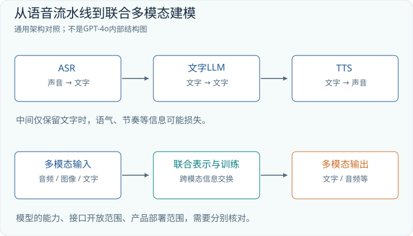

级联系统也不必等待三个模块全部完成才开始播放。流式 ASR 可以持续修订转录，LLM 可以提前生成，TTS 可以按片段合成。代价是中间结果可能改变：前半句听成“帮我关闭”，后半句才补上“不要关闭那个程序”。越早作出不可撤销的决定，越容易受到尚未到达的上下文影响。因此需要区分“可以提前显示的草稿”和“必须等待足够证据才执行的动作”。

## 14.4 原生声到声：让声学信息参与推理与生成

原生声到声通常指模型可以以音频表示为条件产生音频表示，而不是必须把完整输入压成普通转录文本，再通过完全独立的文本回答作为唯一中间结果。它仍可能使用专门的编码器、输出头、分块机制和辅助文本训练目标；“原生”不等于内部没有模块，也不等于每个模态采用完全相同的输入层。

用一个通用教学架构表示，输入音频得到 `[B,Na,D]`，图片得到 `[B,Nv,D]`，文本得到 `[B,Nt,D]`，系统把这些特征与模态标记、位置或时间信息一起处理。输出可能包含文本 logits，也可能包含音频码本 logits 或连续音频潜在变量。生成路径的具体选择决定训练目标、输出速度与质量，而这些选择必须以对应模型公开资料为依据。

联合处理的价值在于：音调、节奏、画面与语言内容能共同影响回答。例如用户说“这个按钮”，画面中的手指可以帮助定位“这个”；听到持续报警声时，回答内容可以利用报警事件；口语回答的停顿也能根据交互上下文生成。不过这些都是需要数据和评测建立的能力，不是把三个张量拼起来就自然获得的结果。

## 14.5 GPT-4o：哪些已知，哪些不应填空

OpenAI 在 2024 年 5 月的发布材料中，把 GPT-4o 描述为跨文本、视觉和音频端到端训练的模型，并展示了多种输入输出能力。这一公开表述支持“它的研究方向超出了文字问答加独立语音合成”的判断。[GPT-4o 发布说明](https://openai.com/index/hello-gpt-4o/)

这些材料没有提供可据此复现的完整架构：本书不为 GPT-4o 编造参数量、层数、专家数、音频码本、图像 tokenizer 或跨模态路由细节。把前几节的通用结构画成 GPT-4o 的确定内部框图，会把教学假设误写成事实。公开效果可以讨论，未知的实现应保留为空白。

接口还需要单独核对。以本书资料核对日 2026 年 10 月 23 日读取的普通 `gpt-4o` API 模型页为例，其模态表列出文字输入输出、图像输入，并未把音频和视频列为该模型 ID 的支持模态。这与 2024 年全模态研究发布材料讨论的范围并非同一个对象。使用语音或实时服务时，必须查看相应模型 ID 和端点的文档，不能仅从名称中的“o”推导接口能力。[OpenAI 的 GPT-4o API 模型页](https://developers.openai.com/api/docs/models/gpt-4o)

产品展示同样不能直接当成系统性能承诺。演示中的短延迟可能使用特定硬件、网络、输入长度与会话设置。真实项目需要测量从用户说完到第一段可听声音出现的延迟，以及长会话、打断、噪声与网络抖动时的表现。研究模型的能力边界与产品提供的功能边界，应分别记录。

## 14.6 视频：时间对齐比多放几张图片更重要

视频可以写成 `[B,F,H,W,C]`，F 是选取的帧数。每帧生成 Nv 个视觉位置后，朴素序列长度是 `F×Nv`。一分钟视频若按每秒两帧采样，每帧 256 个位置，就有 30,720 个视觉位置；再加入音频与文字，上下文和计算预算都会快速增长。

时间信息至少有三种：原始媒体时间、采样帧的时间、系统收到数据的时间。摄像头在第 3.0 秒拍到按钮按下，声音可能在第 3.1 秒出现，网络却先送来了声音。模型若只按接收顺序拼接，会把因果关系误读。系统应保留时间戳和必要的缓冲对齐，而不是假设“相邻 token 就是同一时刻”。

采样也决定问题能否回答。低帧率足以看懂“有人走进房间”，却可能漏掉一瞬间的指示灯闪烁。对长视频可先粗采样寻找候选片段，再对片段加密采样；对实时控制则不能依赖未来画面。离线视频理解模型在完整视频上表现良好，不代表它能以同样质量进行因果、低延迟的在线决策。

## 14.7 流式交互是一个状态机

实时系统不只是反复调用生成函数。它需要管理用户正在说话、模型正在思考、音频正在播放、用户打断等状态。用户打断时，应停止播放尚未听到的片段，并让会话记忆区分“已经播出的内容”和“只生成但未播出的内容”。否则下一轮模型可能认为用户已经听过一个实际上被取消的解释。

评测也应拆开：转录错误率衡量文字识别，事件识别衡量非语音内容，问答正确率衡量语义，语音自然度衡量输出体验，首音频延迟衡量响应速度。某一项高分无法替代其他项。更完整的记录应保存输入片段、时间戳、模型版本、取消事件与实际播放区间，让失败可以复现。

## 14.8 练习与解答

**练习一：声音预算。** 教学 codec 每秒 50 个位置、每位置 8 个码本。20 秒音频的整数张量形状是什么？若把所有码本序列化为一维位置，共有多少个位置？

**解答。** `[B,1000,8]`；完全展平为时间与码本串行排列时有 8000 个位置。实际模型也可能并行预测码本或采用交错设计，所以张量中整数的数量不必等于 Transformer 序列长度。

**练习二：识别时间问题。** 两段视频采样后各有十帧，一段长 5 秒，一段长 50 秒。仅给帧序号，能可靠判断物体速度谁更快吗？

**解答。** 不能。需要真实时间间隔，还需空间尺度或可比较的运动距离。帧数相同不代表运动耗时相同，像素位移相同也不必代表现实距离相同。

**练习三：阅读模型介绍。** 一篇发布文章说模型可以理解音频，而某 API 模型页只列文字和图像输入，应该按哪个开发？

**解答。** 按所调用的具体模型 ID、端点与当前文档开发。发布文章可以说明研究能力与历史背景，不能替代接口契约；缺失的音频入口也不能通过给文本字段塞入波形来补出来。


## 本章实验：让文字、彩色形状与合成音互相转换

本实验加入 256 个采样点的合成音频。三种颜色对应不同频率，三种形状对应不同振幅；输入还带随机相位扰动。音频编码器必须学习频率与振幅所携带的属性，输出规范零相位波形，而不是记忆某条原始波形。它不是人声，不包含发音、汉字读音或说话人，不能把这个任务描述成训练了语音识别或自然语音合成。

```bash
python -m tinyomni.train --tasks image,audio,text,mixed --steps 500 --batch-size 32 --device auto --out runs/ch14
python -m tinyomni.infer --checkpoint runs/ch14/checkpoint.pt --task audio --seed 90001 --out runs/ch14/demo-audio
python -m tinyomni.infer --checkpoint runs/ch14/checkpoint.pt --task mixed --seed 90001 --out runs/ch14/demo-mixed
```

文字目标仍为颜色、形状、运动或 `<unk>`、结束符。只有文字条件明确给出方向，或混合条件中包含可观察运动的视频时，方向和动作才有监督；静态图像与单独音频都不能知道方向。`mixed` 从非空视觉、声音、视频组合取条件，presence mask 告诉模型哪些通道实际存在，不能把缺失通道的零张量当作真正观测。

训练使用文字交叉熵、规范图像 MSE、规范音频 MSE，以及仅在方向可观察时有效的动作 MSE。各连续输出头只读源编码结果。部署命令加载检查点并导出 PNG、WAV 与预测报告；音频预览若重复播放同一短片段，文件名会标明 repeated preview，它不是模型新生成的一段长声音。

成功标准是各单模态和混合模态在独立扰动样例上都能完成对应转换，且遮蔽音频输入会损害音频任务的识别。低波形误差也需与属性正确性合看：所有样例都输出接近零的波形，在某些尺度下也可能显得误差不大，却没有学会颜色与形状编码。

失败时先看规范化和时间轴：随机相位的输入不能直接当作规范相位 target，采样点数与音频帧数也不是同一概念。文字正确、音频错误时检查连续头与损失；音频任务的文字也错误时检查编码器。这个有限世界演示了共享模态学习机制，既不是 GPT-4o 复刻，也不是任意现实声音的理解系统。


---

# 第15章 VLA：从理解场景到生成动作

## 15.1 动作输出改变了问题的性质

VLM 可以回答“红色方块在杯子左侧”，VLA 则希望进一步根据视觉与语言输出动作。这里的 A 是 action。动作可能是一串离散符号，也可能是关节目标、末端位姿增量或未来一段时间的连续控制目标。它们最终都必须与某个具体机器人或模拟环境的接口一致。

文字回答错了，可以重新解释；动作执行后，物体位置已经变化，新的图像也不再与旧输入相同。因此 VLA 必须放在一个闭环里理解：观察环境，生成一段动作，执行其中一部分，再取得新观察。一次前向传播只是闭环中的一个组件，不是整套机器人的全部能力。

本章仅在张量和仿真设计层面讨论。我们使用一个教学单臂接口，动作维度为 7：三维平移增量、三维旋转增量与一个夹爪量。真实设备可能使用关节位置、速度、力矩，或其他旋转表示，维度也可能不同。写出 `[B,K,7]` 只是选定了一种教学接口，不能拿它直接控制任何真实机械臂。

## 15.2 动作张量必须附带物理含义

设模型一次预测未来 K=8 步动作，批次为 B=4，则输出为 `[4,8,7]`。第一个轴区分样本，第二个轴沿未来时间推进，第三个轴区分动作分量。每个分量的单位和参考坐标系必须写入协议：平移用米还是毫米，旋转用弧度还是角度，增量相对世界坐标还是末端局部坐标，夹爪的 0 是张开还是闭合。

```text
图像       I   [B,Ncam,H,W,3]
语言       L   [B,Ntext]
机器人状态 q   [B,Dstate]
动作块     A   [B,K,7]

A[b,k,:] = [dx,dy,dz,drx,dry,drz,gripper]
```

机器人状态 q 可包含关节位置、夹爪状态等本体感知量。它与动作不是同一个东西：状态描述“现在在哪里”，动作描述“接下来要改变什么”。如果只给图片，一只被物体挡住的夹爪可能无法可靠定位；加入状态后，模型获得了另一条证据通道。状态也必须与图像时间对齐，不能把旧画面配上已经移动后的关节角。

归一化同样影响行为。假设某动作分量的训练区间是 `[-0.05,0.05]` 米，把它线性映射到 `[-1,1]`，则归一化值 0.4 代表 0.02 米。若部署端误用另一台机器人的统计量，张量形状仍然正确，移动距离却会错误。旋转角还有周期与奇异性问题，因此跨数据集统一动作表示时，不能只按列名拼接。

## 15.3 RT-2 与 OpenVLA：把动作视为可预测的符号

RT-2 把机器人动作编码成文本 token，并把机器人轨迹与视觉语言任务一起训练，使视觉语言预训练知识能够参与动作选择。其研究重点之一，是把互联网规模的视觉语义知识带入机器人控制；这不等于模型仅凭网页就学会了接触力学。[RT-2 原论文](https://arxiv.org/abs/2307.15818)

为了看清离散化，先用 8 个区间表示 `[-0.04,0.04]` 米的平移。每个区间宽 0.01 米。真实动作 0.023 米落入 `[0.02,0.03)`，可以用该区间的编号表示，解码时取中心 0.025 米。于是连续回归变成分类：预测哪个区间最合适。区间越细，量化误差通常越小，但类别数量和学习难度也可能增加。

```text
连续动作       [0.023,-0.006,...]
逐维量化       [bin6,bin3,...]
动作 token     [id6,id3,...]
下一 token 预测 → token 解码 → 区间中心 → 反归一化
```

OpenVLA 的公开原始模型使用预训练视觉语言组件，结合 DINOv2 与 SigLIP 视觉特征，并将动作各维离散为 256 个区间，使用动作 token 的下一 token 预测训练。代码同时公开了运行与微调流程。理解它时应区分原始 OpenVLA 与后续改进版本，不能把后续动作块加速方案自动写入原版架构。[OpenVLA 论文](https://arxiv.org/html/2406.09246v3)、[官方代码](https://github.com/openvla/openvla)

离散自回归动作具有一个直观优点：前一个动作分量可以成为下一个分量的条件。但串行生成也有成本。若一个动作需要多个 token，而未来 K 步都逐项展开，生成链就会变长。另外，两个相邻区间在普通分类损失中是不同类别；动作误差的物理邻近关系不会仅靠类别编号自动得到正确利用。模型必须从数据与表示中学习这种结构。

## 15.4 连续动作为什么常常需要一整块

拿起杯子不是七个互相独立的数字。向下移动、调整姿态、闭合夹爪、向上抬起之间具有时间相关性。一次预测动作块，可以让模型共同组织一段短轨迹，而不是每次仅给出一个没有未来上下文的瞬时目标。

设 K=8，每步间隔 0.05 秒，则整个块覆盖 0.4 秒。但系统不必一次执行完整的 0.4 秒。可以只执行前 r=2 步，再读取新的图像并重新预测。这样模型有较长的规划视野，同时以 0.1 秒为周期纠正误差。K 是预测范围，r 是实际推进范围，两者不能混为一谈。


这里还存在两个不同的频率。底层控制器可能以较高频率维持关节或末端跟踪，而大模型以较低频率更新动作块。模型输出可以由插值与控制器转换为更密集的目标。不能只看到机器人以某频率运动，就断言大模型每秒完整推理了同样多次。

## 15.5 π0：用 flow matching 生成连续动作块

π0 的公开设计以预训练 VLM 为基础，加入处理机器人状态与动作的 action expert，通过 flow matching 生成连续动作块。论文使用 PaliGemma 初始化视觉语言部分，并明确区分负责视觉语言与机器人相关位置的参数。这里的“专家”不应直接等同于前面语言 MoE 章节中的按 token 动态 top-k 路由。[π0 论文](https://arxiv.org/html/2410.24164v1)

不推导微分方程，也可以理解 flow matching 的训练任务。设真实动作块是 A，随机噪声块是 Z，形状都为 `[B,K,7]`。取一个位于 0 与 1 之间的混合进度 s，构造中间块。下面选择从噪声走向数据的记号约定：

```text
A_s = (1-s) Z + s A
监督目标 U = A - Z
模型输入：图像、语言、状态、A_s、s
模型输出：与 A_s 同形状的方向估计 U_hat
训练比较：U_hat 与 U 的逐元素误差
```

这里的 s 是生成过程的混合进度，不是机器人动作发生的物理时间。动作块中的第 k 行表示第 k 个未来控制时刻；整个矩阵可以在不同 s 下反复被修正。把这两条时间轴画成一条，会误以为每次去噪都要求机器人实际移动一次。

用一个 2×2 小矩阵做手算。令 `Z=[[0,1],[-1,0]]`，`A=[[2,1],[1,2]]`，在 s=0.5 时，中间块为 `[[1,1],[0,1]]`，监督方向为 `[[2,0],[2,2]]`。训练时，网络看到中间块、进度与观察条件，学习朝正确动作分布移动的方向。这个例子只展示形状和监督构造；推理时并不知道 A，必须靠学到的网络预测方向。

生成阶段从随机 Z 开始，多次估计方向并作小步更新，得到最终动作块。通用的离散示意是 `当前块 + 步长 × 预测方向`。实际的时间采样、数值更新和网络结构按具体实现确定，不能把这段教学伪式当成完整 π0 复现代码。官方 openpi 仓库提供了可核对的实现入口。[openpi 官方代码](https://github.com/Physical-Intelligence/openpi)

为什么不直接预测均值动作？假设障碍物左右两侧都可以绕行，而训练演示一半向左、一半向右。简单平方误差回归可能偏向两种动作的平均值，恰好指向障碍物。生成式动作分布可以表示多个可行模式，再采样出其中一个。它仍不保证每次采样都可行；模式表达能力与执行可靠性是不同的指标。

## 15.6 机器人数据的难点藏在接口里

一条示范轨迹并不只是视频文件。它通常需要同步的图像、语言描述、本体状态、动作、时间戳与 episode 边界。相同的“向右移动”在不同相机视角、坐标系和机器人形态下，对应的数值可能完全不同。跨机器人数据需要明确标准化和必要的形态条件，而不是把所有七维向量视为一种普适动作语言。

Open X-Embodiment 汇集了多来源机器人数据，并研究跨形态训练，是理解这类问题的重要公开入口。[Open X-Embodiment 项目](https://robotics-transformer-x.github.io/)。它所代表的数据规模并未消除接口差异：动作空间、采样频率、相机、夹爪与任务标注都仍需要检查。

只采集成功示范也可能留下恢复能力空白。模型训练时总看到杯子正好在夹爪下方，部署时稍有偏差便进入陌生状态；下一步错误让观察更偏离训练分布，错误持续累积。评测应包含初始位姿变化、对象滑动、遮挡和失败后重新观察，并记录能否恢复，而不是只统计最理想条件下的一次成功。

混合数据时还要检查动作分布。某数据集包含大量静止等待，另一个数据集包含密集的有效操作；简单按帧数均匀抽样，可能让模型学会频繁停住。反过来，删除所有静止帧又会抹去等待物体稳定、等待夹爪闭合等有意义行为。应按任务语义区分冗余暂停与必要等待，检查采样权重，并保留能解释时间关系的标注。

连续损失也需要单位意识。平移、旋转与夹爪量的数值范围不同，直接对七个分量求相同权重的平方误差，可能让大数值分量主导训练。归一化能够改善数值平衡，但归一化空间误差低不自动等于物理任务误差小：靠近物体时一毫米偏差可能影响抓取，远离物体时同样误差可能无关紧要。因此离线动作误差需要与闭环任务成功率一起看，不能取代真实的任务评估。

## 15.7 练习与解答

**练习一：动作与执行时域。** `[B,12,7]` 动作块每步 40 毫秒，只执行前 3 步就重新预测。预测时域和重新观察周期分别是多少？

**解答。** 预测时域为 480 毫秒，推进周期为 120 毫秒，另需考虑推理和通信延迟。二者不意味着底层控制器只运行约 8.3 Hz，底层可以更快跟踪目标。

**练习二：量化误差。** 一个动作区间为 `[-0.08,0.08]` 米，均匀分为 16 段并取段中心。区间内最坏量化误差是多少？

**解答。** 区间宽度为 0.01 米，最坏中心近似误差为 0.005 米。超出范围后的裁剪误差不受这个界限保证，因此还要单独处理越界样本。

**练习三：模型还是接口错误？** 仿真成功率较高，换到另一份数据回放时所有位移都大了约一千倍，首先检查什么？

**解答。** 优先检查米与毫米、反归一化统计量和动作含义。稳定的一千倍比例更像单位错误，不应立即通过重新训练掩盖。随后检查坐标系、时间步长以及输出是绝对目标还是增量。


## 本章实验：从四帧运动训练一个二维动作输出头

本实验只用 video 任务训练 TinyOmni。输入包含四帧 16×16 图像，同一个彩色形状向左或向右运动；文字 target 因而可以包含可观察的方向。模型还预测四步二维归一化航点，形状为 `[B,4,2]`，目标由同一个方向规则产生。动作头以均方误差学习，并与文字、规范图像、规范音频损失一起更新参数。

```bash
python -m tinyomni.train --tasks video --steps 500 --batch-size 32 --device auto --out runs/ch15
python -m tinyomni.infer --checkpoint runs/ch15/checkpoint.pt --task video --seed 90001 --out runs/ch15/demo
```

教学轨迹的横向航点依次为 `±0.25、±0.5、±0.75、±1.0`，纵向为零，符号由方向决定。这与正文讨论的 `[B,K,7]` 机械臂接口不同：本实验没有关节、夹爪、碰撞、动力学或接触传感，也不驱动真实机器人。它验证视觉运动能否训练出相关连续输出，不能据此宣称实现了 OpenVLA 或 π0。

训练时连续动作头只读取条件编码，不能读取真实方向 target；否则它可以在文字教师提示下猜对动作，却无法从视频独立工作。部署命令加载 `checkpoint.pt`，导出输入帧、预测文字和 `actions.json`。JSON 中的轨迹只是模型输出数据，程序不会把它发送给设备，也没有隐藏的机器人执行环节。

验收要分别看方向正确率与动作误差。方向正确但航点幅度不对，问题可能在回归头；方向也错，优先检查视频帧顺序、时间位置与编码器。将帧顺序反转应使运动方向改变，这可以作为额外干预检查；只改颜色则不应改变左右轨迹。检验这些关系，比只展示一条漂亮曲线更能说明信息来自哪里。

若模型总输出接近零，可能是在两种方向之间取平均；若训练损失低而部署输出异常，检查动作头是否接触了目标词。现有任务没有环境执行反馈，因此没有证明闭环恢复能力。要走向机器人控制，还需另建状态、控制频率、动作协议、环境反馈与安全约束；那些工作属于后续系统，不应被这次小训练的成功省略。


---

# 第16章 把模型连接成一个能够验证的系统

## 16.1 从张量图到系统图

从 GPT-2 到现代语言模型，从图像 patch 到声音与动作，我们反复使用同一组操作：编码、投影、注意力、非线性变换、输出分布与训练目标。这种统一视角很有力量，但不能把系统可靠性简化成“所有东西最后都是向量”。向量之外还有来源、时间、单位、权限、版本和失败处理。任何一项丢失，都可能让数学上正确的计算产生现实中错误的结果。

本章以一个桌面整理模拟器作为综合项目。用户可以说“把红色方块放进左边的盒子”，系统看到模拟器画面，理解指令，给出简短解释，再产生模拟动作；如果两个盒子的左右关系不清楚，就要求澄清。如果用户只是问“桌上有什么”，系统应回答而不移动物体。项目把语言、视觉、可选音频与动作连接起来，但所有动作都在仿真或离线回放中进行。

目标不是一次训练出全能模型，而是建立一条可以定位错误的链。完成项目后，读者应能回答：模型接收了哪些证据，在哪个张量接口融合，为什么生成这个输出，如何测量失败，以及哪个组件值得下一轮改进。

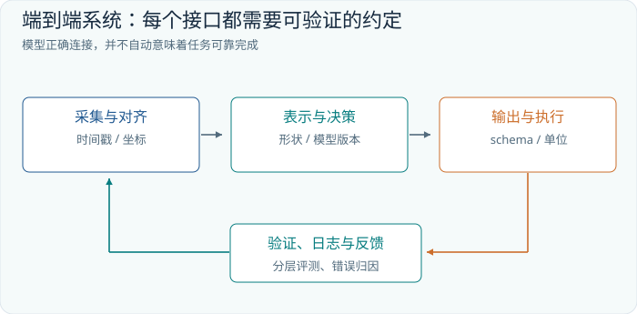

## 16.2 先定义输入输出契约

一次观察不仅包含图像数组，也包含采集时刻、相机标识、原图尺寸和坐标变换。一次动作不仅包含七个数，也包含目标机器人或仿真体、参考坐标系、单位、适用时间与有效期。把这些信息写成明确的数据结构，可以在模型运行前捕获大量错误。

```text
Observation
  images          [B,Ncam,H,W,3]
  image_times     [B,Ncam]
  state           [B,Dstate]
  state_time      [B]
  instruction_ids [B,Ntext]
  instruction_mask[B,Ntext]

ActionProposal
  actions         [B,K,7]
  action_mask     [B,K]
  frame           world 或 tool
  translation_unit meter
  valid_until     timestamp
```

其中 mask 不是装饰。不同样本可能有不同文本长度，终止前的动作块也可能不足 K 步；填充值如果没有掩码，会成为模型误学的目标。批处理中若把两个样本的时间轴拼接，还必须阻止它们在不该发生的地方相互注意，避免把前一个 episode 的环境状态泄漏给下一个。

输出应先成为提案，再由接口检查转成可执行命令。检查包括形状、有限数值、允许范围、坐标系和有效期。检查不负责证明一个计划聪明，只负责防止明显无效的数据进入下一环节。语义正确性仍需通过场景证据与执行反馈判断。

## 16.3 给一次请求建立完整的张量账本

使用一组教学参数：两路相机，每张图片产生 196 个视觉位置；文本有 48 个位置；机器人状态编码成 1 个位置；统一宽度 D=1024。视觉编码器输出先合并相机轴，再与其他条件组合：

```text
视觉原始特征       [B,2,196,Dv]
视觉连接器输出     [B,392,1024]
文字嵌入           [B,48,1024]
状态嵌入           [B,1,1024]
条件序列           [B,441,1024]
动作查询或动作潜变量[B,8,Da]
最终动作           [B,8,7]
```

这只是一个自洽的设计草案，不能据此声称某公开模型恰好有 441 个条件位置。相机标识与空间位置也必须加入表示，否则两个相机中的相同位置编号可能被错误地当成同一个视角。若动作 expert 的宽度 Da 与语言宽度不同，需要按其实际注意力接口进行投影，不能直接假设所有隐藏向量都必须同宽。

若增加一秒语音，先由选定的音频处理器得到 Na 个位置，再决定它们与视觉、文字怎样对齐。不要先写“支持音频”，最后才发现音频 token 把上下文预算吃光。账本的每一行应同时记录长度来源、是否可缓存、是否随新观察失效，以及训练时是否存在同类输入。

## 16.4 数据组织决定泛化问题是什么

准备数据时，先划分任务，而不是先随机切图片。一个 episode 中的相邻帧高度相似，把奇数帧放训练集、偶数帧放测试集，会得到看似优秀、实际上近乎回放记忆的评测。桌面纹理、物体实例、相机位置、指令模板和演示操作者，都可能成为模型记住答案的线索。

建议在项目中建立四种不同的测试集合：已见物体的新摆放；新物体实例；未见指令表达；未见干扰与失败恢复。这样可以分别判断位置泛化、外观泛化、语言泛化和闭环稳健性。它们不应被一个平均准确率遮蔽，因为一种改进可能提升识别，却降低动作稳定性。

去重也不能只比较文件名。重新压缩的图片、裁剪自同一视频的片段、稍作改写的指令，都可能跨集合重复。保留数据来源与 episode 标识，才能在发现污染后追溯。公开预训练模型的全部训练数据往往不可获知，因此“没有发现重叠”与“保证从未见过”应采用不同措辞。

训练数据还需要包含“不行动”的情况。用户问一个问题、目标不存在、指令有歧义、任务已完成，都不应该被强制映射成某个移动动作。否则一个只在行动示范上训练的策略，可能把每次输入都理解为必须移动。将拒绝、澄清、回答和动作分成明确的输出状态，有助于系统按任务需求工作。

## 16.5 评测要沿链路拆开

一个端到端任务失败，可能是听错颜色、认错对象、解析错左右、生成错动作，也可能只是通信超时。只报告最终成功率，无法知道下一轮应该修哪里。应保留中间结果，并以尽可能独立的测试检查各接口。

| 层次 | 核心检查 | 一个可解释的指标 |
|---|---|---|
| 感知 | 对象、文字、位置是否正确 | 字段准确率、框重叠率 |
| 语义 | 指令与目标是否对应 | 目标选择准确率 |
| 动作 | 轨迹与接口是否有效 | 无效输出率、越界率 |
| 闭环 | 任务是否完成并能恢复 | 成功率、恢复率、耗时 |

还应同时测量覆盖率。例如系统在 100 个问题中回答 60 个，答对 57 个，那么被回答部分准确率是 95%，覆盖率是 60%，整体正确回答比例是 57%。只写“准确率 95%”会隐藏大量未处理任务；只写57%又隐藏了已回答部分的较高准确率；拒答是否合理，还需单独检查被拒绝样本。两者合在一起，才能决定阈值是否适合应用。

动作成功率需要明确成功定义。方块进入盒子但夹爪仍未松开，算完成吗？碰倒旁边物体后完成目标，算成功吗？定义必须在测试前固定，并记录失败类别。对于成功率相近的方法，还应比较执行时间、重试次数和对环境扰动的敏感度。

## 16.6 用干预找到真正的因果贡献

模型输出看起来合理，不代表它使用了我们希望它使用的证据。可以把红色与蓝色物体交换位置，保持背景与问题不变；可以替换一句同义指令，保持图像不变；可以隐藏一个相机，观察成功率下降多少。每次只改变一个关键因素，才能把变化归因到相应通道。

若模型在打乱图像后仍选对目标，检查任务模板是否泄漏答案。若加入第二路相机反而降低成功率，检查相机标识、时间同步与外参，而不是立即认定“多视角没有用”。若离线动作误差很小，在线成功率却差，检查误差累积、延迟和训练中缺少恢复状态。不同指标之间的矛盾，本身就是诊断证据。

生成式系统还应固定随机种子进行复现，同时用多个种子测量波动。一次采样成功，不能说明一个动作分布稳定；一次失败，也不能说明所有可能采样都无效。记录模型版本、预处理版本、采样配置和环境初始状态，才能让实验从演示变为可比较的结果。

## 16.7 成本预算不是只看参数量

假设某教学模型有 80 亿参数，全部使用每参数 2 字节存储，权重本身约需 160 亿字节，即十进制约 16 GB。这个数不包含激活、KV cache、视觉与音频中间张量、运行时缓冲区，也不包含训练所需的梯度和优化器状态。因此“权重放得下”不等于“目标批次与上下文能运行”。

多模态请求的成本还取决于输入。一个短问题配一张普通照片，与同样问题配几十页扫描件，文本 token 数可能接近，视觉计算却差很多。降低图片分辨率、减少视频帧或合并视觉 token，能降低开销，但必须同时测量细节任务的损失。压缩是一项带任务约束的设计选择，不是总能免费获得的优化。

延迟也要分解。采集、上传、预处理、编码、语言预填充、动作采样、后处理和执行排队都可能贡献等待时间。用一个假设预算说明：若采集与传输 30 毫秒、编码 40 毫秒、策略生成 80 毫秒、后处理 10 毫秒，决策已经基于约 160 毫秒前的信息。移动物体在此期间可能改变位置，即使模型每次预测准确，过时观察仍会造成失败。

## 16.8 综合项目的实施路线与答案标准

第一阶段只做离线视觉问答：输入模拟器截图与指令，输出目标物体和来源区域。要求读者画出张量账本，建立未见布局测试，并做一次交换物体位置的干预。通过标准不是回答文采，而是答案随视觉证据正确变化，并能识别不存在的目标。

第二阶段加入动作回放：使用已有轨迹，比较离散动作头与连续动作块输出，明确单位和归一化。先检查数值与 shape，再检查目标选对时动作是否仍失败。训练、验证按 episode 与场景分开，保存预测轨迹和真实轨迹的叠图，而不仅是平均损失。

第三阶段进入仿真闭环：每次预测 8 步，只执行前 2 步，记录新的观察并重规划。加入轻微物体位移和短暂遮挡，观察恢复能力。最后可增加语音输入，但语音必须用独立测试集检查颜色、数量与否定词识别；否则语音层的错误会被误记为策略错误。

一份合格的最终报告应包含架构图、接口契约、数据切分说明、成本账本、按层评测结果，以及至少三类可复现失败案例。若模型失败，报告仍然可以合格：关键是能用证据指出失败发生在哪里，下一项实验能够区分哪些解释。工程研究的进步来自这种可检验的积累。

## 16.9 练习与解答

**练习一：泄漏检测。** 从同一段 10 分钟演示中随机抽帧，八成训练、两成测试，测试分数很高。应怎样重做切分？

**解答。** 至少按完整 episode 分离；若要测新场景泛化，还应按物体实例、布局或采集场次隔离，并检查近重复内容。随机帧切分主要测相邻观察之间的插值能力，不能代表新任务能力。

**练习二：视觉压缩。** 两路相机原来各产生 196 个位置，现在各合并为 49 个，文字与状态共 49 个。条件长度从多少降到多少？朴素全局注意力位置对约减少几倍？

**解答。** 从 `392+49=441` 降到 `98+49=147`，长度变为三分之一，位置对变为九分之一。总运行时间未必缩短九倍，因为编码器、投影、前馈网络和调度的成本变化不同。

**练习三：定位系统瓶颈。** 离线目标识别率 98%，动作回放误差很低，闭环成功率只有 55%。下一轮最有价值的检查是什么？

**解答。** 测量观察到执行的实际延迟，核对动作单位与坐标系，比较训练状态和闭环失败状态，并检查任务终止条件。分别进行零延迟仿真、正确目标替换和真实状态替换实验，可以区分感知、时序、策略与接口问题。单纯扩大模型不会自动回答这些问题。

读完本书后，看到一个新的模型名称，读者可以先把它还原成几个具体问题：输入怎样编码，信息在哪里融合，输出表示什么，训练监督来自哪里，推理预算怎样分配，效果由什么实验支持。名称会更新，这套阅读与设计方法可以持续使用。


## 本章实验：完成训练、加载、推理与本地服务闭环

本实验把五类任务放进同一次 TinyOmni 训练：text、image、audio、video、mixed。模型从随机权重共同学习四 token 语义输出、规范图像、规范音频，以及条件足够时的二维教学轨迹。总损失为文字交叉熵与三个带有效样本 mask 的 MSE 之和；方向不可观察的图像和音频样例不参与动作损失，不能要求模型猜隐藏标签。

```bash
python -m tinyomni.train --tasks text,image,audio,video,mixed --steps 500 --batch-size 32 --device auto --out runs/ch16
python -m tinyomni.infer --checkpoint runs/ch16/checkpoint.pt --task mixed --seed 90001 --out runs/ch16/demo
python -m tinyomni.serve --checkpoint runs/ch16/checkpoint.pt --port 8765
```

训练保存 `checkpoint.pt`、配置、实际损失曲线与评测记录。命令行推理先验证加载，再启动仅监听本机的服务；服务加载同一个检查点，不能另建随机模型。另一个终端可以请求：

```bash
curl -X POST http://127.0.0.1:8765/infer -H 'Content-Type: application/json' -d '{"task":"mixed","seed":90001}'
```

接口只接收合成任务类型与样本种子，不接受照片上传、麦克风流或任意文字 prompt。服务生成条件样本后，把条件交给神经网络推理，返回预测文字、生成图像和音频的编码及诊断字段。用于核对的合成真值可以出现在报告中，却必须在模型输入前剔除；服务输出不能直接拿真值冒充预测。

验收记录每种任务的自回归 exact-match、token 准确率、连续输出 MSE 与实际有效样本数。尤其要区分 teacher-forced 单步预测和真正的自由生成；服务使用后者。固定 seed 的命令行结果与 API 结果应一致，才能确认部署路径复用了正确的权重和预处理。

若单项指标优秀但混合指标下降，检查缺失模态 mask 与任务比例；若训练曲线下降而自由生成差，检查解码移位和错误累积；若服务结果不同，检查检查点路径、词表与运行设备。验收通过说明有限合成世界中的训练部署链成立，不证明新类别组合或自然图像语音泛化。下一章把这些检查组织成适合 RTX 3090 的完整个人项目。


---

# 第17章 亲手训练 TinyOmni：一个从零开始的最小全模态项目

## 17.1 最终要交付什么

现在把前面各章连成一个可以训练、保存、加载和提供服务的项目。TinyOmni 使用随机初始化的参数，不下载预训练视觉、语言或音频模型。它能够在明确限定的合成世界中，把文字、图像、声音和视频条件映射成文字，并生成对应的小图像与短音频；方向可观察时，还生成一个二维教学轨迹。你的成果将是一份真正经过优化器更新的检查点，以及可反复调用的推理服务。

这里的“全模态”是本项目的任务定义：同一模型处理多种条件和输出。它不意味着任意现实模态都被支持，也不表示复刻 GPT-4o。有限世界让每个目标都有确定答案，让一块 RTX 3090 可以承担完整学习流程。先完成这条可检查的链，再扩展数据与输出表示，比一开始把未知问题藏在巨大模型里更容易掌握。

## 17.2 十八个世界，以及哪些信息可以知道

世界由三种颜色、三种形状和两个方向组成，共十八种组合。颜色为 red、green、blue；形状为 circle、square、triangle；方向为 left、right。每个世界可以生成不同扰动的观察，而不是永远复用同一个文件。

| 模态 | 实际输入 | 可观察属性 |
|---|---|---|
| 文字 | 五个受控 token | 颜色、形状、方向 |
| 图像 | 16×16 RGB | 颜色、形状 |
| 音频 | 256 个合成采样点 | 颜色、形状 |
| 视频 | 四帧 16×16 RGB | 颜色、形状、方向 |

音频使用三种频率编码颜色，三种振幅编码形状。输入有随机相位和小噪声，目标波形采用规范零相位；它没有自然语言发音。图像输入有位置与噪声扰动，输出目标是规范居中的彩色形状。规范目标把任务从“复制输入文件”变为“识别属性，再生成对应表示”。

四个文字 target 依次是颜色、形状、方向或 `<unk>`、`<eos>`。单张静态图和单独音频没有方向信息，正确目标必须是未知，动作损失也必须关闭。不能因为生成器内部知道方向，就要求模型从看不见的信息中猜答案。`mixed` 随机选择非空的图像、音频、视频组合；只有包含视频时才能观察运动。

## 17.3 一张可逐项核对的张量账本

默认模型宽度为 64，四个注意力头，编码器与解码器各两层，前馈宽度为 128。实际参数数在训练配置的 `parameter_count` 中记录；这个项目保持在远小于两百万参数的规模。读者修改结构后应重新核算，不能继续引用旧数字。

```text
文字 ID                  [B,5]          → [B,5,64]
图像 RGB                 [B,3,16,16]    → [B,4,64]
音频采样                 [B,256]        → [B,8,64]
视频                     [B,4,3,16,16]  → [B,16,64]
加一个条件汇总位置 CLS                    [B,34,64]
共享 Transformer 编码器                   [B,34,64]

因果文字解码器 → 四个 token
条件 CLS → 图像头 → [B,3,16,16]
条件 CLS → 音频头 → [B,256]
条件 CLS → 动作头 → [B,4,2]
```

图像 patch 为 8×8，所以一张图有四个位置；音频每 32 点组成一帧，所以有八个位置。视频四帧各有四个空间位置，并加入时间位置。缺失模态仍占据固定张量槽位，但 encoder 与 decoder 的访问 mask 禁止读取这些缺失位置。仅把输入置零而不管理可见性，会让零值与“缺失”混淆。

连续头只读取源条件的 CLS，绝不读取 teacher forcing 的答案隐藏状态。否则训练阶段看到正确颜色词就能生成正确图片，部署时却没有这些正确答案，这是很隐蔽的标签泄漏。文字输出采用自回归解码；图像和音频则是一次连续回归，不是扩散生成或自然音频 codec。

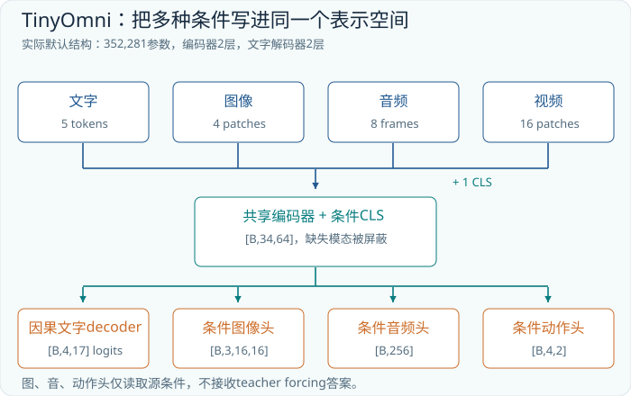

## 17.4 损失怎样连接所有任务

文字训练把 `<bos>` 接到真实回答前面并右移，使用因果 mask；每个位置预测下一个 target。连续输出使用均方误差。当前实现把四项直接相加：

```text
总损失 = 文字交叉熵 + 图像 MSE + 音频 MSE + 有效动作 MSE
```

动作 mask 只选择方向可观察的样本；若一个 batch 没有有效动作样本，该项为零，而不是除以零。图像和音频目标都能由任一合法输入条件确定，因此这两项参与各任务训练。三种 MSE 的数值尺度不同，初版权重相同是可检查的基线，不是普遍最优配方。先分别查看各项曲线，再决定是否改权重。

训练集与验证集使用不同随机种子，验证位置扰动、噪声、相位和模态组合。十八种语义世界仍可能同时存在于两边，因此结果不能被写成“已证明未见组合泛化”。要做更严格的组合测试，必须预先留出某些颜色与形状组合，并修改数据抽样与报告协议。

## 17.5 准备 RTX 3090 环境

下面命令均在包含 `tinyomni/` 的工程目录运行。先创建你习惯的 Python 虚拟环境，按当前系统安装支持 CUDA 的 PyTorch，再安装项目依赖。CUDA 安装命令应从[PyTorch 官方安装选择器](https://pytorch.org/get-started/locally/)按操作系统与驱动条件获取，不能只看显卡型号复制任意版本号。

```bash
python -m pip install -r tinyomni/requirements.txt
python -c "import torch; print(torch.__version__); print(torch.cuda.is_available()); print(torch.cuda.get_device_name(0) if torch.cuda.is_available() else 'CUDA unavailable')"
```

应确认输出识别到 3090，再使用 `--device cuda`。本书本机验证环境与家中 NVIDIA 环境不同，CPU 上通过并不等于 CUDA 已在你的机器通过。这里不预报未经测量的显存峰值和训练耗时。先用现有 24 GB 显卡完成小模型，租卡不是这个阶段的必要条件。

## 17.6 先跑通，再训练，再恢复

先用 CPU 做短流程检查，目的是确认数据、反向、保存和评测都能执行，不把十步输出当成合格模型：

```bash
python -m tinyomni.train --tasks text,image,audio,video,mixed --steps 10 --batch-size 8 --device cpu --out runs/smoke
```

再在 3090 上建立独立运行，先采用保守的 batch 32。小模型不需要为了“用满显卡”盲目增大批次；改批次同时改变了每次更新接触的数据量，应记录配置。

```bash
python -m tinyomni.train --tasks text,image,audio,video,mixed --steps 500 --batch-size 32 --device cuda --out runs/tinyomni3090
```

输出目录保存 `checkpoint.pt`、`config.json`、`metrics.json` 和实际损失曲线。若指标仍在改善，可以恢复到总计 2000 步：

```bash
python -m tinyomni.train --tasks text,image,audio,video,mixed --steps 2000 --batch-size 32 --device cuda --resume runs/tinyomni3090/checkpoint.pt --out runs/tinyomni3090
```

这里 `--steps` 是累计目标步数，不是额外增加 2000 步。恢复需要保持原来的任务集合与随机种子，程序还恢复 AdamW 状态；只加载权重再创建新优化器是另一种训练过程。500 与 2000 都是配置起点，是否继续由验证表现决定，不是固定质量承诺。

## 17.7 用真正生成的结果验收

评测调用自回归 `generate`，不会拿每一步真实前缀下的 argmax 冒充自由生成。报告每个任务的 token 准确率、四 token 完全匹配率，以及图像、音频、动作 MSE。动作还报告实际计分样本数；不可观察动作的 MSE 为空，不应当显示成虚假的零误差。

文字准确率可能被容易的结束符和未知字段抬高，因此必须同时看整句匹配和具体属性。图像误差低也可能只是背景占比大，必须查看生成形状；音频误差低要确认频率与振幅正确。评测还比较正常与遮蔽图像、音频的结果。遮蔽后性能下降说明模型依赖相应条件，但它仍不是现实场景理解能力的证明。

## 17.8 保存后的模型怎样生成文字、图与音

```bash
python -m tinyomni.infer --checkpoint runs/tinyomni3090/checkpoint.pt --task text --seed 90001 --device cuda --out runs/tinyomni3090/demo-text
python -m tinyomni.infer --checkpoint runs/tinyomni3090/checkpoint.pt --task image --seed 90002 --device cuda --out runs/tinyomni3090/demo-image
python -m tinyomni.infer --checkpoint runs/tinyomni3090/checkpoint.pt --task audio --seed 90003 --device cuda --out runs/tinyomni3090/demo-audio
```

每次推理先按 seed 产生条件，再让加载的模型预测。目录中的 `generated_image.png`、`generated_audio.wav`、`predicted.txt` 是模型结果；`target_*` 是独立核对材料。短音频按 8000 Hz 导出，256 点只有 0.032 秒；重复预览文件只是复制播放相同片段，不是模型生成了更长内容。

若要直接输入 `blue square left`，或读取符合协议的16×16彩色形状 PNG、单声道16位8000 Hz且恰好256点的合成音 WAV，可使用附录A介绍的 `tinyomni.custom_infer`。这是独立的文件与受控文字入口，不会给下面的 HTTP 服务增加文件上传能力，也不支持自然录音或自由文本对话。

## 17.9 把同一检查点部署为本地接口

```bash
python -m tinyomni.serve --checkpoint runs/tinyomni3090/checkpoint.pt --device cuda --port 8765
```

在另一个终端请求服务：

```bash
curl -X POST http://127.0.0.1:8765/infer -H 'Content-Type: application/json' -d '{"task":"mixed","seed":90001}'
```

服务仅监听本机，接口只接受 `task` 和 `seed`，不支持任意图片、自然录音或自由文本上传。响应包含模型预测，以及 PNG、WAV 的编码。它确实运行神经网络，但数据入口仍是合成样本生成器。固定 seed 时，应比较 API 与命令行预测，确认服务恢复了同一个模型及协议。

## 17.10 首版的真实训练记录与结果边界

本书附带的首版检查点已经实际训练。记录位于工程的 `runs/tinyomni-final/metrics.json`，模型位于同目录的 `checkpoint.pt`。该次运行从随机权重开始，共 352,281 个参数，batch 为 32，执行 1000 次优化器更新，设备记录为 CPU；它不是 3090 性能测试。参数、任务集合、随机种子与每一步损失都可以从文件复核，GPU 命令仍需在读者机器验证。

训练历史中，第1步总损失为约 5.4214，第1000步为约 0.02330。它们分别来自两次不同随机 batch，说明实际学习过程中的损失变化，不是对同一固定样例的前后比较，也不能代替验证集指标。图17-2画出全部1000步的总损失，纵轴取 log10；负数表示原损失小于1，不表示损失真的为负。曲线允许波动，不应为了好看改成单调下降。

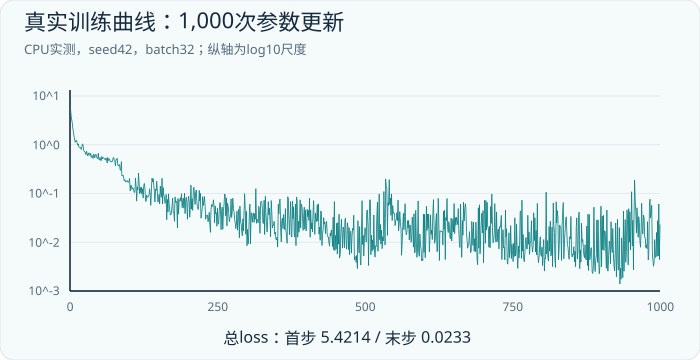

固定该检查点后，最终评测在每项任务上生成256个验证样本，使用完整64位 NumPy 随机数生成器的高位种子域 `[2**63,2**64)`，与训练的低位域分开。下表来自 `metrics.json` 的 `final.generation`；“整句正确”要求四个 target token 全部匹配，MSE 在对应连续目标的全部元素上平均。

| 输入任务 | 整句正确数／256 | 图像 MSE | 音频 MSE |
|---|---:|---:|---:|
| text | 256（100.00%） | 0.000148 | 0.001981 |
| image | 252（98.44%） | 0.000271 | 0.002326 |
| audio | 249（97.27%） | 0.000870 | 0.001262 |
| video | 252（98.44%） | 0.000386 | 0.002855 |
| mixed | 250（97.66%） | 0.000487 | 0.001857 |

动作只在可观察样本上计分：text 和 video 各256例，动作 MSE 分别约0.000247和0.000366；mixed 中143例有效，约0.000407。image 与 audio 的有效动作数为0，其动作误差为空。这些很小的数对应归一化二维航点，不能解释成真实机械臂的位置精度。

模态消融使用另一组256例，对每个样例分别运行正常条件与屏蔽条件。屏蔽会同时清零对应输入并关闭 presence 标志；两次运行的样例与目标相同。由于消融样本与上表不同，正常条件准确率也可以略有不同。下表取自 `final.ablations`：

| 输入任务 | 正常整句正确率 | 屏蔽后整句正确率 | 下降百分点 |
|---|---:|---:|---:|
| image | 96.88% | 10.94% | 85.94 |
| audio | 98.05% | 9.38% | 88.67 |

这说明模型的结果显著依赖相应传感器证据。屏蔽后接近九种颜色形状组合的猜测水平，并非图像或声音理解仍接近满分；单看 token 准确率会被固定的 `<unk>` 和结束符抬高。种子隔离提供了新的随机扰动测试，十八种语义世界仍可能与训练重叠，因此这些成绩没有证明新类别、新组合或真实世界泛化。

图17-3使用 seed 90001，分别展示文字、图像、音频条件下的模型生成，并与合成目标比较。示例图和声音都来自本项目的有限规则世界。三种条件的来源不同，但同样映射到规范颜色形状与规范波形；这验证了受控跨模态生成，没有证明任意照片描述、自然语音识别或开放式图像创作。

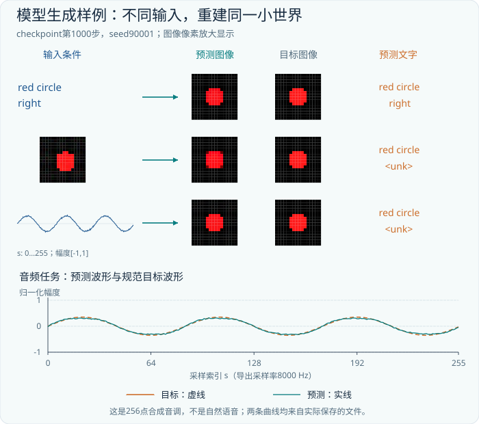

## 17.11 从有限世界走向真实图像与自然语音

先分开看五种任务。文字好、图像差，检查视觉入口；音频差，检查相位扰动与编码；视频方向差，检查时间顺序；teacher-forced 指标好而自由生成差，检查答案移位和错误累积；所有任务都无故高分，检查答案属性是否进入了传感器任务的文字输入。系统接口错误应先修复，不能靠扩大模型掩盖。

在3090上，可以先把目标缩为两个可验收任务：照片生成一句描述，录音生成转写。第一步准备图文对与音文对，按原始图片、说话人或采集场次分开训练验证，保留许可、时长与来源。对同一录音切出的片段不能随机分散到两边；如果要检验声音与图像联合理解，还需真正同步的配对材料，不能把无关图片和录音任意拼成一个样本。

第二步使用小型公开视觉、语音编码器作为冻结的特征入口，只训练连接器与小文字解码器。视觉可参考公开的 ViT/CLIP 路线，语音可参考 Whisper 的声学编码路线；这一步有意使用预训练部件，因此应标成迁移学习阶段。[CLIP 论文](https://arxiv.org/abs/2103.00020)、[Whisper 论文](https://arxiv.org/abs/2212.04356)。文字换成真实 tokenizer，新增变长 padding 与因果标签 mask；图像预处理、音频采样率、声道和窗长都按所选编码器的协议执行。

第三步再加入自然语音生成。先用公开音频 codec 把目标语音变成低速率表示，训练以文字和其他合法条件为输入的音频生成头，再经对应解码器恢复波形。离散码本可使用分类目标，连续潜变量需要相应的回归或生成目标；既要检查内容，也要检查时长、韵律和可听质量。[神经音频压缩实例](https://arxiv.org/abs/2210.13438)。图像生成也需另建合适的潜在表示和解码器，不能把当前16×16回归头直接拉大就假定问题已解决。

每一步只替换一个主要接口：先建立转写或描述基线，再测条件是否有效，最后增加另一种生成输出。转写可看字词错误率，描述需核对物体与属性证据，语音生成要做实际听音与内容一致性检查。以较小 batch、梯度累积和独立单任务运行起步，记录显存峰值后再决定扩展规模。现有 TinyOmni 代码尚未提供这些真实数据入口和自然语音训练流程，正弦音调不能改名为 TTS。

继续坚持完全从零训练时，数据量和训练预算将显著增加；使用预训练编码器可以降低起点成本，但必须明确新的实验已不再是全部组件从零。你的 3090 可以继续承担小范围实验与数据验证，是否租更多 GPU 应在记录瓶颈之后决定。现有代码的可验收能力与后续研究路线，应始终分别报告。

## 17.12 项目答辩题

**练习一。** 为什么静态图像任务不能要求输出真实左右方向？

**解答。** 输入没有对应证据。应把方向目标设为 `<unk>`，关闭动作监督；知道数据生成器内部标签不等于模型能够观察它。

**练习二。** 连续头读取 teacher forcing 的正确颜色词，可以获得更低训练误差，为什么不用？

**解答。** 这会让输出依赖部署时不存在的答案。连续头只读源条件，可以保证训练与推理使用同样的信息边界。

**练习三。** 另一个 seed 上全部预测正确，能否宣布获得未见组合泛化？

**解答。** 不能。新 seed 主要改变扰动与抽样，十八种语义组合可能早已训练过。必须另外隔离语义组合，才能检验该项能力。


---

# 附录A 实验导航与可复核的方法

## A.1 随书工程怎样组织

正文阅读与代码运行使用同一个目录。`chapters/`保存章节，`labs/`保存逐章实训，合并后的`book.md`包含完整内容。`figures/`是可缩放插图，HTML阅读版已内嵌这些插图，离线打开即可阅读。PDF适合连续阅读和打印。这里的源码目录不是一个需要连接外部服务的网站。

| 文件 | 用途 | 何时阅读 |
| --- | --- | --- |
| code/mini_transformer.py | NumPy前向与KV缓存 | 第03-07章 |
| code/verify_examples.py | 手算数字自动复核 | 第01-12章 |
| tinyomni/lab.py | 第01-11章独立小训练 | 对应章节结束时 |
| tinyomni/dataset.py | 合成世界与监督边界 | 第12章起 |
| tinyomni/model.py | 共享模型与模态接口 | 第13-17章 |
| tinyomni/train.py | 优化器、检查点与评测 | 第06与17章 |
| tinyomni/infer.py、serve.py | 加载与本地部署 | 第07与17章 |
| tinyomni/custom_infer.py | 显式条件与文件推理 | 跑通最终项目后 |

第一遍无需逐行读完所有实现。先运行一章实验，再在源码中找到与本章公式对应的十几行。记录输入、输出、损失和检查点路径。熟悉后，再尝试只修改一个设计变量，例如头数、宽度或可见模态。一次改变太多内容，会使结果难以归因。

## A.2 两个不会更新参数的数学检查

```bash
python code/verify_examples.py
python code/mini_transformer.py
```

这两个命令只需要NumPy。它们验证注意力归一化、因果遮蔽、GPT-2参数总数、KV容量、MLA乘法重排、RoPE相对角度及微型解码器缓存。NumPy解码器使用随机参数，没有训练功能；它的用途是检验“这个计算是否实现了我以为的公式”。这与后面的PyTorch训练应分开理解。

缓存检查比较三种方式：一次处理完整序列；逐token生成并保存每层KV；先做多token prefill，再用缓存处理下一段。三种结果应在浮点误差范围内一致。还会修改最后一个输入token，检查之前位置的logits是否不变。这类干预比只打印shape更能发现因果掩码错误。

## A.3 每章训练的验收标准

第01-11章统一运行`python -m tinyomni.lab --chapter 章节号`，第12-16章切换到`python -m tinyomni.train`。前11章保留独立模型，是为了让某个机制的成败可以单独检查，并不是把所有小模型的权重直接拼成TinyOmni。最终项目在一个共同模型中重新训练。

运行小实验后，至少检查四件事：训练loss是否有限；参数是否真的变化；独立数据上的指标是否改善；保存后重新加载的输出是否一致。`lab.py`会对参数变化和重载等价性做断言，并保存`model.pt`、`metrics.json`、`loss.csv`。TinyOmni则额外保存优化器状态，支持恢复训练。

遇到很高的准确率，不要立即提高难度并宣布成功。第05章周期序列只有少量语义模式，第11章规则教师只有100种数字对。它们适合确认实现，却不能证明开放语言建模或通用推理。训练一个机制实验与训练一个具备广泛能力的模型，验证问题不同。

## A.4 显式输入，而不是只抽取一个seed

标准推理CLI按seed抽取可核对样本，便于比较目标与预测。还可以使用`custom_infer`直接指定受控文字条件：

```bash
python -m tinyomni.custom_infer --checkpoint runs/tinyomni-final/checkpoint.pt --text "blue square left" --device cpu --out runs/custom-text
```

把`--device cpu`改为`cuda`即可在可用的GPU上运行。文字语法严格为“颜色 形状 方向”，可用词见第17章。这里仍是17个词表条目的结构化语言，不是任意中文或英文聊天。

也可把标准demo导出的输入文件重新读入，验证文件部署链：

```bash
python -m tinyomni.custom_infer --checkpoint runs/tinyomni-final/checkpoint.pt --image runs/tinyomni-final/demo-image/input_image.png --device cpu --out runs/custom-image
python -m tinyomni.custom_infer --checkpoint runs/tinyomni-final/checkpoint.pt --audio runs/tinyomni-final/demo-audio/input_audio.wav --device cpu --out runs/custom-audio
```

图片必须是16×16，波形必须为单声道、8000 Hz、16位PCM、恰好256个样本。程序拒绝悄悄把任意照片缩小或把语音截取成短音调，因为这样的输入变换没有解决分布不匹配。自定义输入没有ground truth，所以它只报告预测，不伪造准确率。

## A.5 怎样设计你自己的下一个实验

先提出一个会失败的假设，再设计数据。例如，假设模型只是根据颜色猜形状，那么令颜色与形状独立均衡抽样，并检查每个组合；假设模型不看声音，那么保留文字任务标记、屏蔽音频，比较同一组样本；假设视频方向来自单帧位置，那么交换帧顺序并保持画面集合不变，看预测是否翻转。

对于生成任务，要把数值误差与可感知结构一起看。16×16图像的大部分是背景，单纯输出黑底就可能得到看似不大的MSE；音频的点对点误差受相位影响，必须先明确定义对齐与规范目标。增加现实数据时，应同步改变评测，而不是只增加训练目录里的文件数量。

最后，给每次实验留一张记录卡：问题、训练数据版本、验证划分、模型配置、随机种子、运行命令、最好检查点的选择规则、失败样本和结论。若你无法从这张卡复现结果，就还没有完成一个可交流的实验。


---

# 附录B 术语与形状速查

## B.1 不要混淆的概念

| 术语 | 在本书中的精确定义 | 相关章节 |
| --- | --- | --- |
| token | tokenizer或任务协议定义的离散符号 | 02、05 |
| embedding | 离散符号到连续向量的可学习映射 | 02 |
| hidden state | 某层某位置的当前表示，随上下文变化 | 02-04 |
| logits | 尚未归一化的候选分数 | 02、06 |
| attention score | 查询与键匹配得到的分数 | 03 |
| attention weight | 分数经mask、softmax等处理后的读取权重 | 03 |
| residual stream | 各子层通过相加更新的主表示 | 04 |
| causal mask | 禁止当前位置读取未来位置的信息边界 | 03、06 |
| loss mask | 决定哪些预测参与损失计分 | 06、17 |
| prefill | 并行处理已知前缀并建立缓存 | 07 |
| decode | 条件于已知前缀生成后续token | 07 |
| KV cache | 自回归推理保存的历史键和值或其潜表示 | 07、10 |
| MoE | 根据路由为不同token选择专家计算 | 09 |
| MLA | 用共同低维内容潜变量与位置支路组织注意力 | 10 |
| SFT | 用示范目标进行监督微调 | 06 |
| DPO | 使用偏好对与参考策略的直接偏好优化 | 06 |
| GRPO | 使用同题多次采样的相对奖励进行策略优化 | 11 |
| distillation | 用教师提供的分布或示范训练学生 | 11 |
| VLM | 联合处理视觉与语言的模型类别 | 12-13 |
| omni | 多模态建模能力的描述，须列清输入与输出 | 14 |
| VLA | 将视觉、语言条件与动作建模连接的策略类别 | 15 |
| action chunk | 一次预测的多个未来动作 | 15 |
| deployment | 将已保存的参数和相同预处理加载为可调用推理 | 07、17 |

## B.2 常用形状

| 对象 | 常见形状 | 最需要检查的轴 |
| --- | --- | --- |
| 文本ID | [B,T] | T是token数，不是字符数 |
| 隐藏状态 | [B,T,D] | 每一行的通道语义 |
| 多头查询 | [B,H,T_q,d_h] | 拆头后轴是否正确转置 |
| 注意力权重 | [B,H,T_q,T_k] | softmax沿T_k |
| 词表输出 | [B,T,V] | softmax或CE沿V |
| 图像张量 | [B,C,H_img,W_img] | 框架是否采用通道优先 |
| patch序列 | [B,N,D_v] | N与裁剪、分辨率和合并规则 |
| 音频波形 | [B,S]或[B,C,S] | 样本数S、采样率和通道 |
| 视频 | [B,F,C,H_img,W_img] | F是帧轴，别与前馈宽度混用 |
| 动作块 | [B,K,A] | 单位、坐标、步长与有效维度 |

同一个字母在不同研究领域可能代表不同量。读论文时，不要只看作者用了什么字母，要把“这个轴索引什么”写成一句话。本书在图像尺寸中用H_img避免与注意力头数H混淆；实际代码变量名未必如此整齐，阅读时需要主动恢复语义。

## B.3 一张调试检查单

输入进入模型之前，检查离散ID范围、padding协议、图像通道顺序和音频采样率。进入注意力时，检查查询与键的比较宽度、mask真假含义、全屏蔽行和缓存位置偏移。计算损失时，检查标签移位、有效分母以及未观察属性的监督是否关闭。部署时，检查模型配置、词表、权重版本和预处理是否与训练一致。

如果loss突然为NaN，先找第一个产生非有限数的张量。若训练指标很好而验证失效，先查数据重叠和分布差异。若teacher forcing很好而生成差，查解码协议和误差累积。若多模态表现与遮蔽输入无差异，查模型是否绕开该模态。不要把所有问题都归因于“模型还不够大”。


---

# 附录C 原始资料阅读路线

## C.1 先读结构，再读训练和系统

本书以原始论文、作者维护的代码与官方模型资料为主要事实依据。以下是便于复查的主题入口；各章相邻段落还给出了更精确的链接。查询日期为2026年10月23日。研究发布日期与网站最近抓取日期不同，阅读时不要把后者误当成模型发布年份。

1. [Attention Is All You Need，2017](https://arxiv.org/abs/1706.03762)：先看架构和缩放点积定义，再检查编码器与解码器的信息可见性。
2. [Neural Machine Translation of Rare Words with Subword Units，2016](https://aclanthology.org/P16-1162/)：理解子词单位为何能处理罕见词；不要将其直接等同于GPT-2全部tokenizer细节。
3. [Layer Normalization，2016](https://arxiv.org/abs/1607.06450)：明确统计量沿哪些维度计算。
4. [GPT-2技术报告，2019](https://cdn.openai.com/better-language-models/language_models_are_unsupervised_multitask_learners.pdf)与[官方代码](https://github.com/openai/gpt-2)：结合源代码核对词表、位置表、Pre-LN与参数计数。
5. [RoFormer，2021](https://arxiv.org/abs/2104.09864)：先跟踪成对坐标的旋转，再看相对位置信息怎样进入点积。
6. [RMSNorm，2019](https://arxiv.org/abs/1910.07467)：对照LayerNorm，分清是否中心化。
7. [GLU Variants Improve Transformer，2020](https://arxiv.org/abs/2002.05202)：关注门控网络的矩阵数量与参数预算。
8. [FlashAttention，2022](https://arxiv.org/abs/2205.14135)：重点理解IO组织和在线softmax，而不是将它误读成稀疏注意力。
9. [GQA，2023](https://arxiv.org/abs/2305.13245)：检查查询头与KV头的共享关系。
10. [LoRA，2021](https://arxiv.org/abs/2106.09685)：区分低秩增量微调与MLA主体中的低秩瓶颈。
11. [Direct Preference Optimization，2023](https://arxiv.org/abs/2305.18290)：关注偏好对、参考模型和序列log概率。

## C.2 DeepSeek：区分结构与后训练

12. [DeepSeekMoE，2024](https://arxiv.org/abs/2401.06066)：阅读细粒度专家与共享专家的组织方法。
13. [DeepSeek-V2，2024](https://arxiv.org/abs/2405.04434)：跟踪MLA内容分支、位置分支与KV缓存。
14. [DeepSeek-V3技术报告，2024](https://arxiv.org/abs/2412.19437)与[官方仓库](https://github.com/deepseek-ai/DeepSeek-V3)：将配置数字与推理实现对应起来。
15. [DeepSeekMath，2024](https://arxiv.org/abs/2402.03300)：理解GRPO组内比较的来源与用途。
16. [DeepSeek-R1，2025](https://arxiv.org/abs/2501.12948)与[官方仓库](https://github.com/deepseek-ai/DeepSeek-R1)：分别检查R1-Zero、R1和distill模型，别把名称继承误解成架构继承。

## C.3 视觉、全模态与动作

17. [Vision Transformer，2020](https://arxiv.org/abs/2010.11929)：关注patch如何成为序列以及位置表示。
18. [CLIP，2021](https://arxiv.org/abs/2103.00020)：先把批内图文相似矩阵手算一遍，再理解对比目标。
19. [Visual Instruction Tuning / LLaVA，2023](https://arxiv.org/abs/2304.08485)：检查视觉投影与指令数据的分工。
20. [Qwen2.5-VL技术报告，2025](https://arxiv.org/abs/2502.13923)：关注动态分辨率、视觉位置和视频时间坐标。
21. [GPT-4o System Card，2024](https://arxiv.org/abs/2410.21276)与[具体API模型资料](https://developers.openai.com/api/docs/models/gpt-4o)：研究能力与端点支持范围需要分别引用，未披露的内部参数不要补猜。
22. [RT-2，2023](https://arxiv.org/abs/2307.15818)：观察动作如何接入视觉语言建模。
23. [OpenVLA，2024](https://arxiv.org/abs/2406.09246)与[官方项目](https://openvla.github.io/)：跟踪视觉编码、语言主干与动作离散化。
24. [π0，2024](https://arxiv.org/abs/2410.24164)与[openpi代码](https://github.com/Physical-Intelligence/openpi)：比较连续动作块的训练目标与采样实现，特别留意时间方向约定。

## C.4 怎样读出一篇新论文的结构

先写出输入和输出，再画每个中间表示。对每个“高效”声明分别问：减少参数、减少实际计算、减少常驻内存，还是减少数据搬运？对每个“能力提升”声明分别问：训练数据、模型结构、后训练、推理预算是否同时改变？对每个“开放”声明分别问：代码、权重、训练数据、许可和复现材料各开放了什么？

然后把文章中的一个关键机制缩小到可运行算例。若是新注意力，写出四个位置的小矩阵；若是新路由，画出token到专家的分发表；若是新模态，列出采样率、切块规则与接口长度；若是新训练目标，用三条或四条样本手算一次。这个习惯可以把今天读懂的模型，转化成以后阅读未知架构的能力。
