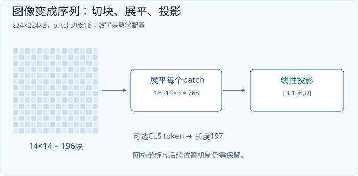
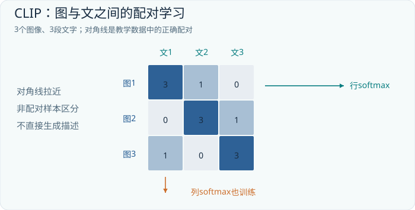

# 第12章 图像怎样成为一串向量

## 12.1 从一句话转向一张图

前面各章的语言模型接受 `[B,T,D]` 张量：一个批次有 B 个样本，每个样本有 T 个位置，每个位置是 D 维向量。现在把输入换成照片，Transformer 内部的矩阵乘法并不要求这些位置必须来自文字。真正需要改变的是入口：怎样把二维图像变成保留空间关系、长度可控的向量序列，以及用什么训练任务让向量承载有用的视觉信息。

我们先约定图像使用 `[B,H,W,C]` 排列，C=3 表示红、绿、蓝三个通道。很多程序库实际使用 `[B,C,H,W]`；这只是轴顺序不同，不是图像内容不同。读任何实现前，都应先写下轴的含义。把高宽轴交换而忘记同步位置坐标，会得到形状完全合法、几何意义却错误的数据。

图像与文字有一个明显差别：文字 tokenizer 已经替我们选择了离散单位，图像的自然输入却是密集像素。直接把每个像素作为一个位置，一张 224×224 图片就有 50,176 个位置。全局注意力的每个头需要处理约 25 亿个位置对。即使不把整张注意力矩阵显式存下，这仍是昂贵的计算任务。视觉入口首先承担的工作，就是在空间细节和序列长度之间作出选择。

## 12.2 把 224×224 图片切成 196 个 patch

设每个 patch 是 16×16，图片高宽都能整除它。沿每个方向得到 224/16=14 块，总计 14×14=196 块。一个 patch 含有 16×16×3=768 个数，按固定次序展平后成为一个长度为 768 的向量。这里的 768 是输入像素数，尚不是模型必须采用的隐藏维度。

```text
原图                [B,224,224,3]
按网格分块          [B,14,14,16,16,3]
展平块内像素        [B,196,768]
乘投影矩阵 W        [768,D]
patch embedding     [B,196,D]
```

分块时必须把“第几行块、第几列块”与“块内第几行、第几列”分清。实际实现可以使用卷积核大小与步长均为 16 的卷积来完成同样的线性映射。它和逐块展平再乘 W 是两种等价的计算组织方式，并不意味着 ViT 的每一层都是卷积。[ViT 原论文](https://arxiv.org/abs/2010.11929)给出了以图像块序列作为 Transformer 输入的基本设计。



图12-1中每一条彩色行向量都对应原图的一块。向量内部的维度是特征通道，向量在序列中的行号才对应空间位置。两种轴的意义不能互换。一个位置可以在后续层中综合整张图的信息，但它仍保留一个由输入布局确定的位置来源。

为了实际算一次投影，暂时使用灰度的 4×4 图片和 2×2 patch。左上角的块展平后为 `[1,2,3,4]`，令投影矩阵为：

```text
p = [1,2,3,4]                    W = [[1,0],
                                      [0,1],
                                      [1,0],
                                      [0,1]]
pW = [1+3, 2+4] = [4,6]
```

这里只保留了两种组合，因此无法从 `[4,6]` 唯一还原四个原像素。现实的投影由训练决定，不是固定求和；这个小例子要说明的是，embedding 是对原始输入作可学习的编码，不能把它想象成无损文件压缩。如果压缩丢掉了任务所需的细小数字，后面的语言推理不会凭空把数字找回来。


再把一张完整小图放在图12-2左侧，而不是只看一个块。这张图按行填入1到16，因此左上块是 `[1,2,5,6]`。橙色边框围住的四格必须一起搬到中间的第0行；右上块 `[3,4,7,8]` 搬到第1行。沿原图连续读取前四个数 `[1,2,3,4]`，得到的是整条像素行，并不是一个2×2 patch。这正是直接 `reshape` 容易犯错的地方：需要先把块网格轴与块内轴分开、调整顺序，再合并轴。

中间矩阵的纵轴已经由像素行 H 变成 patch 位置 T；横轴是块内编号 u。原图第2行、第1列的数值10，属于左下块 p2，落到中间矩阵的第2行、第1列。这个映射不需要训练，也不改变数值。若重排次序出错，后续网络仍可能接收合法形状，因此只检查 shape 不够，还应像本图一样用递增整数检查位置。

右侧才发生可学习的数值变换。同一个 `[4,2]` 矩阵 W 分别作用于四行，得到 `[6,8]`、`[10,12]`、`[22,24]`、`[26,28]`。其中 `p2 W=[9+13,10+14]=[22,24]`。这一步改变通道宽度 u→D，却保留四个位置的顺序；真正跨位置混合要等后面的注意力。RGB 图还多一根通道轴，必须明确采用“每个像素的RGB交错”还是“先整片R、再G、再B”；只要输入向量和权重保持一致，两种约定都能成立，第17章会核对实际代码使用的后一种。

## 12.3 图像中的位置为什么不能省略

单看一堆 patch 特征，模型不知道哪块在左边、哪块在上面。“红杯在蓝杯左边”和“红杯在蓝杯右边”可以包含相同的局部内容，却需要不同答案。自注意力本身对输入重排具有相应的排列等变性质；没有位置机制，它不会自动恢复二维几何。

一种基础方法是给每个 patch 加上可学习的位置向量。原始 ViT 分类设计还可以在开头加入一个可学习的分类位置 `[CLS]`，于是长度由 196 变成 197。最后使用这一位置的隐藏状态做分类。这是可选的聚合设计，不应把“所有视觉 Transformer 都有 197 个 token”当成通则。平均池化、不使用分类 token、保留所有 patch 供其他模块读取，都属于不同的输出选择。[ViT 原论文](https://arxiv.org/abs/2010.11929)

当输入改为 448×448、patch 仍为 16×16 时，序列增加到 28×28=784。全局位置对从 196² 增至 784²，是原来的 16 倍；输入像素和 patch 数只增加了 4 倍。由此可以直观看到，高分辨率视觉模型为什么需要窗口注意力、分层结构、token 合并或局部裁剪。

训练时只有 14×14 个位置向量，推理时却需要 28×28 个位置怎么办？一种做法是把位置表重新看成二维网格，再进行插值。也可以使用适合二维坐标的相对位置或旋转位置方法。插值解决了张量长度不匹配，却不保证模型自动学会更细的物体关系；分辨率变化同时改变了内容尺度和统计分布。

## 12.4 一个视觉 Transformer 层到底在交换什么

假设视觉序列为 `[B,196,768]`，使用 12 个头，每头宽度 64。每个头先得到 Q、K、V，形状均为 `[B,196,64]`，相似度分数矩阵是 `[B,196,196]`。经缩放与逐行softmax后得到注意力权重，其中第i行、第j列控制更新位置i时对位置j的加权贡献。

若一个 patch 覆盖杯柄，另一个覆盖杯身，它们可能通过注意力互相补充；更深的层还可能把桌面、阴影与杯子的整体位置联系起来。这里的“可能”很重要。注意力是可学习的信息混合权重，不是已经验证过的物体关系图。看到某一层对杯柄有高权重，并不能单凭这一张热力图证明模型已理解“可抓握部位”。

前馈网络则对每个位置的通道向量作非线性变换。注意力主要回答“从哪些位置取信息”，前馈网络主要回答“如何组合已经取来的特征”。两者交替叠加，逐渐把局部色块转换成与训练目标相关的表征。这个过程与语言 Transformer 的结构相通，区别来自输入统计、空间位置和训练信号。

## 12.5 CLIP：让图片和句子在同一个空间相遇

视觉分类器能区分固定标签，但要理解用户说的“戴红帽子的狗”，我们希望视觉特征与自然语言建立联系。CLIP 使用两个编码器：一个把图片编码为向量，另一个把描述编码为向量。两者投影到相同维度并归一化，再用向量相似度比较图文是否匹配。它的基本训练任务是从同一批候选中找回配对图文。[CLIP 论文](https://arxiv.org/abs/2103.00020)

设一个批次只有三组数据：图片分别为猫、公交车、苹果，文字分别为“趴着的猫”“黄色公交车”“红色苹果”。图像向量组成 `I:[3,D]`，文本向量组成 `T:[3,D]`。矩阵 `I T^T` 一次计算所有九组相似度，乘上温度对应的缩放因子后，得到训练 logits。下面直接给出一组教学 logits，不声称它来自任何真实模型：

```text
                    猫描述   车描述   苹果描述
猫图片                 3       1        0
车图片                 0       3        1
苹果图片               1       0        3

S = I T^T / τ          shape = [3,3]
```



先对第一行做 softmax。`exp(3)、exp(1)、exp(0)` 约为 `20.09、2.72、1`，归一化后约为 `[0.844,0.114,0.042]`。模型给正确描述的概率是 0.844，负对数损失约为 0.170。每一行都希望正确列变大；转置后，每一列又希望找到正确图片。双向训练让“以图找文”和“以文找图”共同塑造空间。

这个目标没有要求模型生成整段描述，也没有要求每个图像 patch 与每个词逐一对应。它首先建立的是样本级的相似关系。图文检索做得好，不代表模型就能精确数出十九个零件，也不代表它能可靠区分“狗追人”和“人追狗”。一个向量可能善于概括主题，却遗漏对回答至关重要的空间关系。

同批次其他配对通常充当负例，但这只是训练假设。如果两张图片都是同一辆公交车，第二条描述也适用于第一张图，“非对角线全部错误”的假设就出现了噪声。温度也不是无关紧要的装饰：较小的温度会放大相似度差异，使分布更尖锐；它改变训练关注的难例程度，而不是增加图像里不存在的信息。

## 12.6 从对比空间到零样本分类

假设要识别猫、狗、汽车，可以分别编码“这是一张猫的照片”“这是一张狗的照片”“这是一张汽车的照片”，得到三个文本向量。新图片编码后，与这三个向量比较，最高分对应一个候选类别。分类标签于是由文字描述提供，不必给每个新标签重新训练一个分类头。这是 CLIP 所展示的零样本迁移方式之一。[CLIP 官方代码](https://github.com/openai/CLIP)

不过，候选集决定了问题。如果图片实际是狐狸，而候选只有猫、狗、汽车，最高分仍会选出其中之一。softmax 只表示在这些候选之间的相对竞争，不能自动解释为“图像属于狗的现实概率”。加入“不确定”文字也不等于经过校准的拒识机制。可靠应用需要用实际任务数据检查阈值和错误分布。

到这里，视觉已经有两种不同的输出：保留空间细节的 patch 序列，以及适合全局检索的图像向量。下一章的关键选择，就是把哪一种输出交给语言模型。若问题涉及发票上的金额、图中的箭头或物体左右关系，仅给一个全局向量往往过于苛刻；把更多局部证据保留下来，才为语言推理提供了可用的材料。

## 12.7 练习与解答

**练习一：分辨率账本。** 384×384 的 RGB 图片使用 16×16 patch，不使用分类 token。求 patch 数、每个 patch 的原始维度，以及 D=1024 时的 embedding 形状。若改用 8×8 patch，全局注意力位置对增加几倍？

**解答。** 位置数为 24×24=576；原始维度为 768；embedding 为 `[B,576,1024]`。patch 边长减半后位置数变为 48²=2304，是原来的 4 倍，全局位置对变成 16 倍。隐藏维度不由 patch 边长强制决定。

**练习二：相似度与概率。** 在本章三乘三矩阵中，给全部九个 logits 加上 10，softmax 是否改变？只把全部 logits 乘以 2 呢？

**解答。** 同一行或列统一加常数不改变 softmax，因为分子分母共享相同因子。乘以 2 会使分布更尖锐；正确项排名不变，但概率和损失改变。最大项排名相同不意味着训练信号相同。

**练习三：错误定位。** 一个模型能正确判断图片是发票，却总读错角落里的税号。优先检查什么？

**解答。** 先检查原图是否清晰、缩放后字符是否仍可分辨、裁剪是否包含税号，再检查 patch 和 token 压缩是否保留细节，最后检查 OCR 训练覆盖和输出校验。仅增加语言模型层数，无法补回入口已删除的字符证据。
