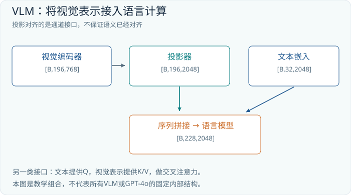

# 第13章 VLM：让语言模型读取视觉证据

## 13.1 图像向量不是一段隐藏的中文

视觉语言模型，通常简称 VLM，接收视觉信息与语言信息，并完成描述、问答、定位等任务。上一章已经把图片变成 `[B,Nv,Dv]` 特征序列，但语言模型习惯读取 `[B,Nt,D]`。两者都有“批次、位置、通道”三个轴，却还不能直接拼接：通道宽度可能不同，向量分布不同，更重要的是，预训练语言模型从未学过这些视觉向量对应什么。

因此，接上视觉编码器包含两件事。第一件是工程接口，让张量维度和注意力掩码对得上；第二件是学习接口，让训练任务迫使模型使用视觉内容。只完成第一件，程序可以正常输出流畅句子，但这些句子可能主要依赖语言先验。例如看到问题“盘子里有几个苹果”，模型可能猜一个常见数量，而没有真正读取盘子的内容。

还应澄清一个常见比喻：视觉 token 不一定有词表 ID。连续的图像特征可以直接占据模型序列中的位置。这里的 token 指“序列中的一个表示单元”，不意味着它已被翻译成某个汉字或英文词。语言模型可以在连续表示空间中使用图像信息，然后才通过文本输出头生成离散词元。

## 13.2 两条连接路线：拼接与交叉注意力

先构造一个教学模型，以下数字均为说明形状而选择，不是 LLaVA 或 Qwen 的固定配置。视觉编码器输出 `[B,196,768]`，语言隐藏宽度为 2048，用户问题有 32 个文本 token。最简单的连接器是一层矩阵投影：

```text
V               [B,196,768]
W               [768,2048]
V_projected     [B,196,2048]
TextEmbedding   [B,32,2048]
拼接后 X         [B,228,2048]
```

连接器也可以是两层 MLP：先把视觉特征映射到中间通道，经过非线性，再映射到语言宽度。每个位置的变换方式相同，因此连接器本身不一定进行跨位置交流；视觉编码器和后续注意力承担了主要的信息交互。



在拼接路线中，图像位置与文字位置共同进入语言模型。生成答案时，当前文本位置可以关注前面的图像位置。具体的图像内部是否双向可见、提示部分如何掩码，依模型设计而异，不能把文本 GPT 的单一因果掩码直接当成所有 VLM 的规定。

另一条路线保留独立的视觉序列，在某些语言层增加交叉注意力。文本产生 Q，视觉产生 K、V。若当前有 32 个文本位置、196 个视觉位置，每个头的权重矩阵为 `[B,32,196]`。其第 i 行可以理解为：更新第 i 个文字位置时，从哪些视觉位置读取信息。输出仍为 `[B,32,dh]`，因为输出位置数跟随查询 Q，而不是跟随视觉序列长度。

两条路线的成本不同。拼接让语言模型处理更长的序列，也让视觉位置参与相应层的状态与缓存；交叉注意力增加专门的接口和训练参数，可以把视觉存储与文本生成较明确地分开。它们没有脱离任务和实现的绝对优劣。长视频、高清文档、少量图片对话，所需要的视觉容量与延迟预算很不相同。

## 13.3 LLaVA：一个可以理解的连接范式

LLaVA 的早期工作把预训练视觉编码器连接到语言模型，并通过视觉指令数据训练问答行为；原始路线使用 CLIP 视觉特征和投影连接器。后续 LLaVA-1.5 工作采用更强的简单基线，包括 MLP 连接器与调整后的数据配置。这里讨论的是公开版本的设计思路，不把不同年份的 LLaVA 配置混成一个恒定架构。[LLaVA 原论文](https://arxiv.org/abs/2304.08485)、[LLaVA-1.5 论文](https://arxiv.org/abs/2310.03744)

可以把常见训练过程理解为两种学习压力。首先是让连接器接入已有语言空间：输入图片及简短描述，要求模型生成与图片匹配的文字；冻结较多已有权重能减少初期训练成本。随后使用“图片、问题、回答”的指令样本，让模型学会按要求读取、比较、解释。究竟冻结视觉编码器、更新语言模型还是端到端训练，需要按具体版本与资源选择，并不是两阶段范式必然规定的唯一配方。

一次训练样本可以写成：

```text
输入位置： <image features> 用户：红色杯子在蓝色杯子的哪边？ 助手：
目标位置： 左 边 。 <end>
损失掩码： 输入与用户问题通常记为忽略，只监督所需助手输出
```

模型仍可使用普通的下一 token 交叉熵，但问题从“如何续写文本”变为“在图像条件下如何续写答案”。若把图片换成另一张，答案应当变化。一个非常有效的诊断实验就是遮挡图片或打乱图文配对：如果正确率几乎不下降，数据可能允许语言捷径，或者模型根本没有学会使用视觉通道。

## 13.4 为什么 OCR 需要保留空间证据

考虑一张 1600×1200 的票据。若把它整体缩为 224×224，小字的有效高度可能从十几个像素压到两三个像素，`8` 与 `3` 的区别便可能消失。此时扩大文本上下文没有帮助。解决问题要从视觉采样出发：提高分辨率、按区域切片、使用全局缩略图加局部裁剪，或采用能处理动态尺寸的视觉编码器。

设一张图分为四块，每块产生 196 个视觉位置，再附加 196 个全局位置，视觉总长度就是 980。它保留更多细节，却同时增长计算量。还必须告诉模型每一块来自原图哪里，否则四张局部图会成为缺乏全局坐标的碎片。裁剪坐标、原始尺寸、缩放比例，都属于输入协议的一部分。

OCR 不只是识别字符。读表格时，“12.50”究竟属于单价、数量还是金额，要由行列、表头和合并单元格共同确定。直接要求输出 JSON，最多保证一种格式，不能保证视觉读数正确。好的文档系统会让每个字段保留来源区域，再用总额与分项的关系做校验；校验失败可以触发更高清裁剪，而不是让模型反复猜同一张低清图片。

## 13.5 Qwen2.5-VL：动态尺寸与时间坐标

Qwen2.5-VL 的公开技术报告给出了另一组具体选择：视觉编码器采用动态分辨率、二维旋转位置和大部分层的窗口注意力；图像 patch 步长为 14，相邻四个视觉特征经合并后再接入语言模型；视频侧使用动态帧率与对齐绝对时间的多模态位置机制。这些是该版本的公开事实，不能外推为所有 Qwen 版本的共同配置。[Qwen2.5-VL 技术报告](https://arxiv.org/html/2502.13923v1)

为理解合并的意义，设输入已处理为 448×448。按 14 的步长得到 32×32=1024 个空间 patch；每个 2×2 邻域合并成一个位置后，空间位置数降为 16×16=256。合并不是把四个词压成一个词，而是把四个相邻特征拼接、变换为一个更宽语义空间中的表示。这里的算式只演示空间计数，实际处理器还会管理图像或视频的时间维、填充及预算。

动态尺寸解决的是“不同图片不必全部挤成同一个正方形”，并不意味着无限分辨率没有代价。应用仍需限制总像素或视觉 token 预算。对于普通场景问答，低分辨率可能足够；对于密集工程图，预算应更多分给局部细节。预算分配本身可以成为一个先粗看、再选择区域重看的过程。

视频的位置还多了时间轴。三个画面分别来自第 0、1、2 秒，与分别来自第 0、10、20 秒，视觉序列长度相同，但速度含义相差十倍。若位置只记录“第几帧”，模型无法仅靠索引恢复这种差别。保留真实采样时间能为速度、持续时长和事件定位提供证据，不过时间编码并不能找回未采样到的短暂事件。

## 13.6 视觉幻觉是怎样产生的

“模型看到一只戴帽子的猫”至少涉及三层判断：输入像素是否包含相关信息；视觉表征是否保留它；语言输出是否忠于它。任一层失败，都可能产生看似流畅的错误。模糊区域中的物体轮廓可能被编码得不可靠，语言先验又更偏爱“餐桌上有杯子”，最终回答便多出一个不存在的杯子。

因此，增加一句“不要幻觉”不是完整解决方案。训练数据需要包含不存在的对象、无法辨认的文字、反事实问题和合理拒答；评测也要区分“说错”和“没有覆盖全部信息”。一个总是说“无法确定”的模型可能少犯事实错误，却几乎不能使用，需要同时报告覆盖率与被接受答案的准确率。

可以用三类反事实检查定位失败。第一类固定问题，交换关键视觉证据，看答案是否变化；第二类固定图片，改变问题中的对象或关系，看模型是否迎合错误前提；第三类局部遮挡，检查回答是否仍声称知道被遮挡细节。这些实验比单看漂亮样例更能判断系统到底依赖了什么。

坐标输出也需要校准。模型生成 `[x1,y1,x2,y2]` 并不自动保证坐标使用原图像素，可能是缩放图像坐标或归一化坐标。程序应明确约定坐标系、边界顺序和越界处理。一个语义正确、坐标系错误的框，在后续点击或机器人任务中仍然是错误输出。

## 13.7 练习与解答

**练习一：交叉注意力形状。** 文本有 40 个位置，图像有 576 个位置，每头宽度为 64。写出一个头的 Q、K、V、注意力与输出形状。

**解答。** 分别为 `[B,40,64]`、`[B,576,64]`、`[B,576,64]`、`[B,40,576]`、`[B,40,64]`。注意力输出沿视觉位置加权求和，保留每个文本查询的位置。

**练习二：视觉捷径。** 某视觉问答模型在正确图片上准确率 82%，把图片随机替换后仍有 79%。能据此认定视觉编码器很强吗？

**解答。** 不能。结果反而提示任务可由问题先验解决，或视觉通道贡献很小。还需构造只有视觉证据改变、正确答案就改变的配对测试，检查类别分布、训练泄漏与问题模板。

**练习三：设计发票字段输出。** 除金额字符串外，还应保存哪些信息，以便查错？

**解答。** 保存原图标识、字段所在区域、坐标系、使用的裁剪与缩放参数、模型及处理器版本，以及字段校验结果。若金额与分项合计冲突，应回到证据区域重读，而不是仅调整 JSON 格式。
