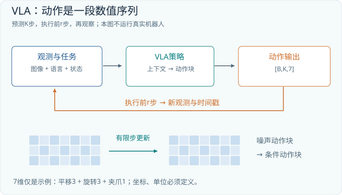

# 第15章 VLA：从理解场景到生成动作

## 15.1 动作输出改变了问题的性质

VLM 可以回答“红色方块在杯子左侧”，VLA 则希望进一步根据视觉与语言输出动作。这里的 A 是 action。动作可能是一串离散符号，也可能是关节目标、末端位姿增量或未来一段时间的连续控制目标。它们最终都必须与某个具体机器人或模拟环境的接口一致。

文字回答错了，可以重新解释；动作执行后，物体位置已经变化，新的图像也不再与旧输入相同。因此 VLA 必须放在一个闭环里理解：观察环境，生成一段动作，执行其中一部分，再取得新观察。一次前向传播只是闭环中的一个组件，不是整套机器人的全部能力。

本章仅在张量和仿真设计层面讨论。我们使用一个教学单臂接口，动作维度为 7：三维平移增量、三维旋转增量与一个夹爪量。真实设备可能使用关节位置、速度、力矩，或其他旋转表示，维度也可能不同。写出 `[B,K,7]` 只是选定了一种教学接口，不能拿它直接控制任何真实机械臂。

## 15.2 动作张量必须附带物理含义

设模型一次预测未来 K=8 步动作，批次为 B=4，则输出为 `[4,8,7]`。第一个轴区分样本，第二个轴沿未来时间推进，第三个轴区分动作分量。每个分量的单位和参考坐标系必须写入协议：平移用米还是毫米，旋转用弧度还是角度，增量相对世界坐标还是末端局部坐标，夹爪的 0 是张开还是闭合。

```text
图像       I   [B,Ncam,H,W,3]
语言       L   [B,Ntext]
机器人状态 q   [B,Dstate]
动作块     A   [B,K,7]

A[b,k,:] = [dx,dy,dz,drx,dry,drz,gripper]
```

机器人状态 q 可包含关节位置、夹爪状态等本体感知量。它与动作不是同一个东西：状态描述“现在在哪里”，动作描述“接下来要改变什么”。如果只给图片，一只被物体挡住的夹爪可能无法可靠定位；加入状态后，模型获得了另一条证据通道。状态也必须与图像时间对齐，不能把旧画面配上已经移动后的关节角。

归一化同样影响行为。假设某动作分量的训练区间是 `[-0.05,0.05]` 米，把它线性映射到 `[-1,1]`，则归一化值 0.4 代表 0.02 米。若部署端误用另一台机器人的统计量，张量形状仍然正确，移动距离却会错误。旋转角还有周期与奇异性问题，因此跨数据集统一动作表示时，不能只按列名拼接。

## 15.3 RT-2 与 OpenVLA：把动作视为可预测的符号

RT-2 把机器人动作编码成文本 token，并把机器人轨迹与视觉语言任务一起训练，使视觉语言预训练知识能够参与动作选择。其研究重点之一，是把互联网规模的视觉语义知识带入机器人控制；这不等于模型仅凭网页就学会了接触力学。[RT-2 原论文](https://arxiv.org/abs/2307.15818)

为了看清离散化，先用 8 个区间表示 `[-0.04,0.04]` 米的平移。每个区间宽 0.01 米。真实动作 0.023 米落入 `[0.02,0.03)`，可以用该区间的编号表示，解码时取中心 0.025 米。于是连续回归变成分类：预测哪个区间最合适。区间越细，量化误差通常越小，但类别数量和学习难度也可能增加。

```text
连续动作       [0.023,-0.006,...]
逐维量化       [bin6,bin3,...]
动作 token     [id6,id3,...]
下一 token 预测 → token 解码 → 区间中心 → 反归一化
```

OpenVLA 的公开原始模型使用预训练视觉语言组件，结合 DINOv2 与 SigLIP 视觉特征，并将动作各维离散为 256 个区间，使用动作 token 的下一 token 预测训练。代码同时公开了运行与微调流程。理解它时应区分原始 OpenVLA 与后续改进版本，不能把后续动作块加速方案自动写入原版架构。[OpenVLA 论文](https://arxiv.org/html/2406.09246v3)、[官方代码](https://github.com/openvla/openvla)

离散自回归动作具有一个直观优点：前一个动作分量可以成为下一个分量的条件。但串行生成也有成本。若一个动作需要多个 token，而未来 K 步都逐项展开，生成链就会变长。另外，两个相邻区间在普通分类损失中是不同类别；动作误差的物理邻近关系不会仅靠类别编号自动得到正确利用。模型必须从数据与表示中学习这种结构。

## 15.4 连续动作为什么常常需要一整块

拿起杯子不是七个互相独立的数字。向下移动、调整姿态、闭合夹爪、向上抬起之间具有时间相关性。一次预测动作块，可以让模型共同组织一段短轨迹，而不是每次仅给出一个没有未来上下文的瞬时目标。

设 K=8，每步间隔 0.05 秒，则整个块覆盖 0.4 秒。但系统不必一次执行完整的 0.4 秒。可以只执行前 r=2 步，再读取新的图像并重新预测。这样模型有较长的规划视野，同时以 0.1 秒为周期纠正误差。K 是预测范围，r 是实际推进范围，两者不能混为一谈。



这里还存在两个不同的频率。底层控制器可能以较高频率维持关节或末端跟踪，而大模型以较低频率更新动作块。模型输出可以由插值与控制器转换为更密集的目标。不能只看到机器人以某频率运动，就断言大模型每秒完整推理了同样多次。

## 15.5 π0：用 flow matching 生成连续动作块

π0 的公开设计以预训练 VLM 为基础，加入处理机器人状态与动作的 action expert，通过 flow matching 生成连续动作块。论文使用 PaliGemma 初始化视觉语言部分，并明确区分负责视觉语言与机器人相关位置的参数。这里的“专家”不应直接等同于前面语言 MoE 章节中的按 token 动态 top-k 路由。[π0 论文](https://arxiv.org/html/2410.24164v1)

不推导微分方程，也可以理解 flow matching 的训练任务。设真实动作块是 A，随机噪声块是 Z，形状都为 `[B,K,7]`。取一个位于 0 与 1 之间的混合进度 s，构造中间块。下面选择从噪声走向数据的记号约定：

```text
A_s = (1-s) Z + s A
监督目标 U = A - Z
模型输入：图像、语言、状态、A_s、s
模型输出：与 A_s 同形状的方向估计 U_hat
训练比较：U_hat 与 U 的逐元素误差
```

这里的 s 是生成过程的混合进度，不是机器人动作发生的物理时间。动作块中的第 k 行表示第 k 个未来控制时刻；整个矩阵可以在不同 s 下反复被修正。把这两条时间轴画成一条，会误以为每次去噪都要求机器人实际移动一次。

用一个 2×2 小矩阵做手算。令 `Z=[[0,1],[-1,0]]`，`A=[[2,1],[1,2]]`，在 s=0.5 时，中间块为 `[[1,1],[0,1]]`，监督方向为 `[[2,0],[2,2]]`。训练时，网络看到中间块、进度与观察条件，学习朝正确动作分布移动的方向。这个例子只展示形状和监督构造；推理时并不知道 A，必须靠学到的网络预测方向。

生成阶段从随机 Z 开始，多次估计方向并作小步更新，得到最终动作块。通用的离散示意是 `当前块 + 步长 × 预测方向`。实际的时间采样、数值更新和网络结构按具体实现确定，不能把这段教学伪式当成完整 π0 复现代码。官方 openpi 仓库提供了可核对的实现入口。[openpi 官方代码](https://github.com/Physical-Intelligence/openpi)

为什么不直接预测均值动作？假设障碍物左右两侧都可以绕行，而训练演示一半向左、一半向右。简单平方误差回归可能偏向两种动作的平均值，恰好指向障碍物。生成式动作分布可以表示多个可行模式，再采样出其中一个。它仍不保证每次采样都可行；模式表达能力与执行可靠性是不同的指标。

## 15.6 机器人数据的难点藏在接口里

一条示范轨迹并不只是视频文件。它通常需要同步的图像、语言描述、本体状态、动作、时间戳与 episode 边界。相同的“向右移动”在不同相机视角、坐标系和机器人形态下，对应的数值可能完全不同。跨机器人数据需要明确标准化和必要的形态条件，而不是把所有七维向量视为一种普适动作语言。

Open X-Embodiment 汇集了多来源机器人数据，并研究跨形态训练，是理解这类问题的重要公开入口。[Open X-Embodiment 项目](https://robotics-transformer-x.github.io/)。它所代表的数据规模并未消除接口差异：动作空间、采样频率、相机、夹爪与任务标注都仍需要检查。

只采集成功示范也可能留下恢复能力空白。模型训练时总看到杯子正好在夹爪下方，部署时稍有偏差便进入陌生状态；下一步错误让观察更偏离训练分布，错误持续累积。评测应包含初始位姿变化、对象滑动、遮挡和失败后重新观察，并记录能否恢复，而不是只统计最理想条件下的一次成功。

混合数据时还要检查动作分布。某数据集包含大量静止等待，另一个数据集包含密集的有效操作；简单按帧数均匀抽样，可能让模型学会频繁停住。反过来，删除所有静止帧又会抹去等待物体稳定、等待夹爪闭合等有意义行为。应按任务语义区分冗余暂停与必要等待，检查采样权重，并保留能解释时间关系的标注。

连续损失也需要单位意识。平移、旋转与夹爪量的数值范围不同，直接对七个分量求相同权重的平方误差，可能让大数值分量主导训练。归一化能够改善数值平衡，但归一化空间误差低不自动等于物理任务误差小：靠近物体时一毫米偏差可能影响抓取，远离物体时同样误差可能无关紧要。因此离线动作误差需要与闭环任务成功率一起看，不能取代真实的任务评估。

## 15.7 练习与解答

**练习一：动作与执行时域。** `[B,12,7]` 动作块每步 40 毫秒，只执行前 3 步就重新预测。预测时域和重新观察周期分别是多少？

**解答。** 预测时域为 480 毫秒，推进周期为 120 毫秒，另需考虑推理和通信延迟。二者不意味着底层控制器只运行约 8.3 Hz，底层可以更快跟踪目标。

**练习二：量化误差。** 一个动作区间为 `[-0.08,0.08]` 米，均匀分为 16 段并取段中心。区间内最坏量化误差是多少？

**解答。** 区间宽度为 0.01 米，最坏中心近似误差为 0.005 米。超出范围后的裁剪误差不受这个界限保证，因此还要单独处理越界样本。

**练习三：模型还是接口错误？** 仿真成功率较高，换到另一份数据回放时所有位移都大了约一千倍，首先检查什么？

**解答。** 优先检查米与毫米、反归一化统计量和动作含义。稳定的一千倍比例更像单位错误，不应立即通过重新训练掩盖。随后检查坐标系、时间步长以及输出是绝对目标还是增量。
